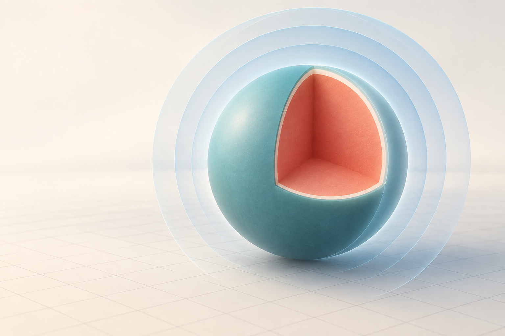
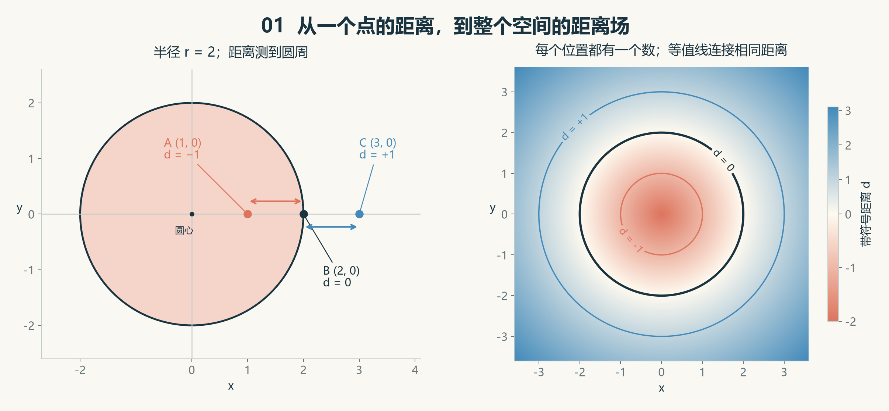
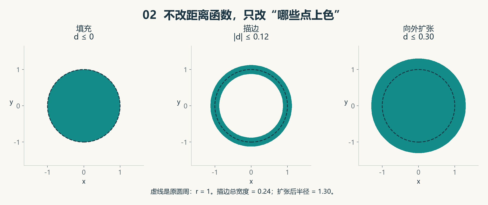
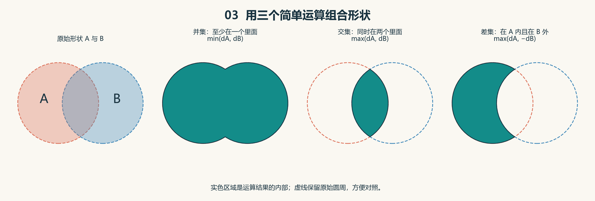
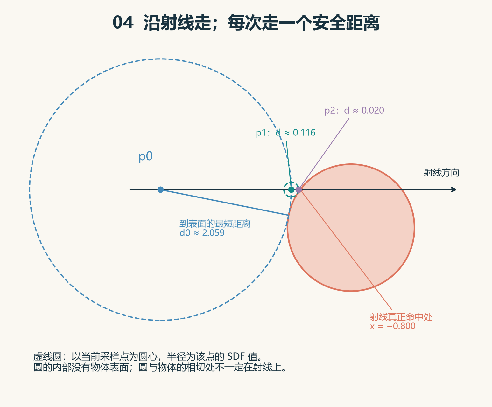
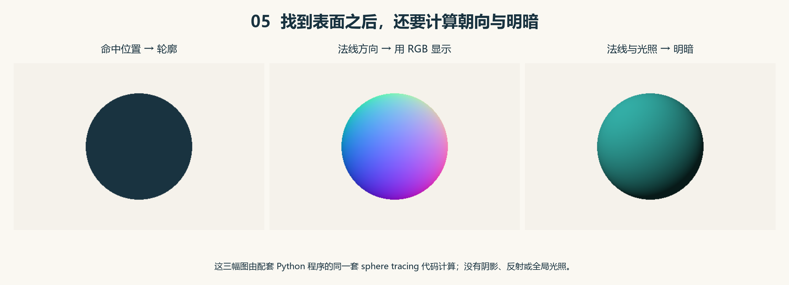

# 从零理解 SDF：用“到表面的距离”画出一个世界

> 面向第一次接触计算机图形学的你。只需要知道坐标、正负数和勾股定理；代码可以第二遍再读。本文统一约定：**物体内部为负，表面为零，外部为正。**



*概念插画由 imagegen 生成。剖开部分用于展示球体内部，透明外层用于联想等距层；它们不是本文球体模型上的洞或额外物体。后面的数学示意图均按公式计算绘制。*

## 先选一条适合自己的阅读路线

第一次读，建议分成三小段，每段读完就停下来想一想：

| 阶段 | 阅读内容 | 读完能做什么 |
|---|---|---|
| 建立直觉 | 第 1～4 节 | 解释正负号，手算圆的 SDF，看懂距离场 |
| 用它画形状 | 第 5～8 节 | 理解填充、描边、形状组合和坐标变换 |
| 进入三维 | 第 9～12 节 | 理解球面追踪与明暗，运行自己的小程序 |
| 巩固与拓展 | 第 13～15 节 | 避开常见误解，完成练习，选择下一步 |

你不需要一次记住所有公式。遇到新公式时，先问：**输入是什么？输出是什么？这个输出能帮我做什么？**

## 1. 如果不直接描出轮廓，还能怎样描述形状？

假设你想告诉计算机：“这里有一个圆。”

一种方法是给它许多轮廓点，再把这些点连接起来。另一种方法是提供一个可以反复询问的规则：

> 给我一个位置，我告诉你：它在圆内还是圆外，以及它离圆周最近有多远。

这种规则就能构成一个 **SDF**。

SDF 常用于指 **Signed Distance Function**，中文是“有符号距离函数”；讨论空间中所有位置上的距离值时，也会说 **Signed Distance Field**，即“有符号距离场”。

先把函数当作一台小机器：

```text
输入：一个位置 p
        ↓
      SDF(p)
        ↓
输出：一个带正负号的距离 d
```

这里没有直接输出像素颜色，也没有输出三角形。它只输出一个数。后续程序再根据这个数决定哪里上色、光线能走多远等。

**SDF 是一种描述形状的方法；把这个描述变成图像，还需要渲染步骤。**

## 2. “有符号”到底是什么意思？

普通距离只有大小，例如“离墙 1 米”。SDF 额外用正负号表示点在哪一侧。

| SDF 的值 | 位置关系 | 应当怎样读 |
|---|---|---|
| `d > 0` | 物体外部 | 在外面，离表面还有 `d` 个单位 |
| `d = 0` | 物体表面 | 正好在边界上 |
| `d < 0` | 物体内部 | 在里面，离表面最近有 `abs(d)` 个单位 |

`abs` 表示绝对值，例如 `abs(-3) = 3`。

负号不是“距离真的小于零”。它承担的是“内部”这个标签。距离的大小仍由绝对值表示。

本教程说的距离，都是通常的直线距离，也叫**欧几里得距离**。测量目标是最近的表面位置。二维图形的表面对应轮廓线；三维实体的表面对应外壳。

例如，在一个半径为 2 的圆心处，到圆周的最近距离是 2。因此圆心处的 SDF 是 `-2`，不是 `0`。

> 先记住一句话：**正负号告诉你里外，绝对值告诉你离表面多远，零值告诉你表面在哪里。**

有些资料采用相反的符号约定，那也可以。阅读公式前要先确认约定。本教程所有公式、配图和代码都使用“内负外正”。

## 3. 亲手算出第一个 SDF：圆

### 3.1 先算到圆心的距离

设圆心在原点 `(0, 0)`，半径是 `r`，要查询的位置是 `p = (x, y)`。

按照勾股定理，到圆心的距离是：

$$
\sqrt{x^2+y^2}
$$

例如，点 `(3, 4)` 到原点的距离是：

$$
\sqrt{3^2+4^2}=\sqrt{25}=5
$$

### 3.2 再减去半径

如果你离圆心有 5 个单位，而圆的半径是 2，那么你离圆周最近就是 `5 - 2 = 3` 个单位。

圆的 SDF 因而是：

$$
\boxed{d(x,y)=\sqrt{x^2+y^2}-r}
$$

不方便显示公式的阅读器，也可以把它读成：

```text
圆的 SDF = 到圆心的直线距离 - 圆的半径
```

现在固定 `r = 2`，验证几个位置：

| 查询位置 `p` | 到圆心的距离 | 减去半径 2 | 结果含义 |
|---|---:|---:|---|
| `(0, 0)` | 0 | -2 | 在内部，到圆周最近为 2 |
| `(1, 0)` | 1 | -1 | 在内部，到圆周最近为 1 |
| `(2, 0)` | 2 | 0 | 在圆周上 |
| `(3, 0)` | 3 | +1 | 在外部，到圆周最近为 1 |
| `(3, 4)` | 5 | +3 | 在外部，到圆周最近为 3 |



*图 1：左图的 A 和 C 都离圆周 1 个单位，但 A 在内部，因此值为 -1；C 在外部，因此值为 +1。右图的每个位置都有一个距离值。*

### 3.3 圆心不在原点怎么办？

假设圆心为 `c = (cx, cy)`，先把查询点的位置减去圆心位置：

$$
d(p)=\sqrt{(x-c_x)^2+(y-c_y)^2}-r
$$

常见的简写是：

$$
d(p)=\|p-c\|-r
$$

`‖p-c‖` 表示向量 `p-c` 的长度。这里的向量可以先理解成“一组坐标差”。

对应的 Python 代码只有几行，可以独立运行：

```python
from math import hypot

def sdf_circle(x, y, cx=0.0, cy=0.0, radius=2.0):
    return hypot(x - cx, y - cy) - radius

print(sdf_circle(1, 0))  # -1.0
print(sdf_circle(2, 0))  #  0.0
print(sdf_circle(3, 0))  #  1.0
```

`hypot(a, b)` 就是在计算 `sqrt(a*a + b*b)`。

**停下来想一想：**把半径从 2 改成 3，原来的点 `(2, 0)` 会变成内部、表面，还是外部？它的新 SDF 值是多少？

## 4. 为什么又叫“场”？

可以联想天气地图：每个位置都有一个温度。所有位置的温度放在一起，就是温度场。

距离场也一样，只是每个位置存放或计算出的数变成了距离。

观察图 1 右半部分：

- 珊瑚色区域在圆内，距离值为负。
- 黑色圆周上，距离值等于零。
- 蓝色区域在圆外，距离值为正。
- 标注相同数值的线，是**等值线**：线上每个点的 SDF 值相同。

圆只有一条轮廓，但它的距离场覆盖整个平面。圆外很远的点、圆心附近的点，也都能查询。

**形状可以从距离场的零值位置恢复出来。**在数学中，这叫“零等值集”：

$$
\text{表面}=\{p\mid d(p)=0\}
$$

这行符号只是在说：“把所有满足 `d(p) = 0` 的位置收集起来。”二维时通常是一条线，三维时通常是一张曲面。

实际使用中，SDF 常见两种表示方式：

| 方式 | 怎样得到一个点的距离 | 需要留意什么 |
|---|---|---|
| 公式计算 | 每次代入位置，现场求值 | 公式是否精确；复杂场景的求值成本 |
| 网格或纹理存储 | 预先保存许多采样值，查询时插值 | 存储大小、网格分辨率、插值误差 |

所以，“场”不表示必须创建一张巨大表格。一个短公式也可以定义整个场。解析公式和网格采样也可以用于同一个建模流程。[可参阅 geometry3Sharp 作者关于隐式建模的说明](https://www.gradientspace.com/tutorials/2018/2/20/implicit-surface-modeling)。

## 5. 有了距离，怎样把二维图形画出来？

想象屏幕上的每个像素都对应平面中的一个位置 `p`。对每个位置算一次 `d(p)`，然后规定哪些位置上色。

### 5.1 填充：给内部上色

```text
如果 d ≤ 0：画图形颜色
否则：画背景颜色
```

“逐个位置计算颜色”的小程序，在 GPU 图形编程里常由**片元着色器**来执行。刚开始学习时，把它近似理解成“帮屏幕上的采样位置算颜色”即可。

### 5.2 描边：给表面附近的一条带上色

```text
如果 abs(d) ≤ 0.12：画描边颜色
否则：画背景颜色
```

它同时选中了内部离边界不超过 `0.12` 的区域和外部离边界不超过 `0.12` 的区域，因此描边总宽度是 `0.24` 个场景单位。

**这里的 0.12 是世界坐标里的距离，不天然等于 0.12 个像素。**需要固定屏幕像素宽度时，要结合坐标到屏幕的缩放关系。

### 5.3 扩张与收缩：换一个阈值

对于圆，如果让 `d ≤ 0.3` 的位置上色，相当于允许原轮廓外面再多出 `0.3` 个单位，圆就变大了。

让 `d ≤ -0.3` 的位置上色，则只保留内部足够深的位置，圆就缩小了。



*图 2：三个小图用的是同一个半径为 1 的圆的 SDF。变化发生在“哪些位置被上色”的规则上。*

### 5.4 为什么它有助于做平滑边缘？

直接在边界处从一种颜色切换到另一种颜色，像素不足时容易出现锯齿。知道了距离，就可以在边界附近的一小段范围里逐渐过渡。

例如，选一个正数 `w`：

| 位置 | 透明度 alpha |
|---|---:|
| `d ≤ -w` | 1，完全显示图形 |
| `d = 0` | 0.5 |
| `d ≥ w` | 0，完全显示背景 |

中间可以线性过渡，也可以用平滑曲线。`w` 应与一个像素覆盖的场景范围相匹配，而不是任意固定。

这种过渡是对像素覆盖的近似。**SDF 提供了处理边缘的好材料，最终效果仍取决于采样和抗锯齿方法。**

## 6. 把形状拼起来：并集、交集和差集

现在有两个圆 A 和 B。对同一个位置 `p`，分别算出：

```text
dA = A 的距离函数在 p 处的值
dB = B 的距离函数在 p 处的值
```

下面的运算会产生一个描述组合形状的新函数。第一遍先关注“新形状的内部在哪里”。

### 6.1 并集：至少在一个形状里面

把 A、B 合成一个整体，使用：

$$
d_{\text{union}}=\min(d_A,d_B)
$$

`min` 表示取较小的数。只要 A、B 中有一个值为负，较小值就会为负。

例子：某个点在 A 内、在 B 外，有 `dA = -0.4`、`dB = 0.7`，那么：

```text
min(-0.4, 0.7) = -0.4 → 属于并集内部
```

### 6.2 交集：同时在两个形状里面

只保留重叠部分，使用：

$$
d_{\text{intersection}}=\max(d_A,d_B)
$$

`max` 表示取较大的数。要让较大的数仍然为负，两个数就都得是负数。

仍然使用刚才的点：

```text
max(-0.4, 0.7) = 0.7 → 不属于交集内部
```

### 6.3 差集：从 A 中挖掉 B

保留“在 A 内，并且在 B 外”的部分，使用：

$$
d_{A\setminus B}=\max(d_A,-d_B)
$$

`-dB` 把 B 的里外符号翻转，再用 `max` 要求两边都满足。

例如某点同时在 A 和 B 内：

```text
dA = -0.4，dB = -0.2
max(dA, -dB) = max(-0.4, 0.2) = 0.2
结果在外部 → 这部分被挖掉了
```



*图 3：先看实色区域是否符合“至少一个”“两个同时”“只留 A”的规则，再回头看公式。*

这些基本形状运算也叫 **CSG（构造实体几何）**。[Graphics Codex 的距离函数运算章节列出了这些基本算子](https://graphicscodex.com/app/_rn_rayMrch.xml.html)。

### 6.4 这里有一个必须知道的区别

**组合后的里外和轮廓可以正确，数值却不一定是到新轮廓的精确距离。**

用图 3 的两个圆来验证：它们半径都是 1，圆心分别为 `(-0.55, 0)` 和 `(0.55, 0)`。

在原点 `(0, 0)`：

```text
dA = dB = 0.55 - 1 = -0.45
并集公式给出 min(dA, dB) = -0.45
```

但原点深处两个圆的重叠区。离并集真正外边界最近的地方是上下两个圆周交点，距离为：

$$
\sqrt{1-0.55^2}\approx 0.835
$$

因此，并集的**精确**有符号距离在这里应约为 `-0.835`，而不是 `-0.45`。原来圆周的一部分已经落入新物体内部，不再是新物体的外边界。

这不妨碍用该公式画出正确的填充形状。不过，若要把它当作尺子测量距离，就必须区分“精确 SDF”和“距离界”。第 10 节会说明这个区别为什么影响光线步进。

对于由精确 SDF 经过标准 `min/max/取反` 组成的正常实体，新函数通常仍能提供安全的距离下界。不要把这个结论套到任意平滑、扭曲或缩放后的函数上。完全重合、相切等退化配置也需要单独处理。

## 7. 更复杂的形状，从哪里来？

圆和球只是最容易入门的基本形状。矩形、盒子、胶囊、圆环等也有对应的距离公式。

以下矩形例子属于可选进阶内容。暂时跳过，不影响理解三维渲染。

### 7.1 矩形：先看一个具体点

设矩形以原点为中心，横向范围是 `[-2, 2]`，纵向范围是 `[-1, 1]`。

点 `(3, 2)` 在右上方，最近的矩形表面位置是右上角 `(2, 1)`。所以距离为：

$$
\sqrt{(3-2)^2+(2-1)^2}=\sqrt{2}
$$

只算“超出了右边多少”会得到 1；只算“超出了上边多少”也会得到 1。两者都没有考虑到拐角处要走一条斜线。

这就是矩形的公式比圆稍复杂的原因。

### 7.2 再读通用公式

设矩形的半宽、半高是 `b = (bx, by)`，查询点为 `p = (x, y)`。定义：

$$
q=(|x|-b_x,\ |y|-b_y)
$$

那么精确距离可以写成：

$$
d(p)=\sqrt{\max(q_x,0)^2+\max(q_y,0)^2}
+\min(\max(q_x,q_y),0)
$$

拆成两部分就容易理解了：

1. **外部距离**：把超出矩形的横向、纵向距离留下来，再用勾股定理合成。内部点这一项为零。
2. **内部距离**：在矩形内，选择离得最近的一条边，以负数表示。外部点这一项为零。

对于 `(3, 2)`，`q = (1, 1)`，结果为 `sqrt(2)`；对于原点，`q = (-2, -1)`，结果为 `-1`。

同样的思想可以扩展到三维盒子。常见解析 SDF 基本形状可见 [Stanford CS248 的隐式曲面课程资料](https://gfxcourses.stanford.edu/cs248/winter22content/media/noiseimplicit/CS248_-_Noise2_zcG595S.pdf)。

## 8. 让形状移动、变大、融合

### 8.1 平移：把查询位置换到物体自己的坐标系

假设 `D(p)` 是一个以原点为中心的形状，要把它移动到 `c`，使用：

$$
D_{\text{moved}}(p)=D(p-c)
$$

为什么是减号？因为当世界里的查询点 `p` 正好等于新中心 `c` 时，`p-c = 0`。对物体自身来说，这个点就是中心。

### 8.2 等比缩放：查询位置和输出距离都要换算

要把形状整体放大 `s` 倍，其中 `s > 0`：

$$
D_{\text{scaled}}(p)=s\,D(p/s)
$$

里面除以 `s`，把查询位置换回原形状的尺度；外面乘以 `s`，把距离换回世界尺度。

以单位圆 `D(p) = length(p) - 1` 为例，放大两倍后：

```text
2 × D(p / 2)
= 2 × (length(p) / 2 - 1)
= length(p) - 2
```

结果确实是半径为 2 的圆。

如果横向放大 2 倍、纵向放大 1 倍，这是**非等比缩放**。仅把坐标分别除以缩放量，一般不能保持精确距离。这时需要专门的距离公式或经过推导的保守修正。

### 8.3 平滑融合：把硬连接变成柔和连接

两个形状使用 `min` 合并时，连接处可能出现折痕。把硬性的最小值换成“平滑最小值”，可以让连接区域变得圆润，产生软泥、液滴一类的外观。

第一遍只需要知道两个结论：

- 这是在改变形状函数，连接处的轮廓会真的变化。
- 平滑后的函数一般不能自动当作精确距离使用。

它与第 5 节的边缘抗锯齿不同：抗锯齿主要改变屏幕上边缘如何过渡，平滑融合改变的是几何形状本身。

## 9. 从二维圆到三维球，只多一个坐标

二维位置是 `(x, y)`，三维位置是 `(x, y, z)`。

球心在原点、半径为 `r` 的球体 SDF 是：

$$
\boxed{d(x,y,z)=\sqrt{x^2+y^2+z^2}-r}
$$

思路完全没变：**到球心的距离，减去球半径。**

如果用图形编程语言 GLSL，可以写成：

```glsl
float sdSphere(vec3 p, float radius) {
    return length(p) - radius;
}
```

这里 `vec3` 是三个数字组成的向量，`float` 是小数类型，`length(p)` 求向量长度。这只是一个函数片段，需要放进完整的渲染程序才能显示图像。

接下来出现一个新问题：二维可以直接按位置上色，三维却还要判断**相机沿某个方向看过去，首先看见哪一处表面**。

## 10. 光线怎样找到表面：Sphere Tracing

### 10.1 给一个像素安排一条射线

想象从相机位置出发，穿过屏幕上的某个像素，向场景里发出一条直线。它叫**视线射线**。

射线上任意一个位置可以表示为：

$$
p(t)=o+t\,v
$$

| 符号 | 含义 |
|---|---|
| `o` | 起点，也就是相机位置 |
| `v` | 射线方向，长度应为 1 |
| `t` | 沿射线已经走过的距离 |
| `p(t)` | 走到这个距离时的位置 |

“方向长度为 1”叫做**归一化**。这样 `t` 才能直接用场景里的距离单位衡量。

### 10.2 一点点试探很慢，大步乱走又可能穿过去

你当然可以每次前进 `0.01` 个单位，再查询新位置。但如果物体很远，就要查询很多次。

每次前进 10 个单位又可能太大，整个物体都被跨过去了。

SDF 给出了一个更有依据的步长。

### 10.3 距离表面有多远，就能安全前进多远

假设当前位置在物体外部，精确 SDF 返回 `d = 2`。

那么，以当前位置为球心、半径为 2 的球，其**内部**没有任何物体表面。否则，就存在一个距离小于 2 的表面点，与“最近距离为 2”矛盾。

所以，无论射线朝哪个方向，你都可以沿射线前进 2 个单位而不穿入物体。最多刚好碰到表面。

前进后再查询新的 SDF，重复这个过程：

```text
查询当前位置的距离 d
        ↓
沿射线前进 d
        ↓
到新位置，重新查询
        ↓
足够接近表面时停止
```

这种借助距离界前进的方法叫 **Sphere Tracing（球面追踪）**，属于 **Ray Marching（光线步进）** 的一种。名称里的球指的是“保证安全的空球”，被渲染的物体可以是别的形状。[Hart 的原始论文介绍了这种基于距离界的追踪方法](https://experts.illinois.edu/en/publications/sphere-tracing-a-geometric-method-for-the-antialiased-ray-tracing/)。



*图 4：用二维圆展示三维安全球的截面。虚线圆是计算过程中的辅助范围，不是场景里的实体。图中的步长根据圆的精确 SDF 计算。*

### 10.4 既然知道精确距离，为什么不能一步到达？

因为 **SDF 返回的是朝任何方向寻找时的最短距离，而射线必须沿固定方向走**。

图 4 中，起点是 `(-3, 0.6)`，物体是原点处的单位圆，射线水平向右。

起点的 SDF 为：

$$
\sqrt{(-3)^2+0.6^2}-1\approx 2.059
$$

但射线实际先碰到的圆周位置是 `(-0.8, 0.6)`，沿射线要走 `2.2` 个单位。

因此，第一次前进 `2.059` 后还没到达表面。后面的步骤会继续补足这段距离。

这个例子说明：**即使 SDF 完全精确，也通常需要多步。**只有某些特殊方向会一步到达。

### 10.5 程序什么时候停止？

实际计算有浮点误差，通常不检查 `d == 0`，而是检查是否足够接近，例如 `abs(d) < 0.001`。

这个很小的阈值叫 `epsilon`，常写成 `eps` 或 `ε`。它使用场景距离单位，应结合物体尺度选择。

下列是逻辑示意，不是完整 Python 程序：

```text
t = 0
重复，最多 128 次：
    p = 相机位置 + t × 单位方向
    d = scene(p)

    如果 abs(d) < epsilon：
        返回“近似命中”和当前位置

    如果 d < 0：
        返回“前提不满足，需要处理内部或穿透情况”

    t = t + d

    如果 t > 最大追踪距离：
        返回“已超出查询范围”

返回“达到步数上限，尚未确定”
```

这里假设相机在物体外部。相机位于内部时，需要另外设计离开内部和命中表面的逻辑。

“足够接近”属于数值近似；“用完步数”也不等于数学上证明没有交点。尤其当射线几乎擦着物体经过时，收敛可能很慢。

### 10.6 安全步长的前提

在外部，设真实最近距离为 `D`，用于步进的值为 `h`：

$$
0<h\le D
$$

只要满足这个不等式，就不会因为这一步走得过大而穿过表面。

| 用于步进的数值 | 可能发生什么 |
|---|---|
| 精确距离，如真实距离为 1，返回 1 | 可以安全前进到这个距离 |
| 保守下界，如真实距离为 1，返回 0.5 | 安全，但可能多走几步 |
| 高估，如真实距离为 1，返回 1.5 | 可能越过表面，出现漏面或穿透 |

因此，改形状公式、加噪声、扭曲坐标或做非等比缩放时，需要重新确认距离界。随手乘 `0.8` 有时能减轻问题，但不能替任意函数提供安全保证。

另外，如果 `h` 只是很松的下界，`h` 很小也不保证真实距离已经很小。用于判定命中的阈值，需要结合距离界的质量判断。

## 11. 找到表面以后，怎样让球看起来立体？

如果命中的像素全部涂成同一种颜色，你得到的主要是轮廓。

要有明暗，还需要知道命中位置处的表面**朝向**。

### 11.1 法线：从表面垂直向外指的箭头

这支垂直于表面的箭头叫**法线**。通常把它归一化，只保留方向，记作 `n`。

对球来说很好想象：球心指向表面点的方向，就是该点向外的法线方向。

对于更复杂的 SDF，可以在表面点附近，分别沿 x、y、z 方向前后移动一点，看看距离值怎样变化。

下面的式子可以第二遍再看：

$$
g_x\approx\frac{d(p+(e,0,0))-d(p-(e,0,0))}{2e}
$$

同样求出 `gy` 和 `gz`，再归一化：

$$
n\approx\frac{(g_x,g_y,g_z)}{\|(g_x,g_y,g_z)\|}
$$

`e` 是一个很小的采样距离。这个三个分量组成的变化方向叫**梯度**，记作 `∇d`。对于“内负外正”的 SDF，在表面光滑、可微的位置，梯度指向外部。

法线估计中的 `e` 与命中阈值 `epsilon` 用途不同，不必取相同值。棱角处没有唯一法线，数值估计的效果也会受到采样尺度影响。

### 11.2 朝着光的表面亮一些

设 `l` 是**从表面点指向光源**的单位方向，一个基础的漫反射明暗因子是：

$$
\text{亮度因子}=\max(n\cdot l,0)
$$

中间的点号表示**点积**。对单位向量，可以直观理解为“两个方向有多一致”：

- 法线正对光，值接近 1，比较亮。
- 光从侧面照过来，值接近 0，比较暗。
- 光在表面背后，点积为负，通过 `max(..., 0)` 截成 0。

配套程序还加入了固定的 `0.15` 基础亮度，使背光处也能看清。这是教学用的简化效果。



*图 5：左图只画“是否命中”；中图把法线的三个分量映射为 RGB 颜色；右图利用法线和光照方向得到明暗。三幅图使用同一个球体和同一套光线步进代码。*

完整链条现在连起来了：

```text
屏幕采样点
    → 相机射线
    → 查询距离并沿射线前进
    → 找到近似表面位置
    → 估计法线
    → 计算明暗
    → 输出像素颜色
```

阴影、反射、折射是后续可以加入的步骤。本例的球面明暗不包含投射阴影或全局光照。

## 12. 动手：生成自己的第一张 SDF 图像

配套的 [sdf_demo.py](sdf_demo.py) 是一个完整、离线可运行的小程序。它只使用 Python 3 标准库，无须安装第三方包。

如果你已经安装 Python：

1. 把教程配套文件保存在同一个文件夹中。
2. 在 `sdf_demo.py` 所在文件夹打开终端。
3. 运行下面的命令。

```bash
python sdf_demo.py
```

程序会在自身所在文件夹生成或覆盖 `sdf-render.png`。已经附上了运行得到的[球体渲染结果](sdf-render.png)，暂时不运行也能阅读教程。

默认图像是 `480 × 320` 像素。程序用 CPU 逐个像素追踪，运行时间取决于电脑性能。

第一次读代码，只需要寻找这四个函数：

| 函数 | 与正文的关系 |
|---|---|
| `scene(p)` | 回答当前位置的距离；对应第 9 节 |
| `trace(ro, rd)` | 沿射线反复查询；对应第 10 节 |
| `normal(p)` | 从附近距离变化估计朝向；对应第 11 节 |
| `render(...)` | 为每个像素安排射线并计算颜色 |

`write_png(...)` 负责把颜色写成图片文件，可以先跳过。

建议一次只做一个小实验，每次运行前先预测结果：

| 实验 | 修改位置 | 先猜一猜 |
|---|---|---|
| 把球半径从 1 改成 0.7 | `scene` 中的 `length(p) - 1.0` | 球的屏幕轮廓会怎样变化？ |
| 把光移到右上方 | `light` 中的 x 分量由 `-0.6` 改为 `0.6` | 最亮的区域会移到哪里？ |
| 把命中阈值改成 0.03 | `trace` 的 `eps` 默认值 | 边缘与命中精度会怎样变化？ |
| 把最大步数改成 8 | `trace` 的 `max_steps` 默认值 | 哪些射线可能来不及确定结果？ |

程序会输出不同追踪状态的数量。其中 `step_limit` 表示尚未收敛，示例把这些像素画成背景；它不是“确实没有交点”的证明。

这个示例采用简单点采样，目标是展示算法。轮廓可能看到锯齿，后续可以练习为每个像素发出多条略有偏移的射线并平均颜色。

## 13. SDF 还能用在哪里？

### 字体和图标

把到字形轮廓的距离编码进纹理，可以在显示时重新选择阈值、平滑边缘，或添加描边等效果。Valve 的经典工作展示了这种做法。[Chris Green，2007 年论文](https://steamcdn-a.akamaihd.net/apps/valve/2007/SIGGRAPH2007_AlphaTestedMagnification.pdf)。

纹理中的数值可能已经从距离范围映射到 `[0, 1]`。因此，看到“边界阈值 0.5”并不表示几何上的有符号距离在边界是 0.5；它可能只是零距离编码后的位置。

### 接近检测与简单碰撞

对于一个点，精确 SDF 能直接帮助判断它在物体内外、离表面多远。

如果一个小球的中心在障碍物外，半径为 `r`，中心到障碍物的精确距离小于 `r`，就说明小球与障碍物发生了重叠；等于 `r` 时恰好接触。

真正的动态碰撞还涉及运动路径、时间步长和碰撞响应，不能只靠单次距离查询完成。

### 程序化建模与效果

用少量参数控制基本形状，再做组合、重复或融合，可以方便地构造规则结构或有机外观。

SDF 也可以和三角网格配合：例如先把距离场转换成网格，再交给常规渲染流程。选择哪种表示，取决于你更需要方便的形状运算、精细表面编辑，还是高效显示。

## 14. 初学者最值得避开的七个误解

| 容易混淆的想法 | 更准确的理解 |
|---|---|
| “SDF 就是到中心的距离。” | 测的是到最近表面的距离；圆、球恰好可以用“到中心的距离减半径”求出它。 |
| “能画出零轮廓的函数都是 SDF。” | 零轮廓正确，只代表能描述表面；数值还必须具有距离意义。 |
| “组合后肯定还是精确距离。” | 标准布尔运算能构造形状，但一般不保持处处精确。 |
| “知道精确 SDF，一步就能命中。” | 最近表面方向与射线方向通常不同。 |
| “Sphere Tracing 只能画球。” | 球是安全步进范围，被查询的形状可以任意复杂。 |
| “SDF 自动无锯齿，而且无限精细。” | 解析表示、纹理采样和最终像素采样分别有自己的限制。 |
| “SDF 一定比网格更快。” | 复杂场景可能每条射线都要做很多次距离计算，需要具体分析。 |

第二条值得亲自验证。下面两个函数的零值都描述半径为 `r` 的圆：

$$
f(x,y)=x^2+y^2-r^2
$$

$$
d(x,y)=\sqrt{x^2+y^2}-r
$$

但令 `r = 2`、`p = (3,0)`：

```text
f = 9 - 4 = 5
d = 3 - 2 = 1
```

真正距离是 1。`f` 的单位是长度的平方，不能直接拿返回的 5 作为安全步长。

能通过 `f(p) = 0` 描述曲面的函数，称为一种**隐式表示**。精确 SDF 是其中具有距离意义的一类。

## 15. 用五道小练习检查理解

建议先写下答案，再往下看解析。

### 练习

1. 圆心为 `(1, 1)`、半径为 2。点 `(1, 1)`、`(3, 1)`、`(4, 1)` 的 SDF 分别是多少？
2. 描边条件是 `abs(d) ≤ 0.05`。描边的总宽度是多少？
3. 某点满足 `dA = -0.2`、`dB = 0.5`。并集、交集和 `A 减 B` 的公式结果分别是多少？
4. 某点到表面的最近距离为 0.4。为什么沿当前射线走 0.4 后仍可能没有命中？
5. 一个函数画出的零轮廓完全正确，但外部某点真实距离为 1，它返回 3。可以直接用 3 进行球面追踪吗？

### 答案与解释

1. **-2、0、+1。**先算到圆心 `(1, 1)` 的距离，再减半径 2。
2. **0.1 个场景单位。**内部 0.05，加上外部 0.05；像素宽度还取决于坐标映射。
3. **-0.2、0.5、-0.2。**分别计算 `min(-0.2, 0.5)`、`max(-0.2, 0.5)`、`max(-0.2, -0.5)`。
4. **最近表面点可能在射线侧面。**0.4 是任意方向里的最短距离，当前射线上的交点可能更远，甚至根本不存在。
5. **不能。**它高估了安全距离，可能跨过表面。轮廓正确不足以保证步进安全。

如果你已经能解释这五题，下一步可以沿自己的兴趣选择：

- 喜欢二维界面：练习圆角矩形、固定像素宽度描边和边缘抗锯齿。
- 喜欢三维渲染：在示例中添加第二个球，再研究地面、阴影与反射。
- 喜欢数学原理：继续学习梯度、Lipschitz 条件和距离下界。
- 喜欢字体：研究距离纹理的编码、采样误差，以及多通道距离场对尖角的处理。

最后尝试不看正文，用自己的话讲清这条过程：**我给出一个位置，SDF 返回带符号的表面距离；我用它判断形状、选择安全步长，再根据表面朝向计算颜色。**

---

## 配套资料与制作说明

- `sdf-images/`：1 张 imagegen 概念插画，以及 5 张依据公式和程序结果绘制的教学配图。
- [sdf_demo.py](sdf_demo.py)：完整 Python 示例，仅依赖标准库。
- [sdf-render.png](sdf-render.png)：示例程序实际生成的球体图像。
- [imagegen-prompt.md](imagegen-prompt.md)：概念插画的完整生成提示词与生成方式。

本教程的数值例子、练习和数学配图为本次制作；引用资料用于核对术语、经典算法及应用背景。插画用于建立直觉，数学结论以正文公式、推导和计算示意图为准。

移动或分享时，请将 Markdown 与 `sdf-images` 文件夹一同保留，图片链接使用相对路径。公式采用常见的 LaTeX 数学语法；如果阅读器没有公式渲染功能，可以先阅读相邻的文字解释与代码表达。
