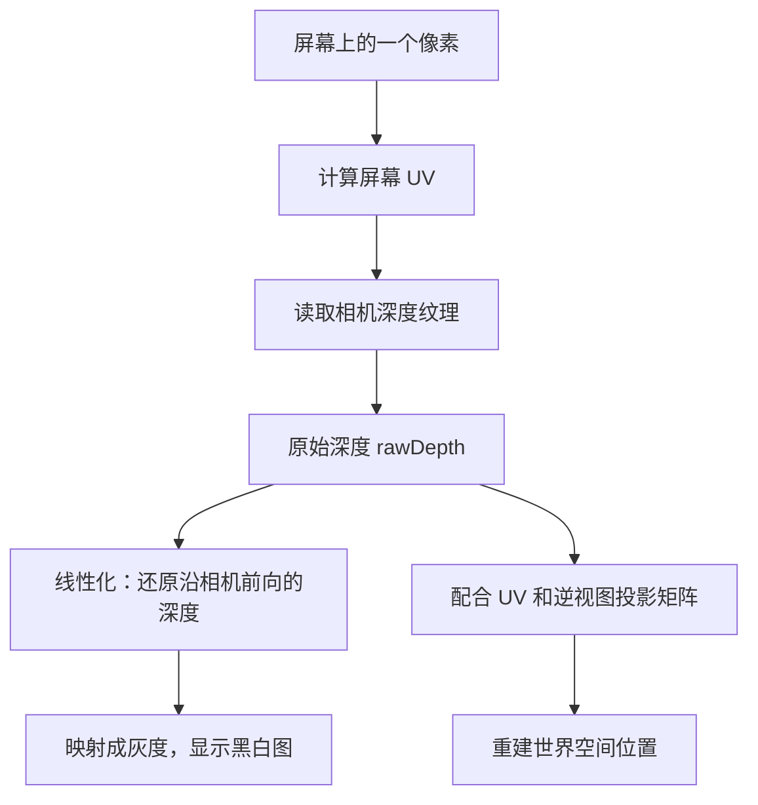

# Unity URP 深度读取与重建：从一张黑白图开始

你可能已经知道：深度与“物体离相机多远”有关。但写 Shader 时，为什么先要读取深度纹理，读完又要调用转换函数？为什么有的教程使用 `LinearEyeDepth`，有的却乘逆矩阵？它们是在做同一件事吗？

这篇文章从零回答这些问题。主线是把场景深度显示成黑白图，再延伸到“根据深度重建位置”。

> **阅读范围**：以 URP、普通透视相机为主，补充正交相机的区别。完整实验使用 URP 14 / Unity 2022.2 起提供的 Full Screen Pass Renderer Feature，设置名称参考 Unity 6。暂按普通 3D Renderer、单相机、非 XR、Render Scale 为 1 的场景学习。
>
> 文中的 API 已对照 Unity 官方文档和公开源码；附带 Shader 尚未在你的 Unity 项目中编译、运行。源码链接中的 `master` 会更新，遇到版本差异，以项目安装的 URP/Core 包为准。

## 1. 先拆开三个动作：读取、线性化、重建位置

它们经常被口头统称为“处理深度”，但输入和输出不同。

| 动作 | 输入 | 输出 | 常见写法 |
|---|---|---|---|
| 读取深度 | 屏幕 UV、深度纹理 | 一个原始深度数值 | `SampleSceneDepth(uv)` |
| 线性化深度 | 原始深度、相机参数 | 有明确距离意义的标量 | `LinearEyeDepth(rawDepth, _ZBufferParams)` |
| 重建位置 | 屏幕 UV、投影深度、逆矩阵 | 一个三维位置 | `ComputeWorldSpacePosition(...)` |

可以把流程理解成：



注意图中的分叉：**用逆矩阵重建位置的那条路径，通常直接使用经过平台范围适配的原始深度，不先调用 `LinearEyeDepth`。** Unity 的官方重建示例采用的就是这条路径。[官方世界位置重建示例](https://docs.unity3d.com/cn/6000.0/Manual/urp/writing-shaders-urp-reconstruct-world-position.html)

## 2. 深度纹理究竟存了什么？

### 2.1 从“屏幕上的一个位置”开始理解

想象你盯着屏幕中央的一个像素。沿着这个像素对应的视线，场景里可能依次有一个箱子、一面墙和更远的山。

在普通不透明物体渲染中，需要决定这个像素最终显示哪个表面。深度测试利用各表面的深度判断遮挡关系；通过测试并允许写入深度的表面，会更新深度缓冲。

因此，可以先把深度图理解成一张与屏幕对应的“表面前后位置记录表”。它不是一份包含整个场景所有表面的三维地图。

比如，箱子挡住了墙，箱子覆盖的像素通常记录箱子的深度。仅凭这些像素的深度，你无法再读出箱子背后的墙。

### 2.2 深度缓冲与相机深度纹理

学习时还要区分两个对象：

- **深度缓冲**参与渲染过程中的深度测试和写入。
- **相机深度纹理**是 Shader 可以采样的深度资源，在 URP 中通常通过 `_CameraDepthTexture` 访问。

URP 可能通过深度预通道，或在某个阶段复制深度缓冲，准备这份可读取的数据。它记录哪些物体，取决于生成方式和时机；不能认为它永远等于“此刻整个场景的全部深度”。Full Screen Pass 的 `Depth` 输入需求用于让管线准备相应资源。[Full Screen Pass 官方说明](https://docs.unity3d.com/6000.0/Documentation/Manual/urp/renderer-features/renderer-feature-full-screen-pass.html)

初学实验先使用 URP/Lit 的不透明物体。普通透明材质通常不写入这份场景深度，因此屏幕上看见玻璃，不代表深度纹理里就记录了玻璃。

## 3. 为什么读到的 0.8 不能解释成 0.8 米？

### 3.1 先明确“距离”沿哪个方向量

本文用 `E` 表示眼空间深度：**点沿相机前向离相机平面有多远**。

在通常的 Unity 视图空间约定下，相机前方的点具有负的 `z`，所以可写成：

```text
E = -positionVS.z
```

它和“点到相机的直线距离”不完全相同。

假设两个点的视图空间坐标是：

```text
A = (0, 0, -10)
B = (6, 0, -10)
```

两者的眼空间深度都是 10，因为它们处于同一个与相机成像平面平行的平面上。但直线距离分别是 10 和 `sqrt(136) ≈ 11.66`。

所以，正对相机的平面可以具有均匀的线性深度；它不会仅仅因为屏幕边缘的点离相机更远，就自动出现径向渐变。

### 3.2 透视相机会把这个深度编码成非线性的数

下面用一组简化条件推导数值：普通透视投影、非反向 Z、深度纹理值从近处的 0 变化到远处的 1。

设近裁剪面为 `n`，远裁剪面为 `f`，眼空间深度为 `E`，原始深度为 `d`。对应关系为：

```text
d = f / (f - n) - (f × n) / ((f - n) × E)
```

不必背公式，只需要发现：**它含有 `1 / E`，因此 d 不随 E 等比例变化。**

例如 `n = 1`、`f = 100`：

| 眼空间深度 E | 原始深度 d，约值 | E / f |
|---:|---:|---:|
| 1 | 0.0000 | 0.01 |
| 2 | 0.5051 | 0.02 |
| 5 | 0.8081 | 0.05 |
| 10 | 0.9091 | 0.10 |
| 100 | 1.0000 | 1.00 |

从 1 到 2，原始深度已经变化了大约 0.5；从 10 到 100，却只变化大约 0.09。

这解释了两个现象：

- 原始深度是 0.8，不代表物体位于远裁剪距离的 80%，更不代表 0.8 米。
- 直接把原始深度输出成颜色，可能看到大片接近白色的区域，近处才有明显变化。

这是透视投影与深度编码的结果；“线性化”就是反过来，从编码后的值求回 `E`，或求回它的缩放形式。

### 3.3 为什么别人的图反而近白远黑？

很多平台使用 **Reversed Z（反向 Z）**：近裁剪面附近为 1，远裁剪面附近为 0。Unity 用 `UNITY_REVERSED_Z` 表达这个平台约定。[Unity 平台差异说明](https://docs.unity3d.com/6000.0/Documentation/Manual/SL-PlatformDifferences.html)

对上面的普通投影例子，可以用 `1 - d` 理解编码方向的反转。于是直接显示原始深度时，黑白方向也会反转。

但做了 `1 - d` **仍然没有线性化**：反转顺序不会消除公式里的 `1 / E`。

## 4. URP 中怎样真正读到一个深度值？

核心代码只有两步：

```hlsl
// 放在 HLSLPROGRAM 内，函数定义之前。
#include "Packages/com.unity.render-pipelines.universal/ShaderLibrary/Core.hlsl"
#include "Packages/com.unity.render-pipelines.universal/ShaderLibrary/DeclareDepthTexture.hlsl"

// 放在片元函数内；screenUV 是当前像素的屏幕 UV。
float rawDepth = SampleSceneDepth(screenUV);
```

`DeclareDepthTexture.hlsl` 提供深度纹理的声明和访问入口。采用这个入口时，不需要再自己重复声明 `_CameraDepthTexture`。[官方深度访问源码](https://github.com/Unity-Technologies/Graphics/blob/master/Packages/com.unity.render-pipelines.universal/ShaderLibrary/DeclareDepthTexture.hlsl)

### 4.1 screenUV 从哪里来？

这里的 UV 描述“当前像素位于屏幕哪里”，通常落在 `[0,1]` 范围内。它不是物体贴图 UV。

在官方网格示例的片元阶段，可以由 `SV_POSITION` 的像素坐标计算：

```hlsl
float2 screenUV = input.positionHCS.xy / _ScaledScreenParams.xy;
```

例如一张宽 1000、高 500 的图，像素中心坐标约 `(500,250)` 对应屏幕 UV 约 `(0.5,0.5)`。再用这组 UV 查询深度纹理，就是查询屏幕中央的深度。[官方 UV 计算示例](https://docs.unity3d.com/Packages/com.unity.render-pipelines.universal@14.0/manual/writing-shaders-urp-reconstruct-world-position.html)

**阶段很重要**：顶点函数输出的 `SV_POSITION` 是齐次裁剪坐标，进入片元函数后，`SV_POSITION` 已具有光栅化后的屏幕坐标语义。不能看到变量名都叫 `positionCS`，就认为两个阶段里的值完全相同，更不能在片元阶段随手再做一次 `xy / w`。

本文附带的全屏 Shader 使用 URP 的 `Blit.hlsl` 提供顶点入口和屏幕 UV，以减少你需要自己处理的坐标步骤。[官方 Blit 源码](https://github.com/Unity-Technologies/Graphics/blob/master/Packages/com.unity.render-pipelines.core/Runtime/Utilities/Blit.hlsl)

### 4.2 函数可以调用，不等于纹理已经准备好

包含头文件，只是让编译器认识函数。你还需要让 URP 在该 Pass 执行之前生成可采样的深度。

本文实验通过 Full Screen Pass 的 **Requirements → Depth** 声明需求。普通网格 Shader 的常见做法则是启用 URP Asset 的 **Depth Texture**，检查相机覆盖设置，并确保采样发生在深度资源可用之后。

如果在某个不透明物体的着色阶段就尝试读取“全部不透明物体都画完之后”的深度，那就涉及渲染时序，不能只靠增加一行采样代码解决。

## 5. Linear01Depth 和 LinearEyeDepth 到底有什么区别？

对于普通透视相机，先采样一次，再选择需要的表达：

```hlsl
float rawDepth = SampleSceneDepth(screenUV);
float eyeDepth = LinearEyeDepth(rawDepth, _ZBufferParams);
float depth01 = Linear01Depth(rawDepth, _ZBufferParams);
```

| 数值 | 含义 | 例子：E = 10、远裁剪面 f = 100 |
|---|---|---:|
| `rawDepth` | 投影编码后的深度 | 取决于近远裁剪面、投影和平台 |
| `eyeDepth` | 沿相机前向的深度，使用场景单位 | 10 |
| `depth01` | 眼空间深度除以远裁剪距离 | 0.1 |

它们不是从纹理中读取两种独立的信息。后两个函数是在解释已经读取的同一个值。

在以上前提下，可以用这个关系理解：

```text
Linear01Depth(rawDepth, _ZBufferParams)
    ≈ LinearEyeDepth(rawDepth, _ZBufferParams) / far
```

这里的近裁剪面对应 `near / far`，**不是严格的 0**。如果想让近裁剪面正好为黑、远裁剪面正好为白，可以自行映射：

```hlsl
float nearToFar01 = saturate(
    (eyeDepth - _ProjectionParams.y) /
    (_ProjectionParams.z - _ProjectionParams.y)
);
```

上述区别可直接核对官方函数实现；其普通 `_ZBufferParams` 重载还明确限制了正交投影、斜裁剪投影的适用性。[Core 深度函数源码](https://github.com/Unity-Technologies/Graphics/blob/master/Packages/com.unity.render-pipelines.core/ShaderLibrary/Common.hlsl)

`_ProjectionParams.y`、`.z` 分别表示近、远裁剪距离；`_ZBufferParams` 是 Unity 提供的深度换算参数，包含反向 Z 对应的取值。因此调用上述线性化函数前，不要再凭感觉把 `rawDepth` 反转一次。[官方内置变量说明](https://docs.unity3d.com/6000.0/Documentation/Manual/SL-UnityShaderVariables.html)

### 正交相机是另一个分支

正交投影的原始深度与眼空间深度呈线性关系，但仍可能反向，而且仍然没有场景距离单位。

URP 提供 `LinearDepthToEyeDepth` 进行这种换算。它的名字与 `LinearEyeDepth` 很像，适用输入却不同。需要兼容两类相机时，可以写成：

```hlsl
float eyeDepth;
if (unity_OrthoParams.w > 0.5)
    eyeDepth = LinearDepthToEyeDepth(rawDepth);
else
    eyeDepth = LinearEyeDepth(rawDepth, _ZBufferParams);
```

Unity 的粒子代码也采用了这种按投影类型选择的处理方式。[URP 粒子源码](https://github.com/Unity-Technologies/Graphics/blob/master/Packages/com.unity.render-pipelines.universal/ShaderLibrary/Particles.hlsl)、[正交深度换算实现](https://github.com/Unity-Technologies/Graphics/blob/master/Packages/com.unity.render-pipelines.universal/ShaderLibrary/ShaderVariablesFunctions.hlsl)

## 6. 动手：把深度显示成黑白图

附带文件 **URPDepthExplorer.shader** 是完整的全屏实验 Shader。下面先解释使用方式和最关键的几行，避免被 ShaderLab 外壳分散注意力。

### 6.1 场景与 Renderer 设置

1. 在 URP 3D 场景中使用一个透视相机，先设 `Near = 0.3`、`Far = 100`。
2. 摆放几个不透明立方体，放在相机前方不同深度，并左右错开，确保不会完全互相遮挡。材质使用 URP/Lit。
3. 把附带的 `.shader` 文件导入项目，创建一个材质，选择 `Learning/URPDepthExplorer`。
4. 找到当前相机实际使用的 **Universal Renderer Data**，添加 **Full Screen Pass Renderer Feature**。
5. 将新材质赋给 **Pass Material**，把 **Injection Point** 设为 **Before Rendering Post Processing**，把 **Requirements** 设为 **Depth**。如果版本把需求做成多选，只选 Depth 即可。
6. 如果 Inspector 有 **Fetch Color Buffer**，关闭它；这个实验不读取场景颜色。**Bind Depth-Stencil** 也不需要开启；它与“采样深度纹理”不是同一个设置。
7. 关闭相机后处理，保持单相机、Render Scale 为 1，先在 Game 视图观察。不同版本界面略有差异，所需的是“全屏执行这个材质，并提前准备深度纹理”。

Full Screen Pass 的执行位置、材质和纹理需求见[Unity 6 官方说明](https://docs.unity3d.com/6000.0/Documentation/Manual/urp/renderer-features/renderer-feature-full-screen-pass.html)；URP 14 的对应入口见[URP 14 文档](https://docs.unity3d.com/Packages/com.unity.render-pipelines.universal@14.0/manual/renderer-features/renderer-feature-full-screen-pass.html)。旧版 URP 若没有该 Feature，需要另外接入全屏 Pass；不影响本文的深度原理。

### 6.2 三种观察方式

在材质的 **View** 下拉菜单切换：

| 模式 | 输出内容 | 应该观察什么 |
|---|---|---|
| Raw | 原始深度 | 黑白方向依平台而定，透视相机下灰度变化明显不均匀 |
| Linear01 | `eyeDepth / far` | 远处更白，但远裁剪面很远时，近处场景可能整体偏暗 |
| EyeRange | `eyeDepth / Display Distance`，截断到 `[0,1]` | 用自己设定的距离范围观察深度，最适合第一次实验 |

先选 **EyeRange**，把 **Display Distance** 设为 20。此时，眼空间深度为 5、10、20 的表面，对应输出值分别是 0.25、0.5、1。

这里说的是 Shader 输出值。实际显示还涉及色彩空间与显示转换，不能拿肉眼感受到的亮度去精确测量这些数值。

天空等没有有效场景表面的区域，由本示例统一显示为黑色。**这只是便于观察的背景约定，不能把这里的黑色理解为距离 0。** 代码使用一个很小的阈值识别远端清除深度，因此极靠近远裁剪面的几何体也可能被当作背景；实验物体应与远裁剪面保持明显距离。

### 6.3 真正决定颜色的是这几行

下面是普通透视相机的教学核心；完整文件还包含正交相机分支和背景处理：

```hlsl
float rawDepth = SampleSceneDepth(screenUV);
float eyeDepth = LinearEyeDepth(rawDepth, _ZBufferParams);
float gray = saturate(eyeDepth / _DisplayDistance);
return half4(gray, gray, gray, 1.0);
```

按顺序读：

1. 查询这个屏幕位置记录了什么原始深度。
2. 把原始深度换算成沿相机前向的深度。
3. 选择“多远时显示成白色”，把距离缩放到颜色范围。
4. R、G、B 输出同一个值，得到灰度。

`saturate(x)` 把数值限制在 `[0,1]` 内。这里的除法和截断服务于**可视化**，它们不会改变场景中物体的真实位置。

### 6.4 做三个小实验

**实验一：只改变 Far。** 在普通透视相机下，把 Far 从 100 改成 1000，保持物体和 Display Distance 不变。Raw 会受编码参数影响，Linear01 会更暗，EyeRange 对仍在裁剪范围内的同一表面应基本不变。这能区分“编码值”“按 Far 缩放的深度”和“场景单位深度”。

**实验二：把物体移到屏幕边缘，但保持视图空间 z 不变。** EyeRange 应保持相同灰度。这说明当前测量的是轴向深度，并非到相机的直线距离。

**实验三：切换正交相机。** 调整 Orthographic Size，让物体仍处于画面内。Raw 的深度变化现在是线性的，EyeRange 仍然能表达距离，因为完整 Shader 选择了正交换算分支。

## 7. 你记得的“两种重建方式”，可能分别指什么？

目前没有原教程或代码，无法认定你记得的是哪一组。官方接口里确实存在几组容易混淆的对应关系，但不能据此说“Unity 官方规定深度重建只有两种方式”。

| 如果你看到的是…… | 实际在区分什么 | 是否重建三维位置 |
|---|---|---|
| `SampleSceneDepth` / `LoadSceneDepth` | 使用归一化 UV 访问，或使用整数像素坐标访问 | 否，只读取数值 |
| `Linear01Depth` / `LinearEyeDepth` | 同一深度的归一化表达、场景单位表达 | 否，只还原标量深度 |
| `LinearEyeDepth` / `LinearDepthToEyeDepth` | 此处主要对应透视、正交输入的不同换算 | 否 |
| 逆矩阵 / 视线向量乘线性深度 | 两种理解和实现位置重建的思路 | 是 |

`SampleSceneDepth` 和 `LoadSceneDepth` 的参数形式可在[官方深度访问源码](https://github.com/Unity-Technologies/Graphics/blob/master/Packages/com.unity.render-pipelines.universal/ShaderLibrary/DeclareDepthTexture.hlsl)中查看。具体平台适配可能随包版本变化，不宜只凭函数名假定所有细节。

如果记忆来自 Shader Graph，它的 Scene Depth 节点还提供 **Raw、Linear01、Eye** 三种采样模式；界面把读取和数值转换放在一起，更容易让人觉得是几种独立的“读取方式”。[Scene Depth 节点文档](https://docs.unity3d.com/Packages/com.unity.shadergraph@14.0/manual/Scene-Depth-Node.html)

接下来重点解释最符合“重建”这个词的最后一组。

## 8. 位置重建方式一：通过逆矩阵倒推

### 8.1 为什么一个深度数加 UV，足以求出三维位置？

单独一个深度数，不能告诉你点在画面左边还是右边。单独一个屏幕 UV，也不能告诉你这个方向上的点有多远。

但相机参数固定时：

- UV 确定对应的观察射线。
- 深度确定这条射线上的位置。
- 相机的投影和视图变换，确定如何把这个位置表达在世界空间。

所以“UV + 深度 + 相机信息”足以还原该像素记录的那个表面点。

### 8.2 官方示例对应的调用顺序

```hlsl
float rawDepth = SampleSceneDepth(screenUV);
float ndcDepth = rawDepth;

#if !UNITY_REVERSED_Z
    ndcDepth = lerp(UNITY_NEAR_CLIP_VALUE, 1.0, rawDepth);
#endif

float3 scenePositionWS = ComputeWorldSpacePosition(
    screenUV, ndcDepth, UNITY_MATRIX_I_VP
);
```

这里的 `ndcDepth` 是供逆投影使用的深度坐标。深度纹理采样值在 `[0,1]` 范围；不同图形 API 的 NDC z 约定不完全相同，上面的条件分支按 Unity 官方示例完成适配。[官方重建示例与平台适配说明](https://docs.unity3d.com/cn/6000.0/Manual/urp/writing-shaders-urp-reconstruct-world-position.html)

这段重建代码用于已经确认存在场景表面的像素。对天空的清除深度，需要按效果目标另行处理；不要把天空还原出来的远平面位置当成真实物体。

### 8.3 “逆矩阵”究竟逆了什么？

下面只用数学符号解释，不要求先背矩阵元素：

```text
世界坐标 P
    ↓ 视图矩阵 V：换到相机的坐标系
视图坐标
    ↓ 投影矩阵 Pj：投影到齐次裁剪空间
裁剪坐标 C
    ↓ 除以 C.w
NDC 坐标
```

现在已经知道 NDC 位置，可以取齐次代表 `(ndc.x, ndc.y, ndc.z, 1)`，乘 `(Pj × V)` 的逆矩阵，再除以结果的 `w`，取回普通三维世界坐标。

`UNITY_MATRIX_I_VP` 就是此处使用的逆视图投影矩阵；Unity 的辅助函数负责组装坐标及相关平台处理。**这个过程恢复的是位置，不是新增了一次深度纹理读取。**

也正因为它在逆转投影，传入的深度必须保持该投影要求的表达。下面这种搭配是错误的：

```hlsl
// 错误：eyeDepth 是距离，不能当作投影深度传进去。
float eyeDepth = LinearEyeDepth(rawDepth, _ZBufferParams);
float3 wrongPosition = ComputeWorldSpacePosition(
    screenUV, eyeDepth, UNITY_MATRIX_I_VP
);
```

## 9. 位置重建方式二：沿视线走到指定深度

另一种常见思路先还原眼空间深度，再沿相机射线定位。**下面是几何推导，用来解释这类教程；不把它称为已确认的“官方第二种方法”。**

### 9.1 普通透视相机：射线都从相机出发

设视图空间里有一个射线向量 `R`，方向从相机指向当前像素对应的场景方向，且 `R.z < 0`。`R` 可以由视锥角点插值得到，也可以由逆投影获得。

沿射线的点可以表示为：

```text
positionVS = t × R
```

我们已通过 `LinearEyeDepth` 得到眼空间深度 `E`，因此这个点应满足：

```text
positionVS.z = -E
t × R.z = -E
t = E / (-R.z)
```

代回去：

```hlsl
// rayVS 必须对应当前像素，方向从相机指向场景。
// 下面是算法片段，rayVS 需要由调用方提前构造。
float3 reconstructedVS = rayVS * (eyeDepth / -rayVS.z);
float3 reconstructedWS = mul(
    UNITY_MATRIX_I_V, float4(reconstructedVS, 1.0)
).xyz;
```

这个 `rayVS` 不需要单位长度。真正的要求是方向正确，并且缩放后 `z` 分量等于 `-eyeDepth`。

### 9.2 为什么直接 normalize(ray) × eyeDepth 会出错？

假设射线方向可用 `(0.6,0,-1)` 表示，眼空间深度为 10。正确视图位置为：

```text
(0.6,0,-1) × 10 = (6,0,-10)
```

如果先把它归一化，再乘 10，得到的 `z` 约为 `-8.57`。这个点到相机的直线距离是 10，但沿相机前向的深度并不是 10。

错误来自把两种距离混在一起：**单位方向向量乘直线距离可以得到位置；眼空间深度必须额外除以方向的前向分量。**

教程中的 `ray * depth` 有时是正确的，因为它提前把射线缩放到了 `-ray.z = 1`，而不是把射线长度归一化为 1。阅读时要追溯 `ray` 的构造过程。

### 9.3 两种方式为什么能得到同一个位置？

对于普通透视相机，同一个像素的射线和深度确定唯一的表面点。逆矩阵是一次性倒推；射线方法是把这个倒推过程拆成“方向”和“轴向深度”。只要输入和坐标约定一致，两者应在数值精度允许范围内得到相同结果。

| 角度 | 逆矩阵思路 | 射线 × 线性深度思路 |
|---|---|---|
| 主要深度输入 | 适配后的投影深度 | 眼空间深度 |
| 直觉 | 倒放投影过程 | 沿当前像素的观察射线定位 |
| 初学时的入口 | 官方 `ComputeWorldSpacePosition` 示例 | 理解射线缩放与深度含义 |
| 最容易混淆的地方 | 把线性距离当作投影深度 | 把轴向深度当作直线距离 |

对于正交相机，各像素对应平行但起点不同的射线，不能直接照搬“所有射线从相机中心出发”的推导。对于斜裁剪投影，也不能默认普通 `_ZBufferParams` 换算仍然适用。处理这些相机时，应使用匹配的矩阵和坐标约定，或者重新推导射线起点与深度关系。

## 10. 从黑白深度图读懂常见问题

| 看到的现象 | 先检查什么 |
|---|---|
| 物体有轮廓，但 Raw 模式几乎全黑或全白 | 可能只是透视深度非线性；切 EyeRange 观察 |
| Linear01 模式整体很暗 | Far 是否远大于场景尺度；这会让 `E / far` 很小 |
| 所有模式都只有一片颜色 | 是否选对 Renderer、是否请求 Depth、场景物体是否写深度、Pass 时机是否正确 |
| 颜色变化跟物体贴图坐标一起移动 | 是否误用了模型 UV；应查询屏幕 UV |
| 透明物体在深度图里消失 | 它是否参与生成该深度纹理；普通透明材质通常不参与 |
| 切换正交相机后数值异常 | 是否仍在调用仅适合普通透视输入的换算 |
| 重建位置在画面边缘出现偏差 | 检查射线是否被错误归一化，以及是否混用了直线距离和轴向深度 |
| 逆矩阵重建结果错乱 | 是否把 `Linear01Depth` / `LinearEyeDepth` 的输出误传为投影深度；UV 与矩阵是否匹配 |

再记住一个与未来水面效果有关的区别：**读取场景深度，得到的是深度纹理所记录表面的深度；当前正在画的水面片元，还有它自己的位置与深度。**

例如背景表面眼空间深度为 10，水面片元眼空间深度为 8，二者差为 2，表示沿相机前向的深度差。它还不是水面法线方向的水深，也不是这两个表面之间的最短距离。

要把这些量用于相交高亮，首先要确保两边都表达成相同的坐标空间和距离尺度。先做明白这张黑白图，你就能知道后续相减的两个数究竟是什么。

## 11. 用五个问题检查自己是否理解

1. `SampleSceneDepth(uv)` 返回 0.8，能否说物体距相机 0.8 个单位？
2. `Linear01Depth` 和 `LinearEyeDepth` 会读取两张不同的纹理吗？
3. 已经有 `eyeDepth`，为什么还不能知道完整世界位置？
4. 使用 `ComputeWorldSpacePosition` 前，是否应先把深度线性化？
5. 为什么单位视线向量乘 `eyeDepth`，在屏幕边缘通常会出错？

<details>
<summary>展开参考答案</summary>

1. 不能。原始深度是投影编码值，解释它需要相机参数和平台约定。
2. 不会。它们转换的是已经取得的同一个数值，只是输出尺度不同。
3. 缺少当前屏幕方向以及相机变换信息；同一眼空间深度平面上可以有许多点。
4. 不应如此。该重建路径需要适配到正确 NDC 约定的投影深度。
5. `eyeDepth` 是轴向深度，单位视线向量需要配合沿射线的直线距离。正确计算要除以射线的前向分量。

</details>

## 附：完整实验代码

下面代码与随文的 `URPDepthExplorer.shader` 一致。第一次阅读可以只关注片元函数 `DepthFragment`。

```hlsl
Shader "Learning/URPDepthExplorer"
{
    Properties
    {
        [Enum(Raw,0,Linear01,1,EyeRange,2)] _View("View", Float) = 2
        _DisplayDistance("Display Distance", Float) = 20
    }

    SubShader
    {
        Tags { "RenderPipeline" = "UniversalPipeline" }

        Pass
        {
            Name "DepthExplorer"
            ZWrite Off
            ZTest Always
            Cull Off
            Blend Off

            HLSLPROGRAM
            #pragma target 3.5
            #pragma vertex Vert
            #pragma fragment DepthFragment

            #include "Packages/com.unity.render-pipelines.universal/ShaderLibrary/Core.hlsl"
            #include "Packages/com.unity.render-pipelines.core/Runtime/Utilities/Blit.hlsl"
            #include "Packages/com.unity.render-pipelines.universal/ShaderLibrary/DeclareDepthTexture.hlsl"

            CBUFFER_START(UnityPerMaterial)
                float _View;
                float _DisplayDistance;
            CBUFFER_END

            half4 DepthFragment(Varyings input) : SV_Target
            {
                UNITY_SETUP_STEREO_EYE_INDEX_POST_VERTEX(input);

                float2 screenUV = input.texcoord;
                float rawDepth = SampleSceneDepth(screenUV);

                // A small threshold treats the cleared far depth as background.
                // Geometry extremely close to the far plane can also be masked.
                #if UNITY_REVERSED_Z
                    if (rawDepth <= 0.000001)
                        return half4(0.0, 0.0, 0.0, 1.0);
                #else
                    if (rawDepth >= 0.999999)
                        return half4(0.0, 0.0, 0.0, 1.0);
                #endif

                if (_View < 0.5)
                    return half4(rawDepth, rawDepth, rawDepth, 1.0);

                float eyeDepth;
                if (unity_OrthoParams.w > 0.5)
                    eyeDepth = LinearDepthToEyeDepth(rawDepth);
                else
                    eyeDepth = LinearEyeDepth(rawDepth, _ZBufferParams);

                // E / far matches Linear01Depth for standard perspective cameras.
                // Using the converted E also supports ordinary orthographic cameras.
                float gray;
                if (_View < 1.5)
                    gray = eyeDepth / _ProjectionParams.z;
                else
                    gray = eyeDepth / max(_DisplayDistance, 0.0001);

                gray = saturate(gray);
                return half4(gray, gray, gray, 1.0);
            }
            ENDHLSL
        }
    }
    Fallback Off
}
```
