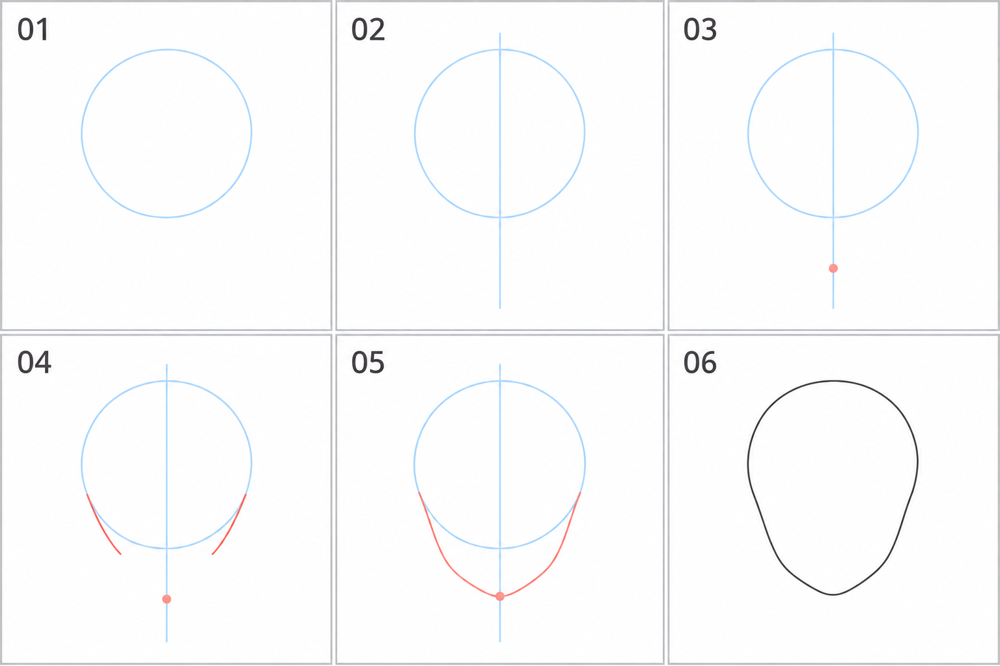

# 01 · 头部起形：从圆到脸颊和下巴

> 本篇只练一件事：画出一个没有头发、没有五官的正面头部外轮廓。
>
> 你需要的基础：能在绘画软件中新建图层、使用画笔和橡皮。
>
> 建议先读一遍，再用二十到三十分钟完成文末练习。可以分两次做。

## 1. 为什么从这里开始？“结构”到底指什么？

你最终想画的是洛琪希的脸。要把眼睛和嘴放好，先需要知道：这张脸有多宽、多长，左右分别在哪里，下巴到哪里结束。

在这一篇里，我们先用几个简单形状，把这些位置安排出来。这一步常被称作“起形”，可以理解为：**先确定大轮廓，再往里面放细节。**

完整的头部结构还包括立体体积、侧面、转头和俯仰等内容。本篇只取其中最小的一步：**正面、平视时的外轮廓。** 今天画的是一个简化的二维轮廓，它是后面理解立体头部的起点。

本篇的方法是“圆形辅助形 + 下方的脸颊和下巴”。这是一种便于入门的画法，不是所有头型都必须套用的公式。圆也不代表真实头骨的精确边界。

## 2. 先看我们要做出的结果



从上排左侧的 01 开始，按 01 → 02 → 03 → 04 → 05 → 06 阅读。

- **浅蓝色：** 帮助定位的草稿线，完成后可以隐藏。
- **珊瑚红色：** 当前新确定的点或线段。
- **深灰色：** 最后保留的外轮廓。

颜色只是为了方便你看懂。你自己练习时，用一支普通笔刷也可以。

这张图由 imagegen 生成并经检查，用来说明顺序。各格有轻微绘制差异，重点是理解新增了什么，而不是测量格子里的像素比例。

## 3. 动笔前，只准备两个图层

在你熟悉的绘画软件里，新建一个约 1600 × 1600 像素的画布。大小可以调整，不影响这次练习。

把两个图层命名为：

```text
轮廓   ← 放在上面，最后整理线条
草图   ← 放在下面，画圆、中心线和定位点
```

选择一支边缘清楚的普通笔刷，颜色用灰色或浅蓝色。线画得稍轻一点，方便修改。缩放到你能舒服地画出一个手掌大小轮廓的程度，不必一直放大到看清每个像素。

**先在“草图”层完成前五步。**

## 4. 第一步：画一个近似的圆——先决定上半部占多大

### 这一步为什么要画圆？

圆给你一个容易比较的起点。它暂时帮助你确定头部上方的大小和左右宽度，接下来再往下延伸出脸部轮廓。

现在不用想眼睛，也不用想发型。注意力只放在一个问题上：**这块形状大概有多宽、多高？**

### 怎么落笔？

1. 在画布中间偏上的位置，轻轻画一个圆，下面留出空间。
2. 可以用几段较长的弧线接起来，不要求一笔闭合。
3. 如果某侧明显鼓出去，就擦掉或重画那一小段。

手画得稍扁、稍歪都可以。你甚至可以先用椭圆工具做一个辅助圆，体验后面的流程，再单独练手画圆。

### 怎样检查？

把画面稍微缩小，看它是否大致接近圆，而不是明显细长的椭圆。检查左右有没有特别突出的鼓包。

**到这里就停。** 一张脸不像，未必是圆不够标准；今天不必把大部分时间花在修圆上。

## 5. 第二步：穿过圆心画中线——给下巴一个对齐依据

### 这条线有什么用？

这次练的是朝向正前方、没有歪头的头部。用一条竖直线标出它的左右中心，你就能判断下巴是否偏到一边。

这里的“中心”是画面上头部左右的大致中间，不是五官的某条固定比例线。

### 怎么落笔？

1. 找圆顶和圆底的大致中间位置。
2. 画一条穿过圆心的竖线。
3. 让线延伸到圆外下方，留出放下巴点的位置。

如果圆不完全对称，先让中线大致把它分成左右两半就够了。

### 怎样检查？

比较中线左边和右边的宽度。如果一侧明显宽很多，先看看是线偏了，还是圆画歪了。

**本篇先把线画直。** 以后头转向侧面时，中线会帮助表达转向，那是另一篇练习。

## 6. 第三步：放下巴点——先决定脸要延伸多长

### 为什么先放一个点，不直接画下巴？

因为点很容易移动。先确定脸部最低处，你再连接左右轮廓，就不会一边画一边不断把脸往下拉。

这一步决定了一个很重要的形状关系：**在圆的大小基本不变时，下巴点越往下，最后的头部轮廓就越长。**

### 怎么落笔？

1. 在圆底下方、中线上的一个位置，轻点一下。
2. 第一次参考图中位置即可，不需要量出固定比例。
3. 暂时把这个点当作脸的最低位置，接下来左右两边都要接近这里。

不要把它放到画布很下面；你只是给圆增加一段下半部，不是在圆下面再接一个同样大的圆。

### 怎样检查？

看“圆顶到下巴点”的整体长度，再和圆的宽度比较。你的目标是一个比宽度略长、下方可以逐渐收窄的形状。

如果拿不准，复制草图，做两个版本：一个下巴点稍近，一个稍远。等接完轮廓，你就能直观看到区别。

**这里没有必须背下来的距离。** 不同角色和画风会有不同的脸部长度，之后要结合具体参考调整。

## 7. 第四步：接出两侧脸颊——先向下，再逐渐收窄

### 为什么不从圆的最宽处直接拉直线到下巴？

因为那样很容易画成“一个圆加一个尖三角”。脸的两侧通常需要有形状变化，而不是两条直线一直交到尖点。

本次示意采用柔和的脸部轮廓：**上面保留一些宽度，往下走时慢慢往中间收。**

### 怎么落笔？

1. 找圆左下和右下的大致对应位置。你可以把它想成钟面上接近 8 点和 4 点的方向，只用于帮助定位，不必量角度。
2. 从左侧画一小段弧线，向下、略向内走。
3. 在右侧画一段相似的线。
4. 两条线先停在接近圆底的高度附近，暂时不急着接到下巴点。

试着让线顺着原来的大轮廓往下延续，避免在接头处突然向外凸出或向内凹进去。

### 怎样检查？

选同样的高度，看看左右两条线分别离中线多远。大致相近就可以，暂时不追求机械式对称。

也可以问自己：从上往下看，宽度是不是逐渐减少？有没有突然出现一个台阶或尖角？

## 8. 第五步：连接下颌和下巴——让线在底部柔和地转弯

这里的“下颌轮廓”，先简单理解为脸部下方两侧连向下巴的边界。本次只画外形，不学习骨骼名称。

### 怎么落笔？

1. 从刚才左侧脸颊线的末端继续向内、向下画。
2. 接近下巴点时，逐渐改变方向，画出小小的圆弧过渡。
3. 从右侧做同样的连接，让两侧在底部连起来。
4. 如果最底下变成了针尖，就把尖端擦掉一点，换成短而柔和的弧线。

这次练习可以让下巴显得偏尖，但不需要成为一个几何三角形的尖角。其他画风当然可以有更方或更尖的下巴，那些变化留到后续比较。

### 怎样检查？

缩小看整体：上部比较圆，下部逐渐收窄，下巴基本在中线上。

你现在会看到圆的下半段还留在脸的内部，像一道弧线。**那是辅助圆，不是脸上需要保留的边界。** 下一步会把它隐藏。

## 9. 第六步：整理外轮廓——决定哪些线要留下

### 怎么做？

1. 降低“草图”层的不透明度，让线变淡。
2. 切换到上面的“轮廓”层。
3. 沿着圆的上半部、两侧脸颊和下巴，画出一条连续的外边界。可以分几笔完成。
4. 不描中心线、不描下巴定位点，也不描内部的圆底弧线。
5. 隐藏“草图”层，看看剩下的轮廓。

现在你应该得到图中 06 那样的简化头型。

如果轮廓局部不顺，可以旋转画布，让落笔方向更舒服，也可以使用适量防抖。整理时仍然要看整体，别为了修一小段线把整张脸越改越窄。

### 怎样检查？

依次只看这三件事：

- 头顶是否有完整、连贯的圆弧？
- 两侧是否逐渐收向下巴，而不是突然折进去？
- 下巴是否大致在左右中心？

满足到“能看懂”的程度，就可以保存。今天先把它当成完成品。

## 10. 画出来怪怪的，先查哪一项？

| 你看到的现象 | 先检查什么 | 可以怎样试着改 |
| --- | --- | --- |
| 像一个很长的鸡蛋 | 下巴点是否放得太远 | 把下巴点向上移一点，重接下面两侧 |
| 像一个球，几乎没有下半张脸 | 下巴点是否太贴近圆底，两侧是否没有收窄 | 适度下移下巴点，让下方轮廓逐渐往内走 |
| 像圆下面粘着一个三角形 | 两侧是否用了过直的线，接头是否突然改变方向 | 放慢收窄，改成连贯曲线 |
| 明明画正面，却像向一边歪 | 下巴点是否偏离中线，左右收窄是否差很多 | 打开草图层，比较同一高度左右的宽度 |
| 下巴像针尖 | 两侧是否直接交成尖角 | 擦掉最尖的一小段，换成短圆弧 |
| 里面有一道奇怪的弧线 | 是否把辅助圆的下半段也描成了轮廓 | 隐藏草图层，检查最终层只保留外边界 |

每次只改一项，然后缩小看变化。为了这次“正面、平视”的练习，我们暂时把左右大致对称作为观察目标；以后画表情和转头时，情况会更丰富。

## 11. 今天只交三张小草图

### A：跟着画一遍

按照 01—06 做一次。在草稿旁标出“圆”“中线”“下巴点”，确认自己知道每一步的用途。约八到十分钟。

### B：保留图解，但自己决定步骤

新开一块空白区域，自己画第二个轮廓。忘记步骤时可以回看，重点是自己做判断。约五到八分钟。

### C：只改变一个变量

复制第二张的草图，保持圆的大小不变，只把下巴点上移或下移一点，再重接脸颊和下巴。约五分钟。

把 B 和 C 放在一起，写一句观察：

> 我把下巴点向______移动后，脸的外形变得更______。

如果还有精力，可以做一次“下巴位置不变、只改变两侧收窄程度”的比较。这是额外练习，不需要今天一起完成。

## 12. 怎样判断可以结束这一篇？

- [ ] 我知道圆只是辅助形，不必成为最终画面的一部分。
- [ ] 我能先找到中线、放下巴点，再连接两侧。
- [ ] 我能指出轮廓太长、太窄或偏向一边的具体位置。
- [ ] 我尝试改变一个位置，并看到了形状变化。
- [ ] 我保存了这次练习，不需要为了第一张线不够漂亮反复重来。

完成这些，就已经实现了这一篇的目标：你开始能够有意识地安排头部外形。

下一篇最自然的小问题是：**“在这个轮廓里，眼睛应该放在哪个区域？”** 先确定摆放位置，再单独学习一只眼睛怎样画、嘴巴怎样画。等到开始转头时，我们再引入球体、侧面和弯曲中线。

> 今天的记录：我最想改的是______；我已经比第一张更清楚的地方是______。

[返回总目录](00-系列总计划与目录.md) · [下一篇：眼睛在脸上的什么位置](02-眼睛在脸上的什么位置.md)
