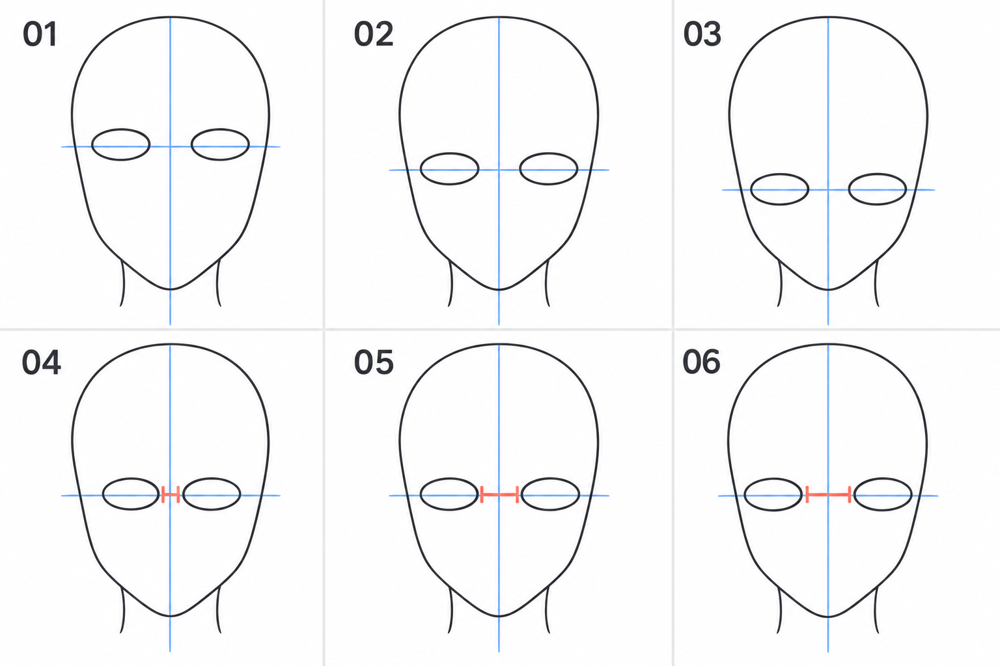

# 02 · 眼睛在脸上的什么位置

> 今天只做一件事：在已经画好的正面头部里，安排两只眼睛的位置。
>
> 前置：[01 · 头部起形](01-头部起形：从圆到脸颊和下巴.md)。本篇用椭圆占位，不需要会画漂亮的眼睛。

## 1. 为什么先决定位置？

一只眼睛单独看很好看，放进脸里却可能不协调。问题有时出在位置：两只眼睛太高、太低、太挤，或者把脸的两侧撑满了。

先用两个简单形状占位，调整起来很轻松。等位置合适，再把它们换成眼睑、虹膜和瞳孔。

**今天只观察三个关系：眼睛在脸上的高度、两只眼睛之间的空隙、眼睛到脸侧的空隙。**

## 2. 看图：上排改高度，下排改间距



| 编号 | 看什么 | 自己练习时固定什么 |
| --- | --- | --- |
| 01—03 | 眼睛从较高到较低的位置变化 | 头型、眼睛大小和左右间距 |
| 04—06 | 两只眼睛从较近到较远的变化 | 头型、眼睛大小和所在高度 |

蓝色竖线表示脸的中线，横线表示本图约定的**眼形中心高度**；红色短标记强调两只眼睛中间的空隙。这里的横线不是所有画法通用的“上眼睑线”。

配图是 AI 生成的关系示意，各格存在微小差异。你练习时复制自己的同一张头部底稿，才更容易做到一次只改一个条件。六格是变化比较，不是正确答案与错误答案。

## 3. 第一步：准备同一个头部底稿

打开第 01 篇的画稿，在头部轮廓上方新建“眼睛占位”图层。保留浅色竖直中线。

今天练正面、平视、没有歪头的脸。先检查下巴是否大致在中线上。头型明显歪斜时，先调整轮廓，避免一边摆眼睛、一边猜到底哪里出错。

可以复制底稿做三份。轮廓保持不动，眼睛在单独图层上画，之后就能只移动眼睛。

## 4. 第二步：先选一条试画的高度

### 从哪里开始？

如果你还没有参考，可以先在“头顶到下巴”的大约中间高度画一条轻横线，作为试画起点。这里说的头顶是头部轮廓顶部，不是头发或帽子顶部。

这不是角色比例的标准答案。二次元头型、眼睛大小和画风都会改变安排；有了喜欢的参考之后，应比较参考中的具体关系。

### 怎么放？

在横线左右两边，各画一个横向椭圆。让横线从两个椭圆的大致中心经过，两个形状高度、宽度先画得相近。

暂时不填瞳孔，不加睫毛。缩小看看椭圆上方留下多少额头区域，下方留下多少脸部区域。

### 怎么检查？

复制一份，把两只眼睛**一起**稍微往上移；再复制一份，一起往下移。一次移动小一点，比较更容易。

问自己：“哪一版更接近我喜欢的参考？哪一版给鼻子、嘴和下巴留下的空间比较合适？”今天还没画那些部件，也可以先观察剩下的空间。

不要在同一次比较里又放大眼睛、又缩短下巴，否则你难以判断变化来自哪里。

## 5. 第三步：安排中间的空隙

先看靠近中线的两个边界，也就是未来的两个内眼角。它们不应该自动贴到中线上，中间需要留出鼻梁所在的区域。

如果不知道从哪里起步，可以暂时让中间空隙接近一只占位眼的宽度，再结合参考调整。这个办法只是让你能开始比较，不是所有二次元角色的定律。

把左眼往左、右眼往右移动，中间空隙会增大；反向移动，空隙会缩小。**保持两只眼睛同时、对称地移动，先别改变眼形大小。**

如果只是想拉开间距，却直接把左眼缩小，就混入了另一个变量。

## 6. 第四步：还要检查两侧有没有空间

从画面左侧到右侧，依次有五块区域：

```text
脸侧空隙 ｜ 左眼 ｜ 中间空隙 ｜ 右眼 ｜ 脸侧空隙
```

这五部分共同占据这一个高度上的脸宽。眼睛越宽，中间空隙或两侧空隙就需要相应调整。

所以，如果你把眼距拉大后，两只眼睛快碰到脸部轮廓了，先停下来。可以减小眼距，或者另存一版、适度缩小两只眼睛后重新比较。不要为了保留某个数字，把眼睛硬塞进头里。

此时最值得看的，是整体空间关系，而不是椭圆是否画得光滑。

## 7. 遇到这些情况，怎么改？

| 现象 | 先检查 | 试着改一项 |
| --- | --- | --- |
| 一边高、一边低 | 两个眼形中心是否在同一条横线附近 | 单独调整偏高或偏低的一只 |
| 五官区域显得挤在中间 | 内眼角之间的空隙是否过小 | 两只眼睛各向外移一点 |
| 眼睛快碰到脸侧 | 五块区域的宽度是否互相挤占 | 先缩小间距，再决定是否调整眼宽 |
| 怎么移动都不协调 | 是否同时改了头型和眼形大小 | 回到同一个底稿，只改高度或间距 |
| 换一张参考就不适用 | 是否把练习起点当成固定公式 | 按新参考比较头宽、眼宽和空隙 |

## 8. 三个小练习

**A，五到八分钟：** 在第 01 篇头型上画两个占位眼，保留中线和横线。能说明每条线表示什么即可。

**B，五分钟：** 复制三份，只改变眼睛高度。选一版，写下你喜欢它的原因，例如“下方空间更接近参考”。

**C，五分钟：** 从选中的版本再复制三份，只改变眼距。比较中间空隙与脸侧空隙，而不是给画面打好坏分数。

## 9. 可以结束的标准

- [ ] 我知道横线在本篇代表眼形中心高度。
- [ ] 我能同时移动两只眼睛，而不重画头部。
- [ ] 我比较了眼距，也检查了脸侧剩余空间。
- [ ] 我能说出一次调整改的是高度、间距还是大小。

保存一个自己愿意继续画下去的版本。下一篇只挑其中一只眼睛，把占位形状换成真正的眼睑外形。

[返回总目录](00-系列总计划与目录.md) · [下一篇：一只眼睛的外形怎么画](03-一只眼睛的外形怎么画.md)
