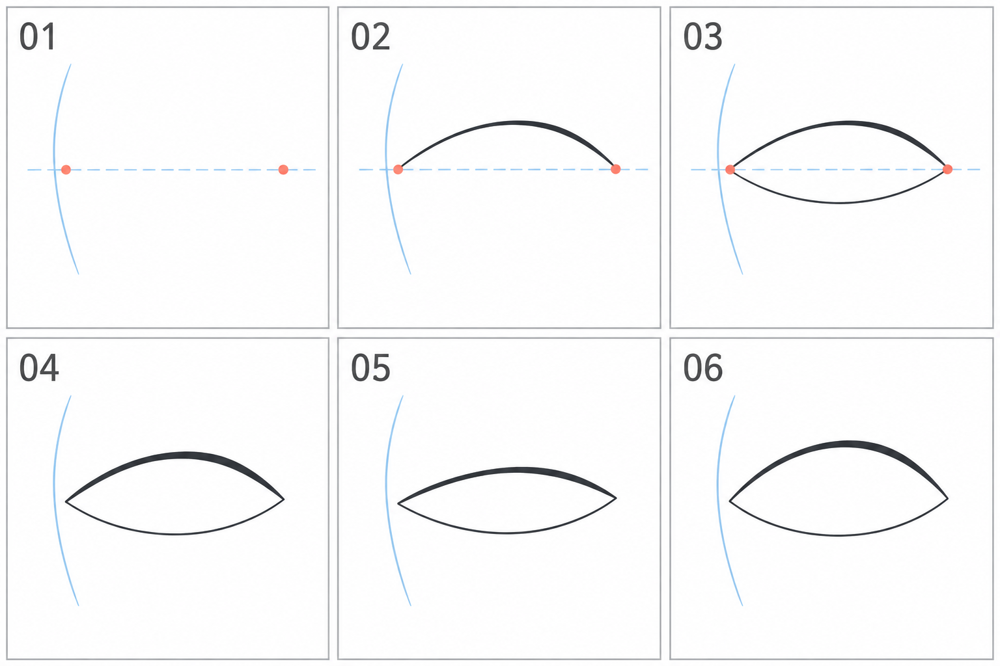

# 03 · 一只眼睛的外形怎么画

> 今天只画眼睛的开口外形：两个眼角、上眼睑和下眼睑。
>
> 前置：[02 · 眼睛位置](02-眼睛在脸上的什么位置.md)。暂时不画虹膜、瞳孔和复杂睫毛。

## 1. 先认识今天要画的四个部分

你看到的眼睛外形，可以先概括为四个部分：靠近鼻子的内眼角、远离鼻子的外眼角、上方的眼睑边界、下方的眼睑边界。

“眼睑”就是眼皮。今天画的是眼皮围出的可见开口，不是整个眼球的外轮廓。把它想成一个有上下边界的窗口，有助于理解下一篇的遮挡。

为方便讲解，本图画的是**画面右侧的那只眼睛**：图内左边靠近鼻子，右边靠近脸侧。另一只眼睛的方向相反。

## 2. 看图：先定两端，再连上下边界

| 编号 | 当前做什么 |
| --- | --- |
| 01 | 用两个点确定内外眼角和眼睛宽度 |
| 02 | 在两点之间画上眼睑 |
| 03 | 加一条较浅的下眼睑弧线 |
| 04 | 整理线条，让上边界稍重、下边界较轻 |
| 05 | 对比开口较窄的眼形 |
| 06 | 对比开口较高的眼形 |

左侧蓝色竖向弧线只提示靠鼻子的一侧，不是需要画进眼睛里的部件。04—06 用来比较开口大小；生成图有细微边界差异，自己练习时保持两眼角和下边界不变，只移动上边界。

## 3. 第一步：两个点决定这一只眼睛占多宽

在新图层上画一条很淡的短横线，标两个点。先把它们看作内外眼角，距离就是眼睛的大致宽度。

刚开始让两点在差不多的高度，比较容易。喜欢的画风可能让外眼角略高或略低，这个变化可以之后再试。

**为什么先画点？** 如果直接画一条很长的漂亮弧线，你可能最后才发现眼睛占得太宽。先定两端，就能把线限制在已决定的区域内。

检查时，把它放回第 02 篇的占位区域：两个点有没有明显超出原来的安排？有的话，先改点的位置。

## 4. 第二步：画上眼睑，先找到最高处

在两个点上方轻点一个位置，作为这次上眼睑弧线的最高区域。它可以略偏向一侧，不必永远在正中间。

从内眼角开始，线条向上拱，到高处后再向外眼角落下。可以用两段弧线完成，不要求一笔画出。

用眼睛沿着这条线走一遍：有没有突然鼓出一个尖包？有没有在接笔处凹进去？先把明显断裂或突兀转折整理掉。

**这一步只决定大形。** 上边界可以有柔和转折，动漫眼睛也不一定是完美圆弧。暂时不要用很多睫毛掩盖轮廓。

## 5. 第三步：画下眼睑，围出内部空间

从内眼角向下绕出一条浅弧，再接向外眼角。作为本次示例，下弧比上弧平一些，这样眼睛不会像一个对称的叶片。

你现在得到的是封闭或近似封闭的眼部开口。正式二次元线稿里，下边界可以断开、变轻甚至部分省略；初学先把完整开口理解清楚。

**检查内部的白色形状。** 它的宽高是否接近你想要的眼形？如果内部太窄，就先调整边界，别急着往里面塞虹膜。

画歪时不一定要重来整只眼睛。只擦掉最影响形状的一小段，重新连接。

## 6. 第四步：稍微区分上下线的轻重

把上眼睑略微加重，下眼睑保持较细。这个处理有助于读出上方边界，但不是所有画风都必须使用的规则。

如果软件压感还不顺，你可以先画普通细线，再在上边界局部补一点厚度，不必强求一笔粗细自然变化。

线条加粗会吃掉内部的白色空间。如果越描越像一条黑条，先退回较轻版本，看看是不是加得太多。

今天可以不画任何单根睫毛。让轮廓有清楚的起止和变化，已经完成主要任务。

## 7. 只改一个条件：上眼睑的高度

复制完成的眼形三份。第一份不动，第二份把上眼睑压低一点，第三份把上眼睑抬高一点。内外眼角和下眼睑尽量不动。

这能帮助你分辨“眼睛变窄”与“眼睛整体缩小”：前者改变的是开口，后者会连眼宽一起改变。

不同开口会影响神态，但此时还没有眉毛和虹膜，不急着给每一种形状贴上固定情绪标签。先说得具体些：“这一个上边界更低，可见区域更窄。”

## 8. 常见问题

| 现象 | 可能需要检查的地方 | 试改方法 |
| --- | --- | --- |
| 像规则叶片 | 上下弧线是否完全一样 | 让下弧浅一些，再比较内部白形 |
| 像尖锐菱形 | 是否全用直线硬接 | 把一两处转折改成较柔和的曲线 |
| 线越来越黑，形状越来越小 | 是否反复在内侧加粗 | 回退，先修边界，再少量改变线重 |
| 眼角接不上 | 起止点是否被不断移动 | 重新标两端，只重接出问题的一段 |
| 单眼漂亮，放进脸里太大 | 是否忘了原来的占位范围 | 缩小或重画到既定区域，再看整体 |

## 9. 三个小练习

**A：** 按 01—04 画一只简单眼形，约十分钟。先完整连出开口，再考虑省略下边界。

**B：** 另画一只，不逐笔照抄。先定眼角，再决定上下弧线。约五分钟。

**C：** 复制 B，只改上眼睑高度，得到窄、中、较高三种开口。约五分钟。

结束前检查：我能指出内外眼角吗？我知道哪些线在围出开口吗？我有没有先检查位置，再加重线条？

下一篇会把虹膜和瞳孔放进这个开口里。今天画好的眼形可以直接继续使用。

[上一篇：眼睛位置](02-眼睛在脸上的什么位置.md) · [返回总目录](00-系列总计划与目录.md) · [下一篇：虹膜和瞳孔](04-虹膜和瞳孔放在哪里.md)
