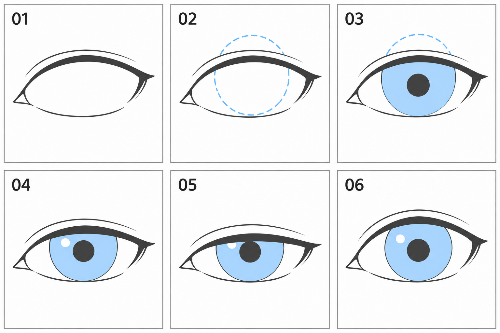

# 04 · 虹膜和瞳孔放在哪里

> 今天只练一个关系：眼睑遮住虹膜，虹膜中间有瞳孔。
>
> 前置：[03 · 眼睛的外形](03-一只眼睛的外形怎么画.md)。准备一只已经画好开口的正面眼睛。

## 1. 先把几个名字分清

- **眼睑：** 上下眼皮，围出我们能看见的眼部开口。
- **虹膜：** 眼睛里有颜色的部分；在二次元里常画成蓝色、紫色或其他色彩。
- **瞳孔：** 虹膜中央的深色区域，常用较小的深色圆形或椭圆来概括。
- **眼白：** 虹膜外侧、开口内可见的浅色区域。
- **高光：** 表示反光的亮点，不是瞳孔，也不必在今天加上。

本篇采用正面、视线较平的简化圆形虹膜。某些风格会拉长或改造虹膜形状；先用容易观察的形状理解遮挡，再研究风格变化。

## 2. 看图：完整辅助形与最后看得见的部分

| 编号 | 观察重点 |
| --- | --- |
| 01 | 只有眼睛开口，内部仍是空白 |
| 02 | 蓝色虚线先表示完整虹膜辅助圆，包括被遮挡的部分 |
| 03 | 加虹膜颜色和瞳孔，仍保留部分辅助线用于理解 |
| 04 | 隐藏被眼睑遮住的轮廓，得到完成示意 |
| 05 | 上眼睑更低，看见的虹膜更少 |
| 06 | 上眼睑更高，看见的虹膜更多 |

图中上方另外的细弧线是风格化的眼皮褶皱示意，不是眉毛，今天可以不画。各格为生成示意，不是严格对齐的动画帧；练习要在自己的同一底稿上保留虹膜大小，再改遮挡。

## 3. 第一步：先画完整的辅助圆

在眼睑线稿下面新建“虹膜草图”层。先在眼睛开口中间画一个圆，让它的上方有一部分超过上眼睑。

现在超过边界没有关系，因为你是在画辅助形。这一步让你知道被眼皮挡住的部分仍然延续成一个完整形状。

不要只照着剩下的白色区域画一个被挤扁的圆。虹膜的辅助形状和眼睛开口是两个不同的东西。

**检查：** 这个圆是否给左右留出了可见的眼白？是否大到把眼睛整个塞满？先比较虹膜与眼宽，再决定大小。

有些角色的虹膜很大，另一些较小。第一遍可以参考图中的关系，不要把它当成固定占比。

## 4. 第二步：在虹膜自己的中心放瞳孔

找到刚才完整辅助圆的大致中心，画一个更小的深色圆形。

注意：中心指的是**完整虹膜的中心**，不是“被眼皮遮过以后剩余色块的视觉中心”。如果上面被遮住了，不能为了让瞳孔居中于剩余色块，就自动把它向下挪。

画的时候可以暂时显示完整辅助圆，再隐藏一次，来回检查。

瞳孔一开始画得小一点、颜色深一点就够了。不需要同时添加很多亮点和纹理，否则很难看清位置是否合适。

## 5. 第三步：只留下开口里能看见的部分

把完整虹膜辅助层复制或保留备份。在工作层上，擦掉眼睑外侧的虹膜线与颜色。

如果你熟悉选区，也可以先选中眼部开口，再在选区内上色。初学使用橡皮清理同样可以，暂时不需要复杂蒙版。

上眼睑边界应当在虹膜前面，视觉上把虹膜上方挡住。下眼睑如果也遮到虹膜，按同样关系处理。

**检查：** 有没有一段蓝色圆弧画到了眼皮上方？有没有颜色漏到开口以外？那通常是辅助线或多余颜色没有清掉。

## 6. 第四步：比较“遮得更多”和“虹膜缩小”

复制这只眼睛。保持虹膜和瞳孔不动，只把上眼睑的边界向下移一点，并相应遮住更多虹膜。

你会发现，眼睛可以显得半闭，而虹膜本身不需要缩成一个小圆。

再复制一份，把上眼睑稍微抬高，就能露出更多虹膜。至于虹膜上方要不要露出明显眼白，要结合表情与画风判断；露白较多可能让神态更紧张或惊讶，不是越完整越正确。

此时还不用做动画。只是轮流隐藏、显示两个版本，观察变化来自哪条边界。

## 7. 高光什么时候加？

等位置、大小和遮挡关系已经清楚，可以在最上方单独加一个小亮点。它能帮助表达光泽，但不会自动修正不协调的虹膜。

暂时让亮点小一些，不遮住整个瞳孔。双眼的高光与光照关系会在后面继续处理；今天做单眼练习，完全可以不加。

## 8. 常见问题与修正

| 现象 | 先检查 | 可以怎么改 |
| --- | --- | --- |
| 像一个圆贴在眼皮外面 | 虹膜上边界是否越过上眼睑 | 清掉被遮住的圆弧和颜色 |
| 半闭眼时虹膜被压扁 | 是否直接垂直缩放了整个虹膜 | 恢复原形，改眼睑遮挡 |
| 瞳孔看起来飘在虹膜边缘 | 是否按可见色块而非完整虹膜找中心 | 显示辅助圆，重查中心 |
| 显得特别瞪眼 | 虹膜是否过小、上方露白是否过多 | 分别试着加大虹膜或降低上眼睑 |
| 加了很多高光还是不自然 | 是否跳过位置和大小检查 | 暂时隐藏高光，回到基础形状 |

## 9. 三个小练习

**A，十分钟：** 在上一课眼形里画完整辅助圆，加瞳孔，再清除被遮住的部分。保存能看见辅助圆的一版和完成版。

**B，五分钟：** 另画一只眼睛，从眼睑开口开始自己完成一次。给自己讲清楚哪一层在前、哪一层在后。

**C，五到十分钟：** 复制同一眼睛，只降低上眼睑。确认虹膜和瞳孔的位置、大小没有跟着乱动。

可以结束时，你应当能够指出眼睑、虹膜、瞳孔和眼白，并解释“被遮住”与“变小”的区别。

下一篇把两只眼睛放回同一张脸，检查高度、大小和视线是否协调。

[上一篇：眼睛外形](03-一只眼睛的外形怎么画.md) · [返回总目录](00-系列总计划与目录.md) · [下一篇：两只眼睛怎样配成一对](05-两只眼睛怎样配成一对.md)
