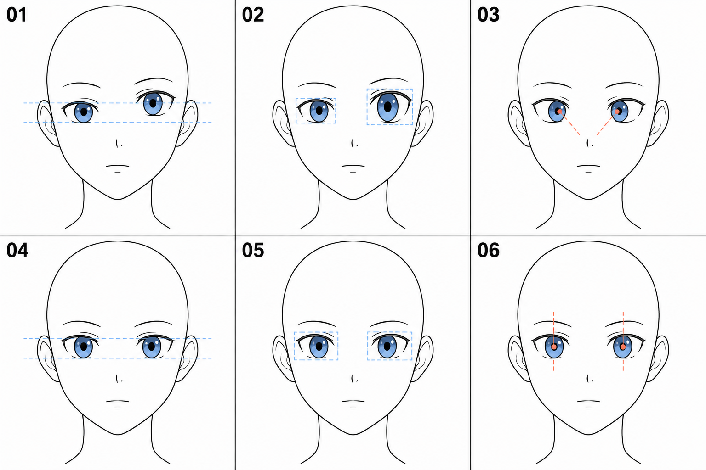

# 05 · 两只眼睛怎样配成一对

> 今天只练一件事：让同一张正面脸上的两只眼睛，在高度、大小和视线方面协调。
>
> 前置：[02 · 位置](02-眼睛在脸上的什么位置.md)、[03 · 眼形](03-一只眼睛的外形怎么画.md)、[04 · 虹膜与瞳孔](04-虹膜和瞳孔放在哪里.md)。

## 1. 为什么单眼画好了，放成一对还会不协调？

当你长时间放大左眼，只关注细节，切到右眼时很容易换一套宽度、开口高度或虹膜大小。两只单独看都成立，放回脸里却不属于同一套安排。

这次我们把画面缩回能同时看见双眼的大小。**先比较两只眼睛之间的关系，再修改其中一只。**

本篇限定在正面、平视、平静神态。转头时两眼会有透视差异，眨眼时开合也可以不同；这些情况后面再练。

## 2. 看图：每一列只检查一种关系

| 上下对应 | 当前检查什么 | 先看哪里 |
| --- | --- | --- |
| 01 与 04 | 双眼的高度关系 | 上下边界与水平辅助线 |
| 02 与 05 | 双眼的尺寸关系 | 包住眼睛的简化边界框 |
| 03 与 06 | 虹膜、瞳孔的位置关系 | 两眼内侧和外侧的眼白分布 |

图中鼻子、眉毛和嘴只提供整脸语境，尚未学到可以先忽略。红色标记用于突出瞳孔位置与比较方向，不是实际视线光路。生成图存在微小变化，自己练习时固定底稿，再做指定调整。

## 3. 第一步：同时画两只眼睛的大形

保留第 02 篇的中线和眼部参考线。在两个占位区域里，先都画上眼睑，再都画下眼睑。

这种交替进行的方法方便你及时比较。你可以先画一只，再立即画另一只，但不要等第一只已经画满高光和睫毛才开始第二只。

比较四个眼角的位置，以及两边眼睛离脸侧的空隙。如果一边明显挤到轮廓上，先回到位置关系，而不是继续细化。

## 4. 第二步：查高度，先选同一种位置来比较

你可以用上眼睑最高处比较，也可以用两只眼睛开口的中间高度比较。关键是不要拿左眼的眼角去对右眼的最高处。

临时画一条横线，穿过你选的比较位置，看另一只眼睛的对应位置偏上还是偏下。

如果整只眼睛都高了，可以选中眼睑、虹膜与瞳孔一起移动；如果只有上眼睑过高，则改上边界就够了。

**先判断是“整只眼移位”，还是“开口形状变了”。** 两种问题的改法不同。

## 5. 第三步：查大小，用一个想象中的外框

给两只眼睛各套一个简单矩形：左到右包住内外眼角，上到下包住眼部开口。图 02、05 的蓝框就是为了说明这个比较方法。

先比宽，再比高。前者主要影响占据脸部的空间，后者影响开口程度。

如果右眼整体比左眼大，可以缩小右眼或重画到相近范围；如果只是右眼更睁开，就单独调整眼睑。

不要求每个像素镜像相同。我们的目标是让你能控制差异，而不是无意中画出两套大小。

## 6. 第四步：查视线，观察虹膜周围的空隙

把两只虹膜和瞳孔先安排在比较自然的正视状态。分别观察每只虹膜靠鼻子一侧和靠脸侧一侧剩多少眼白，再把两只一起看。

如果把两只虹膜都挤向鼻子，容易读成向内集中；如果一只靠上、一只靠下，也可能让视线不协调。需要结合眼形、头部角度和想看的目标判断，不能只用“瞳孔必须在开口正中”来套所有情况。

本次只做平静的正面练习。有疑问时对照一张清楚的正面参考，先模仿它的大致眼白分布。

移动虹膜时，瞳孔作为虹膜的一部分跟着移动。不要只把深色瞳孔单独拖到虹膜边缘；同时继续清理超出眼睑的部分。

## 7. 可以复制和翻转吗？

可以。复制一只眼睛并水平翻转，是数字绘画里方便的起点。它能帮助你先检查位置，也适合把精力放在这一课的配对关系上。

复制后仍要看整体：内外眼角方向是否正确，眼距是否合适？如果复制内容里有高光，镜像后高光方向也会反过来，可以先隐藏高光再检查。

练习手画双眼时，也可以把镜像版本作为比较参考，再自己画一遍。工具辅助和手绘练习可以并用。

## 8. 常见问题

| 现象 | 先分辨 | 修改顺序 |
| --- | --- | --- |
| 一只明显更高 | 是整体移动，还是上眼睑更高 | 先改位置，再看开口 |
| 一边总显得更大 | 眼宽、开口高度、虹膜直径哪一项不同 | 一次只改其中一项 |
| 像在看两个方向 | 虹膜与瞳孔是否各自乱移 | 用同一参考检查视线关系 |
| 改完眼睛，眉毛显得奇怪 | 眉毛仍留在修改前的位置 | 先稳定双眼，下一篇再安排眉毛 |
| 画面越修越乱 | 是否同时改了所有部件 | 回到副本，只处理最明显的问题 |

## 9. 三次小练习

**A，十分钟：** 画一对不带高光的眼睛，画出临时高度线，检查位置和大小。

**B，五分钟：** 复制一版，故意把右眼往上移一点。再把它修回去，体验“找出问题—指定改法”的过程。

**C，五到十分钟：** 另存一版，只改变一只眼睛的开口高度；判断这次应该移动整眼，还是只改眼睑。

可以结束时，你应当能分开检查高度、大小、视线，并能说出自己修改的是哪一种。

[上一篇：虹膜和瞳孔](04-虹膜和瞳孔放在哪里.md) · [返回总目录](00-系列总计划与目录.md) · [下一篇：眉毛](06-眉毛怎样放在眼睛上方.md)
