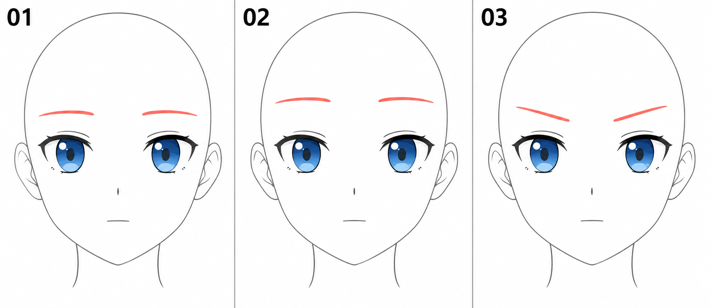

# 06 · 眉毛怎样放在眼睛上方

> 今天只练眉毛的位置和方向，观察它怎样改变同一张脸的神态。
>
> 前置：[05 · 双眼配对](05-两只眼睛怎样配成一对.md)。准备同一双眼睛，其他部件先保持不动。

## 1. 眉毛先当成一条有方向的短带

靠近鼻子的一端叫眉头，远离鼻子的一端叫眉尾。初学先用一条线或一条窄色带表达，不用逐根画眉毛。

它有几个容易调整的条件：整体高度、倾斜方向、弯曲程度和长度。**今天先固定长度与粗细，主要比较高度和倾斜。**

眉毛不是上眼睑，也不是贴着上眼睑的那条眼皮褶皱。它位于更上方，和眼睛之间留有空间。

## 2. 看图：眼睛不变，眉毛怎样影响感觉？

| 编号 | 眉毛变化 | 观察方式 |
| --- | --- | --- |
| 01 | 较平缓的基准眉形 | 先记住眉毛与上眼睑之间的距离 |
| 02 | 整体向上抬起 | 比较额头区域和眉眼空隙的变化 |
| 03 | 靠鼻子的一端降低，外侧相对抬起 | 比较眉毛斜向带来的紧张、专注或不满感 |

珊瑚红用于强调眉毛，不表示最终必须用这个颜色。图中的眼睛已有细节，你自己可以用简单版。配图用于比较趋势，不作为严格不变的逐像素模板。

情绪还受眼睑、嘴部、姿势和场景影响，不能把一种眉形永远对应成一个固定情绪。这里先练“位置改变了，感觉也会变化”。

## 3. 第一步：在眼睛上方找一块空间

新建“眉毛”图层。在一只眼睛上方，轻轻画一条短线，暂时让它大致顺着眼睛走向，保持放松、轻微的弧度。

别急着把线加粗。缩小看它离上眼睑是否近到快黏在一起，或者高到像漂在额头中央。

如果拿不准，先参考你喜欢的角色正面画面，比较的是“眉眼之间的空隙”和“眼睛自身的高度”，而不是只记住像素距离。

头型大小变了，像素距离也会变；部件之间的相对关系更值得观察。

## 4. 第二步：放上另一侧眉毛

在另一只眼睛上方画出对应眉形。先比较左右眉头的高度，再比较眉尾的方向。

这次做平静、正面的基准练习，两边先安排得相近。以后可以抬一边眉毛表达疑惑，但今天先把有意变化和无意画歪区分开。

如果你发现眼睛本身一边高一边低，回到上一课处理，不要靠把眉毛也画歪来补偿。

## 5. 第三步：只抬高，不改变眉形

复制基准版本，把两侧眉毛作为整体向上移一点。长度、粗细和弯曲程度先不变。

轮流显示修改前后。你会更清楚地看见，变化来自眉眼空隙，而不是眼睛突然变大。

移动幅度先小一些。如果一下抬得很高，只能看到强烈差别，却不容易学会控制轻微神态。

可以写一句：“眉毛抬高后，我觉得这张脸更像______。”允许不同人有不同判断，但尽量说清楚观察到的变化。

## 6. 第四步：只改变倾斜方向

回到基准版本。保持眉毛在原来的大致区域，把靠鼻子的眉头向下压一点，让眉尾相对更高。

两侧都做同一种相对变化：左边眉头靠中间，右边眉头也靠中间。不要把两条眉毛朝同一个画面方向旋转，否则会变成另一种不对称神态。

再试着把眉头稍微抬起、眉尾相对降低，感受变化。这个额外版本可以帮助理解方向，但不必今天画满各种表情。

## 7. 什么时候开始画眉毛的粗细？

位置和方向确定后，可以让短带一端稍厚、另一端渐细。先观察你选的画风，不必统一规定哪一段必须多厚。

线条过重会抢走注意力。如果想保留轻柔的角色感觉，可以先用较细、较浅的眉形比较。颜色和浓淡同样属于表达选择，不是技术分数。

## 8. 常见问题

| 现象 | 可能原因 | 可以怎么做 |
| --- | --- | --- |
| 像多画了一条上眼线 | 眉毛太贴近眼睑，或混淆了褶皱 | 把眉毛单独上移，重新看空隙 |
| 总像在生气 | 眉头无意中压得很低，斜度较大 | 先恢复平缓眉形，再逐步加倾斜 |
| 左右神态不一致 | 对眉头、眉尾的方向理解反了 | 先标鼻子侧，再比较两端 |
| 抬眉后像换了角色 | 同时改了眼睛、眉宽和嘴 | 回到同一底稿，只移动眉毛 |
| 一条眉毛画很久 | 太早进入单根毛发细节 | 暂时改成短线或窄色带 |

## 9. 三个小练习与检查

**A：** 用五到八分钟，在已有眼睛上方画一对平缓眉毛。

**B：** 复制一版，只抬高两侧眉毛。保持其他部件不动。

**C：** 回到基准版，只压低眉头，比较倾斜前后。用五分钟写下两个版本分别带来的感觉。

完成时检查：我分得清眉头和眉尾吗？我能单独改高度吗？我能单独改斜度吗？如果能，就保存基准版，后面做表情时继续使用。

[上一篇：双眼配对](05-两只眼睛怎样配成一对.md) · [返回总目录](00-系列总计划与目录.md) · [下一篇：鼻子定位](07-简化的鼻子怎样定位.md)
