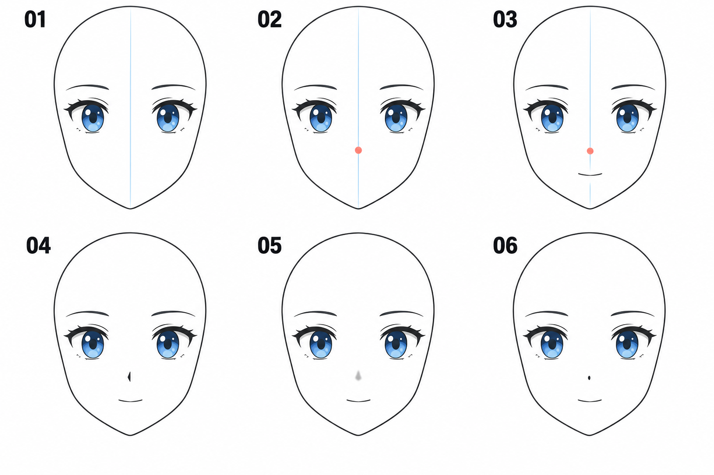

# 07 · 简化的鼻子怎样定位

> 今天只解决正面脸上鼻子的基本位置，并用一个很小的标记表达它。
>
> 前置：[06 · 眉毛](06-眉毛怎样放在眼睛上方.md)。不要求先学会写实鼻子，也暂时不画侧脸。

## 1. 为什么二次元鼻子只有一点或一小笔？

绘画可以省略细节，用少量线条或明暗提示体积。在某些二次元画风里，正面鼻子会被简化得很小，让注意力集中在眼睛和表情上。

省略不意味着可以随便放。即使只有一小笔，它仍然和中线、眼睛、嘴、下巴保持关系。

今天先做一个定位点，再决定用短线还是小色块表现。你不需要把鼻子的完整结构压缩到这一篇里学完。

## 2. 看图：先定位置，再选择表达方式

| 编号 | 这一格的作用 |
| --- | --- |
| 01 | 保留中线和双眼，鼻子区域还是空白 |
| 02 | 在中线上标一个小定位点 |
| 03 | 加一条简单嘴部占位，检查剩余空间 |
| 04 | 用短而略有方向的一笔表达鼻子 |
| 05 | 用很小的明暗色块提示鼻子 |
| 06 | 用接近点状的记号作极简表达 |

红点是定位记号，不是最后必须画在脸上的颜色。图中的嘴只是帮助观察空间，这一课画一条轻短线即可，下一篇再认真练嘴形。

配图为生成示意，04—06 展示可选的简化方式，不是画得越复杂越高级。

## 3. 第一步：确认中线指的是脸的朝向

打开你已有的正面脸草图。让浅色中线从额头区域延伸到下巴附近。

今天的头没有转向，所以鼻部定位先放在中线附近。如果未来头转向一侧，中线与鼻子的关系会改变，那时不能继续套用今天这条笔直线。

先检查两只眼睛是不是分布在中线两侧。如果眼睛本身全偏到一边，单独把鼻子放在纸张正中并不能解决问题。

**要对齐的是这张脸的中间，不一定是整个画布的中间。**

## 4. 第二步：在眼睛下方选一个试放的位置

观察眼部区域下方到下巴的空间。在这段空间里轻放一个点，给它下方的嘴和下巴留出余地。

没有参考时，可以先把点试放在“眼部下方至下巴这段距离”的中间附近，再准备嘴部占位后微调。它只是试画起点，不是人体比例公式。

如果使用洛琪希的参考，就比较眼睛下缘到鼻子标记有多远、鼻子到嘴有多远、嘴到下巴还剩多少。先观察三段关系，再决定定位。

这一步只画一个轻点，方便移动。不要刚放下就描成很黑的一块。

## 5. 第三步：加嘴部占位，检查空间分配

在鼻子点下面画一条很短的横线，作为嘴的大致位置。

现在从上往下看：眼睛、鼻子、嘴、下巴。问自己：鼻子是不是快贴到嘴？嘴下面有没有留出下巴区域？鼻子是否离眼睛特别近，让中间挤成一团？

如果不合适，移动鼻子点或嘴的占位，先一次只改一个。别把头部轮廓、眼睛和鼻子同时大改，容易失去比较依据。

**这一步的目的，是在很轻的草稿阶段发现空间问题。**

## 6. 第四步：把定位点换成小标记

你可以从三种方式里任选一种开始：

- **短线：** 在定位点附近画一小段略带方向的线，长度保持克制。
- **小色块：** 用一小块较浅的灰色或之后的肤色阴影，提示鼻尖附近的明暗。
- **点状概括：** 用很小的记号提示鼻子存在，适合高度简化的练习。

选择表达方式时，位置先保持不变。这样你就能比较风格差异，而不是又开始改变整张脸的比例。

表示鼻部阴影的笔触，可以略偏到定位中心的一侧，因为它在提示一个局部面；这和把整个鼻部位置画歪是两回事。今天可以先照示意轻画，光照方向以后再展开。

## 7. 为什么不从两眼之间画一条长线下来？

当然有画风会清楚画出鼻梁，但如果你想要的是这次示例中的简化正面脸，一条长而黑的鼻梁线可能会改变画面的细节密度和风格。

初次练习可以先省略鼻梁，缩小画面看小标记是否已经足够。想增加线条时，先问自己：这一笔是在说明哪个边界或哪个面？

之后学侧转，鼻子的突出与遮挡会变得更重要，我们会用另外一篇处理。

## 8. 常见问题

| 现象 | 先检查 | 可以怎样试改 |
| --- | --- | --- |
| 鼻子很抢眼 | 是否太大、太黑或鼻梁线太长 | 先减小标记、减轻颜色 |
| 鼻子像偏到脸边 | 定位点是否偏离脸的中线 | 打开辅助线，先移动定位点 |
| 鼻嘴挤在一起 | 两个标记之间是否几乎没空隙 | 小幅调整一者，比较三段距离 |
| 下半脸显得特别长 | 是鼻嘴位置靠上，还是下巴太长 | 分开检查位置与头型，不急着一起改 |
| 换成阴影块后像脏点 | 色块是否太大或边界过重 | 先用更小、更轻的形状尝试 |

## 9. 三个小练习

**A，八分钟：** 在已有脸上找到中线，放鼻子点，加一条嘴部占位，检查空间关系。

**B，五分钟：** 复制一版，只把鼻子略向上或向下移动，比较它与眼睛、嘴的距离变化。

**C，五分钟：** 恢复你选中的位置，做短线和小色块两个版本。只改表达方式，不改位置。

结束前，你应当能指出鼻部定位点，解释为什么它放在那里，并区分“移动鼻子”与“改变鼻子的画法”。

[上一篇：眉毛](06-眉毛怎样放在眼睛上方.md) · [返回总目录](00-系列总计划与目录.md) · [下一篇：闭合的小嘴](08-闭合的小嘴怎么画.md)
