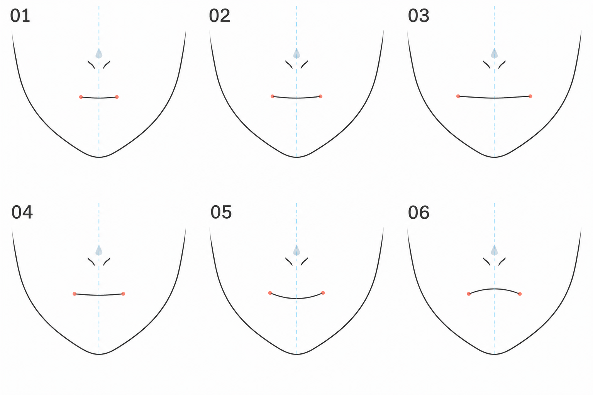

# 08 · 闭合的小嘴怎么画

> 今天只用一条简洁的线，画出闭合的小嘴，并比较它的宽度与嘴角变化。
>
> 前置：[07 · 鼻子定位](07-简化的鼻子怎样定位.md)。使用同一张正面、平视的脸。

## 1. 一条线画的是什么？

在这类简化二次元画法里，小嘴上的线主要提示上下嘴唇闭合处的关系，不是要求你把嘴唇的完整外轮廓描一圈。

写实嘴唇还有体积和明暗，本篇先省略。**我们先看嘴放在哪里、有多宽、两端怎样变化。**

“小嘴”也不代表越小越可爱。它需要和眼睛、脸宽、角色表情放在一起判断。

## 2. 看图：先改宽度，再改弯曲

| 编号 | 主要比较内容 |
| --- | --- |
| 01—03 | 大致相同位置，嘴从较窄到较宽 |
| 04 | 接近平缓的基准嘴形 |
| 05 | 嘴角相对中段抬起，形成轻微笑意 |
| 06 | 嘴角相对中段降低，形成另一种神态 |

红点强调嘴角，蓝线是脸部中线。鼻子和下巴只是空间参照，图中的鼻部细节可以忽略。配图为生成示意，各格不是精确测量模板。

不要把 05 理解成整张嘴一起向上移。这里讨论的是两端与中段的相对高度变化。

## 3. 第一步：找嘴所在的位置

打开上一课的草图。在鼻子下方、下巴上方找到嘴部占位线。如果之前没有画，就先放一小段轻横线。

比较两个空隙：鼻子到嘴，嘴到下巴。参考图中的分配通常比背一个统一比例更有用。

先让嘴的大致中心落在正面脸的中线附近。这次练平静正面，不刻意做偏向一边的笑容。

把画面缩小，看嘴是否挤到了鼻子下面，或掉到快碰下巴的位置。位置合适后，先固定下来再练形状。

## 4. 第二步：用两个点确定嘴角

在占位线左右各点一个小点，表示两个嘴角。它们之间的距离，就是这次想画的嘴宽。

可以先取比单只眼睛宽度更小的一段作为尝试，再对照具体角色调整。这里只是为了从小范围开始，不是所有角色的标准。

从这两个点的中间向上看，是否大致对着鼻子和脸的中线？如果明显偏了，先移动两个点的位置。

用点确定两端，比一笔画完后才发现嘴太宽更容易修改。

## 5. 第三步：用一条轻线连接

从一端连接到另一端，可以接近平直，也可以带很轻的弧度。不要为了“看起来像嘴”，马上加很多褶皱和嘴唇边线。

这条线可以分两笔画。接头处别突然变粗，嘴角也不必画成两个很大的黑点。

线画得太重时，小嘴会成为脸上最显眼的地方。可以用较细笔刷、稍浅颜色，或者减少重复描线。

**检查方法：** 把画面缩回整张脸大小。如果你第一眼只能看到嘴的一大块黑色，先检查线重和尺寸。

## 6. 第四步：固定位置，只比较宽度

复制基准版。保持嘴中心和高度大致不变，把两个嘴角向外各移动一点，再重新连接。

另一版则把两端往内收。这样你得到窄、中、宽三个版本。

比较它们与脸宽和眼睛大小的关系。选一个更接近你希望表达的角色感觉的版本，写一句理由。

不要同时缩短下巴、移动鼻子，否则宽度变化的效果会被混在一起。

## 7. 第五步：固定宽度，只改变嘴角与中段的关系

回到基准版。两端宽度先不动，让线的中间略低于嘴角，会得到柔和的上扬嘴角效果。

再试另一版，让中间略高、两端相对较低，比较不同感觉。弯曲幅度保持小一些，先练轻微差别。

本次没有同步修改眼睛和眉毛，所以可能出现情绪不完全一致的情况。这正是后面表情课要处理的内容。今天先学会控制嘴形本身。

## 8. 下嘴唇那条小线要不要画？

有些画法会在嘴下面加一小段线或明暗提示下唇体积。它不是必须项，也不是第二张嘴。

第一遍可以省略。想加时，让它更短、更轻，和主嘴线保持清楚区分。如果加了之后像重复画了两张嘴，就先隐藏，回到一条线版本。

## 9. 常见问题

| 现象 | 先检查 | 一次试改一项 |
| --- | --- | --- |
| 像一条很黑的横杠 | 线重是否过大 | 减细或减轻线条 |
| 嘴显得歪向一边 | 两端的中点是否偏离中线 | 整体移动，不急着重画形状 |
| 微笑变成很夸张的弯月 | 弧度是否过大 | 先减小中段与嘴角的高差 |
| 小嘴像贴在脸上的符号 | 位置是否与鼻子、下巴不协调 | 回到整体距离，检查上下空间 |
| 加了唇线反而乱 | 次要线是否与主线一样重 | 隐藏次要线，再判断是否需要 |

## 10. 三次小练习与结束标准

**A，八分钟：** 在已有脸上标嘴角，画一条平缓闭嘴线。只检查位置、宽度和线重。

**B，五分钟：** 复制三版，只比较窄、中、宽。

**C，五到八分钟：** 固定你选中的宽度，比较平缓、嘴角微抬、嘴角微降三个版本。

可以结束时，你应当能分别调整嘴的位置、宽度和弧度，而不是每次只能全部重画。保存平静版，下一课会在这个区域里画小开口。

[上一篇：鼻子定位](07-简化的鼻子怎样定位.md) · [返回总目录](00-系列总计划与目录.md) · [下一篇：张开的小嘴](09-张开的小嘴怎么画.md)
