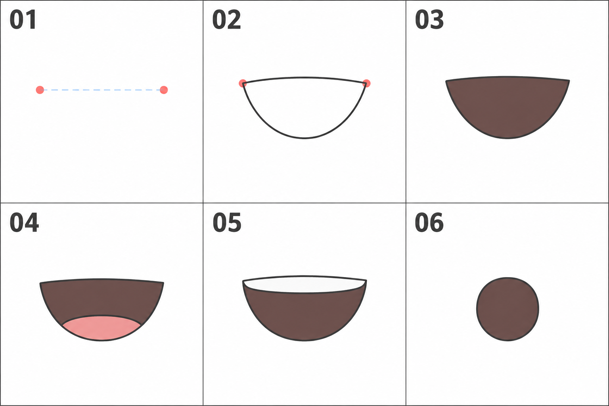

# 09 · 张开的小嘴怎么画

> 今天只练一个小开口：先画外形，再区分口腔暗部与可选细节。
>
> 前置：[08 · 闭合的小嘴](08-闭合的小嘴怎么画.md)。先做正面、小幅度张嘴，不处理大张嘴时下颌的明显变化。

## 1. 从一条线，变成一个有面积的形状

闭嘴练习主要是一条线。嘴张开后，你需要考虑开口的宽度和高度，以及里面的色块。

可以暂时把它理解为一个小窗口：外边界决定开口形状，深色内部提示口腔。这个比喻用于简化绘画，不意味着真实嘴部是平板上的洞。

先把开口画清楚，再决定要不要加舌头和牙齿。它们不是每个小嘴都必须出现的部件。

## 2. 看图：前三格是基础过程，后三格是可选变化

| 编号 | 在做什么 |
| --- | --- |
| 01 | 标两个嘴角，先确定宽度 |
| 02 | 连出上下边界，得到一个开口 |
| 03 | 把内部概括成深色区域 |
| 04 | 一种可选画法：在底部留出小舌面 |
| 05 | 另一种可选画法：在上方留出简化牙齿带 |
| 06 | 改成小圆口，比较另一种开口外形 |

**04、05、06 不是必须依次叠加的步骤。** 今天做到 03 就能完成基础练习。图为生成示意，用来观察形状和层次，颜色不必照抄。

## 3. 第一步：保留位置，再决定宽度

在上一课的嘴部区域新建一层，先隐藏闭嘴线。仍然用两个点确定嘴角。

第一次可以沿用较小的嘴宽，重点观察高度变化。嘴如果小到看不清，可以临时放大画布，但之后要缩回整脸检查。

这一次只做轻微张嘴，头部轮廓暂时保持。以后表现大声说话、大笑或大幅张口时，需要进一步考虑下颌运动，不能只把小开口无限拉大。

## 4. 第二步：画上边界，再画下边界

从左嘴角到右嘴角，画一条比较浅的上边界。再从一端向下绕出弧线，接到另一端，形成更深的下边界。

这样你会得到一个简单的开口。它可以略扁、略圆，不要求是完美半圆。

先看空白形状是否清楚：两边有没有接上？底部有没有歪到一侧？想画小笑口时，嘴角位置是否符合想表达的方向？

不要为了修一个轮廓，反复把整张嘴扩大。必要时保留副本，重新用简单形状画一遍。

## 5. 第三步：给内部铺一个深色

在线稿下面新建色块层，给开口内部填一个深色。深棕、偏红的深色或适合整体画风的暗色都可以；第一次甚至可以用灰色。

现在外形与内部形成区别。把画面缩回整脸大小，观察它是否读得出“张嘴”。

如果一眼看成很重的黑斑，先检查开口大小、位置和颜色对比，不要急着添加更多细节。

内部深色不需要复杂渐变。先学会把边界整理干净，避免颜色漏到嘴外。

## 6. 第四步：需要时，再加一项细节

### 选项 A：简化舌面

在深色开口的下部画一个较小、较浅的色块，让它与底部关系清楚。不要画成悬在开口正中央的一颗粉色豆子。

这是适用于本次小口示意的概括方式。实际可见舌面会随嘴形、视角和动作变化，不要求每个表情都露出来。

### 选项 B：简化牙齿

在上边界内侧留一条浅色区域，表示一小段可见牙齿。先把它当作整体的带状形，不逐颗画格子。

如果浅色区域太宽，几乎吃掉全部口腔暗部，就容易读成另一种咬合或露齿表情。缩窄一点，再比较。

**第一遍选一个做即可，也可以两个都不做。**

## 7. 只改开口形状，试一次小圆口

保留原来的嘴部中心，把横向开口改成较小的圆形或椭圆形，再填同样的深色。

它可能更接近轻微惊讶或某些发音状态，但具体感觉还要结合眉眼。这里先观察形状从横向展开变成集中在中间，视觉效果发生了什么变化。

不要在同一次比较中把眉毛、眼睛和头型都改掉。完整表情会在之后的课里组合。

## 8. 常见问题

| 现象 | 先检查 | 可以怎样改 |
| --- | --- | --- |
| 像一块黑点，不像开口 | 外形、大小与位置是否协调 | 先看线稿版，再减小或减轻填色 |
| 像两条不相干的线 | 嘴角是否把上下边界连成一个形状 | 整理两端连接 |
| 舌头像飘着 | 舌面色块是否和下部关系不清 | 移向底部，减小并简化形状 |
| 牙齿像棋盘 | 是否过早分成许多小格 | 改成简洁的整体浅色带 |
| 张得很大却下巴完全不动 | 已超出本篇的小幅张口范围 | 先缩回小开口，大动作以后专门练 |

## 9. 三个小练习

**A，十分钟：** 从嘴角开始，画出小开口并填一块暗色。放回整张脸检查。

**B，五分钟：** 自己再画一个，不看逐步图，只记住“宽度—开口—暗部”的顺序。

**C，五到十分钟：** 复制一版，在“加小舌面”“加牙齿带”“改圆口”中只选一种变化。

能解释外形和内部色块的分工，能区分基础步骤与可选细节，就可以结束。下一篇会把整个第一阶段的五官放回同一张脸，检查关系。

[上一篇：闭合的小嘴](08-闭合的小嘴怎么画.md) · [返回总目录](00-系列总计划与目录.md) · [下一篇：整张脸的检查](10-把五官放回同一张脸.md)
