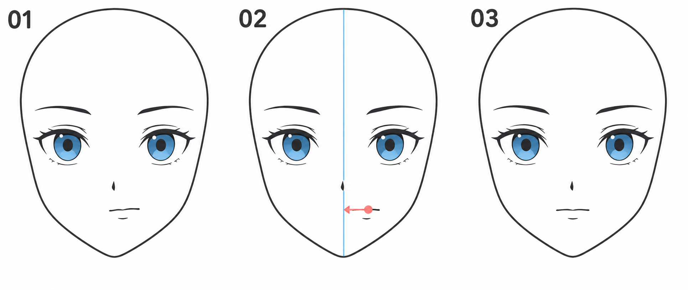

# 10 · 把五官放回同一张脸

> 今天完成第一阶段的小作品：一张正面脸部草图。
>
> 前置：01—09。目标是整合与检查，不是同时加入头发、服装、上色和复杂表情。

## 1. 今天最重要的能力：看出一个具体问题

前面我们把脸拆开练习。现在要把轮廓、眼睛、眉毛、鼻子和嘴放回同一张图里，观察它们能否协调地表达你想画的脸。

“感觉怪”是一个起点，但还不能告诉你怎样修改。今天练习把它说得更具体：是整张嘴偏了，还是嘴太宽？是两眼一高一低，还是其中一只更睁开？

**先写出问题，再决定改什么。** 这样你更容易看到自己的修改有没有作用。

## 2. 看图：从发现问题，到只改一个地方

| 编号 | 正在做什么 |
| --- | --- |
| 01 | 示例嘴部向画面右侧偏移，其他部件作为比较背景 |
| 02 | 加中线，标出嘴部偏移并确定移动方向 |
| 03 | 把嘴移回中线附近，再观察整脸 |

本例的练习目标是平静、对称感较强的正面脸，所以把嘴移回中间。偏向一侧的嘴也可能是有意设计的表情；**问题在于是否符合这次的目标，而不是任何不对称都错误。**

图中的嘴下小线提示下唇，练习时可以省略。生成图有细微线条差异，重点看“定位—判断—小范围修改”的顺序，不把它当作严格相同的三个文件版本。

## 3. 第一步：先选一个明确、简单的目标

今天建议画：正面、平视、没有歪头、较平静的脸。你可以参考喜欢的角色，但不要求在还没有发型时就达到完整角色辨识度。

如果有参考，把它放在旁边，保持能同时看到参考和练习。选择五官清楚、没有复杂遮挡的画面。

明确目标后，才有依据判断哪里需要修改。否则一会儿想画惊讶，一会儿想画害羞，容易把不同表达混在一起。

## 4. 第二步：按从大到小的顺序组装

在同一张草图里依次安排：

1. **头部外轮廓与中线。** 先知道脸的大小、宽窄和下巴位置。
2. **双眼占位。** 先放高度、间距，再替换成简化眼形。
3. **虹膜与瞳孔。** 检查被眼睑遮挡的关系和视线。
4. **眉毛。** 先选择一对比较放松的眉形。
5. **鼻部定位。** 用很少的线或色块表示。
6. **嘴部。** 先用闭合小嘴，减少额外问题。

已经有前几课的整脸底稿，可以继续沿用，不需要从零重画。零散练习来自不同尺寸时，重新安排到统一的头型里，不要直接把每个部件原尺寸拼起来。

图层只要便于修改即可。可以把双眼、眉毛、鼻嘴分别放层，不必为每一根短线建立图层。

## 5. 第三步：缩小看，按顺序检查

### 先看头型和位置

在能看清整张脸的缩放比例下，检查外轮廓是否稳定，五官有没有集体偏向一侧。看中线时，对齐的是这张脸，不是画布边缘。

### 再看双眼关系

检查对应位置的高度、开口大小与虹膜安排。还记得第 05 篇的区别：整体移位、开口变化和尺寸变化要分开处理。

### 接着看下半脸空间

从眼睛往下，鼻子、嘴和下巴之间是否分配了合理空间？如果嘴已经贴近下巴，继续修改嘴的弧度通常解决不了位置问题。

### 最后看线条与细节

在主要位置稳定之后，再修一段过粗的眼线、一个漏出的辅助圆或一条多余线。不要让精细线条把你困在不协调的位置安排上。

## 6. 第四步：只选一个最值得改的问题

把问题写成可以执行的句子：

- “画面右侧眼睛整体偏高，先下移一点。”
- “嘴的中心偏到右侧，保持形状不变，向左移。”
- “鼻子和嘴太挤，先试着把嘴略下移，再检查下巴空间。”

避免只写“画得不好看”“不像”。它们表达了感受，但还需要继续定位才能动手。

如果同时看见很多问题，先选影响范围最大的：整个五官偏移，通常比一根睫毛长度更值得先处理。

## 7. 第五步：留副本，修改，再比较

保存修改前的版本，复制相关图层或另存一个文件。只执行刚才写下的一项调整。

修改后先看整个脸，再看局部。比较参考与修改前后，问自己：“原来的具体问题有没有减轻？有没有产生新的位置问题？”

如果没有变好，可以退回副本。这不是失败，而是一次判断：你发现这个改法没有解决当前问题，需要换一个解释再试。

建议一次检查处理一到两项就停，避免把同一张画反复磨到疲惫。

## 8. 翻转画布怎样帮助检查？

临时水平翻转画布，常能让你注意到已经看习惯的偏斜。它只是换一种观看方式，不是自动判错工具。

翻转后依然要把问题说具体：哪里相对于哪里偏了？这是不是自己刻意设计的表情？决定修改后，可以在你最舒服的方向操作。

不要因为翻转后“看起来陌生”，就认为整张画全部需要推倒重来。

## 9. 第一阶段的小作品怎么交？

用一张简单对照图记录即可：

| 修改前 | 发现的问题 | 做的调整 | 修改后观察 |
| --- | --- | --- | --- |
| 保存一张 PNG | 写一句具体描述 | 只写实际改动 | 是否改善，下一次再看什么 |

三次小任务可以这样安排：

**A，十五到二十分钟：** 组装一张简化正面脸，先不进入复杂细节。

**B，五到十分钟：** 缩小、翻转、对照参考，找出一个明确问题。

**C，五到十分钟：** 保存副本，修改一项，写一句前后比较。

如果需要更长时间，可以分两次做。完成标准不是达到示意图的线条精细程度，而是你能够主动安排五官并解释一次修改。

## 10. 到这里，你已经学会了哪些可复用的动作？

- [ ] 先用轻的辅助形和定位点，再增加细节。
- [ ] 把眼睛、鼻子和嘴放进同一个头部，而不是各画各的。
- [ ] 分开比较位置、大小、形状和线重。
- [ ] 把“怪怪的”变成一个可修改的问题。
- [ ] 留下源文件与前后版本，允许作品先以草图完成。

下一阶段从[刘海先画成几大块](11-刘海先画成几大块.md)开始，把这张脸逐渐变成你喜欢的角色。第二阶段 11—18 已完成，可继续顺序阅读。

[上一篇：张开的小嘴](09-张开的小嘴怎么画.md) · [返回总目录](00-系列总计划与目录.md) · [下一篇：刘海分块](11-刘海先画成几大块.md)
