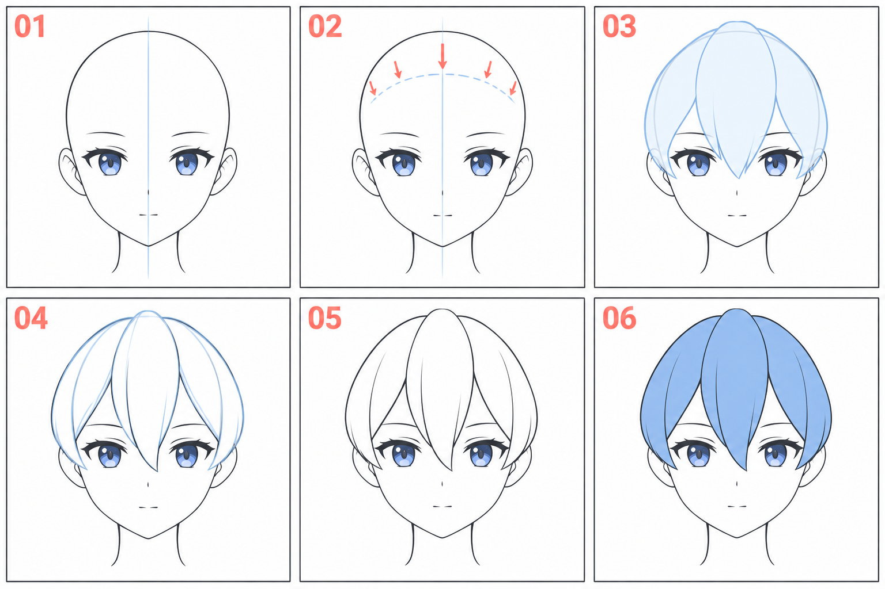

# 11 · 刘海先画成几大块

> 今天只做一件事：在已有的正面脸上，画出轮廓清楚的刘海。
>
> 前置：[10 · 整张脸的检查](10-把五官放回同一张脸.md)。暂时不处理辫子、帽子和复杂发丝。

## 1. 为什么先画大块？

如果一开始逐根画头发，很容易得到很多线，却看不出发型。角色发型首先靠大轮廓、分组和遮挡被识别，细发丝可以之后再补。

本篇把一束头发暂时看作有宽度的带状形：上方有来源，中间顺着一个方向延伸，末端逐渐收尖。它不是贴在额头上的独立三角形。

**我们先决定刘海整体占哪里，再在里面分出少量发块。**

## 2. 看图：从完整头部到几块刘海

| 编号 | 当前观察什么 |
| --- | --- |
| 01 | 没有头发时，头部原本的轮廓和空间 |
| 02 | 前额发际区域的大致位置，作为辅助参考 |
| 03 | 刘海整体从上方向前额延伸的覆盖范围 |
| 04 | 把整体分成中央和两侧的主要发块 |
| 05 | 整理外轮廓与发块边界，隐藏不需要的辅助线 |
| 06 | 简单颜色帮助读出分组，不要求这课完成上色 |

图为 AI 生成的教学演绎，不是官方发型设定稿。示意各格略有差异，练习时沿用自己的同一底稿。颈部和耳朵只是背景参照，尚不会画可以省略。

## 3. 第一步：把头部留在头发下面

打开第一阶段完成的脸，保留原来的头部轮廓。在上面新建“刘海草图”层，先不要擦掉头顶。

因为有了这个底稿，你才知道头发覆盖在多大的头上。若只从眼睛上方直接往外长头发，容易把头顶画得太扁，或者让左右发型挤进头骨本应占据的空间。

把底稿调淡一些即可。最终要隐藏被头发遮住的轮廓，但草稿阶段仍用它检查体积。

## 4. 第二步：先找覆盖范围，不急着画每个发尖

看参考里刘海大致从哪个区域向下走，遮到额头、眉毛或眼睛的什么位置。头发的生长区域、分发方向和最后落在脸上的位置不是同一回事。

图 02 的弧线只帮助你认识前额发际区域，不表示所有发束都从这条线末端开始，也不是最后必须保留的一条线。

在新层上轻画刘海整体的顶部与下沿。顶部顺着头部留出合理余量，下沿可以在中央稍长、两侧稍短，具体关系以选定参考为准。

这时甚至可以把刘海当作一整块剪纸形状。缩小看：它覆盖了哪里？有没有把想保留的眼神全部挡住？

## 5. 第三步：分出中央和两侧的大块

先选最有辨识度的一块，例如从上方向两眼之间落下的中央发束。画它的两侧边界，让上方较宽、向末端逐渐收拢。

再在左右补几块。每块可以长短不同、偏向不同；初学控制在少量大块，先看得出主要节奏即可。

**两条边界要在描述同一束头发的走向。** 如果一边突然左拐、另一边完全向右，发块可能像被切断或扭结。先用一条淡的方向线想清楚它往哪里走，再围出宽度。

不需要把每束都画成等腰三角形。发束可以先弯再收尖，边缘也可以有轻微转折。

## 6. 第四步：决定哪一块压在前面

两束头发交接时，先选其中一束在前面。让前方发束的边界连贯，后方发束进入遮挡处的线在这里停下。

不要把所有线都画穿。如果各束边界交叉成很多 X，通常很难看出前后。你可以临时给前方发块填一个淡色，检查它是否盖住了后方该隐藏的线。

某些画风会透出被刘海遮住的眉眼线条，那属于表现选择。初学这课先把遮挡关系处理清楚，再决定是否采用这种风格化做法。

## 7. 第五步：挑一条边界留下来

把草稿调淡，新建整理层。保留整体外轮廓、主要分束边界，以及确实能说明方向的少量内部线。

隐藏原头部被刘海盖住的部分。先用图层副本或遮挡方式处理，保留完整头部底稿，方便后面改发型。

缩小看发型：如果已经能分清中央与两侧，就可以停。画满内部线条不会自动增加结构感。

## 8. 常见问题

| 现象 | 先检查 | 可以怎样改 |
| --- | --- | --- |
| 像几根尖刺贴在额头 | 发块有没有上方来源与连续走向 | 先画整体，再从整体分块 |
| 头顶变扁 | 是否把原头部轮廓压小了 | 显示底稿，恢复头部空间 |
| 每块像复制的三角形 | 长短、宽度、偏向是否全相同 | 只调整一两块的长度与走向 |
| 线条交叉看不懂 | 前后关系是否不明确 | 确定前方发块，停掉被遮挡的线 |
| 发丝很多却不像参考 | 整体轮廓与分组是否差得较大 | 暂时隐藏细线，先对照大形 |

## 9. 三次小练习

**A，十分钟：** 在已有头部上画刘海整体，只分三到五个主要块，不加细发丝。

**B，五到八分钟：** 重新画一次，自己决定中央发束和两侧发束的前后关系。

**C，五分钟：** 复制一版，只改变中央发束的长度。比较它对额头露出面积和眼神的影响。

可以结束时，你能指出整体轮廓、主要发块和一处遮挡，并且隐藏细线后仍能看懂刘海形状。

[上一篇：整张脸的检查](10-把五官放回同一张脸.md) · [返回总目录](00-系列总计划与目录.md) · [下一篇：侧发和后发](12-侧发和后发怎样包住头.md)
