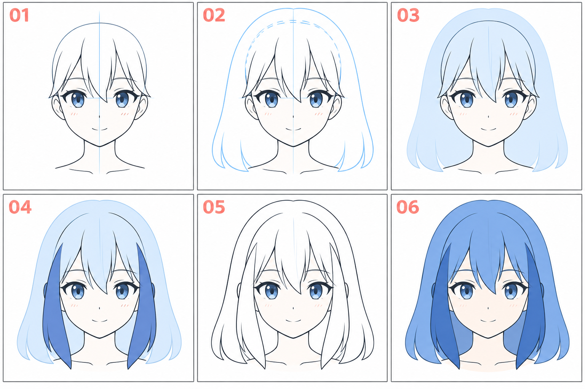

# 12 · 侧发和后发怎样包住头

> 今天只解决头发的前后层次：哪些在脸后面，哪些垂到脸前面。
>
> 前置：[11 · 刘海分块](11-刘海先画成几大块.md)。先用简单披发理解关系，再把方法用于角色的实际发型。

## 1. 先分清“发型整体”和“脸前面的两束头发”

从正面看，头发常同时出现几种关系：后面的大体量包住头部，两侧发束从侧面垂下，刘海覆盖额头。

如果把所有头发都画成脸旁的两条带子，头后面的体量会缺失；如果只画一整块外轮廓，又可能看不出哪些发束在脸前。

**本篇先确定外轮廓，再把前方侧发和后方发量分开。**

## 2. 看图：外面有厚度，前后有遮挡

| 编号 | 重点 |
| --- | --- |
| 01 | 已有刘海的头部，暂未加入完整侧后发 |
| 02 | 在头部之外规划头发整体外轮廓 |
| 03 | 浅色后发体量在脸部后方形成背景 |
| 04 | 加两侧靠前的发束，区分前后层次 |
| 05 | 整理可见边界，清掉被遮住的线 |
| 06 | 用不同蓝色帮助辨认分组 |

示意采用简化披发，不是要求把洛琪希的辫子改成披发。它帮助你先学会层次，下一课再处理辫子。颜色用于分组，不是统一的光影公式。配图为生成示意，各格有细微变化。

## 3. 第一步：显示头部底稿，画发型的外边界

保留完整头部底稿。沿着头部外侧规划一圈更外面的发型轮廓，然后确定它往下延伸到哪里。

不需要处处留下相同距离。发型有蓬松和贴合的区别，但都要先考虑里面有一个完整的头。

先把头发想成整体剪影，少画内部线。缩小看外形是否完整，左右体量是否符合参考，而不是先纠结某一根发梢。

如果画辫子角色，头顶部和耳侧的发量也仍然存在，不是从脸边直接长出两根辫子就结束。

## 4. 第二步：把后发放到脸后面

在软件里，可以先在脸部下方建立“后发”层，用一个简单色块或轮廓概括后面的发量。

注意“图层下面”不自动等于“画面里被遮住”。如果脸部图层只有线条、内部是透明的，后发颜色仍会透过脸显示出来。

临时处理有两种简单办法：在脸部线稿下放一个不透明的脸形底色，或者把后发中被脸遮住的区域清理掉。最好留一份完整后发草稿，便于以后改位置。

**检查：** 后发应该从头的两侧和下方露出来，而不是把脸中央也涂满。你看到的是物体之间的遮挡关系，软件图层只是实现它的方法。

## 5. 第三步：把靠前的侧发放到上面

新建“前侧发”层，从太阳穴附近或参考中的分发区域，向下画出两侧主要发束。

先选一个长度：到脸颊、下巴或肩部。再用两条方向一致的边界围出宽度，末端适当收拢。

靠前的侧发可能遮住一小部分脸、耳朵或肩部。选择前后关系后，就不要让后面的轮廓完整穿过它。

这不是要求两侧画得一样。先用比较简单的正面安排入门，之后可以根据参考调整一侧的长度、厚度或露耳方式。

## 6. 第四步：用“线在哪里停下”说明遮挡

看一处头发和脸相接的地方。前方发束的边界可以连续，后方脸侧或耳部的线到遮挡处就结束。

如果两条线只是在同一位置相切，又不清楚谁在前面，形状容易粘在一起。可以略微调整位置，让遮挡更明确，或留出一小段清楚的空隙。

这种办法同样适用于以后画帽子、衣领、抱书动作：先想清楚前后，再决定可见线条。

## 7. 第五步：检查原来的头没有消失

轮流显示、隐藏头发，看底稿里的头部大小有没有被你无意改小。也可以暂时降低头发层透明度，检查外轮廓是否把头部包住。

再缩小检查整个发型。若头像一加头发就像戴了巨大头盔，可能是外侧余量过大或轮廓过于均匀；如果过于贴头，则可能失去该有的体量。对照具体参考，小幅调整一侧或顶部即可。

今天不急着添加发丝高光。把整体空间与遮挡讲清楚，已经足够。

## 8. 常见问题

| 现象 | 先检查 | 可以怎样改 |
| --- | --- | --- |
| 后发透进脸里 | 脸层内部是否透明 | 加脸部遮挡底色，或清理被挡区域 |
| 头像像扁掉了 | 是否为了加头发缩小头部底稿 | 恢复底稿，重新规划外轮廓 |
| 像左右两根孤立带子 | 是否缺少头顶部和后方体量 | 先把完整发型剪影补出来 |
| 耳朵、脸侧线穿过头发 | 遮挡处是否忘记停线 | 明确前方发束，隐藏后方线 |
| 侧发和后发粘成一片 | 边界与露出的空隙是否不清楚 | 调整一处重叠关系，不急着加细线 |

## 9. 三次小练习

**A，十分钟：** 在已有头像外面规划完整发型轮廓，只用大色块区分后发与脸。

**B，八分钟：** 加两束靠前侧发，选一处遮挡认真整理。

**C，五分钟：** 复制一版，只改变一侧发束的长度。保持头部和另一侧不变，比较脸部露出面积。

可以结束时，你能指出后发、脸、前侧发的关系，并解释为什么后方的某一条线应该隐藏。

[上一篇：刘海](11-刘海先画成几大块.md) · [返回总目录](00-系列总计划与目录.md) · [下一篇：辫子](13-辫子怎样概括.md)
