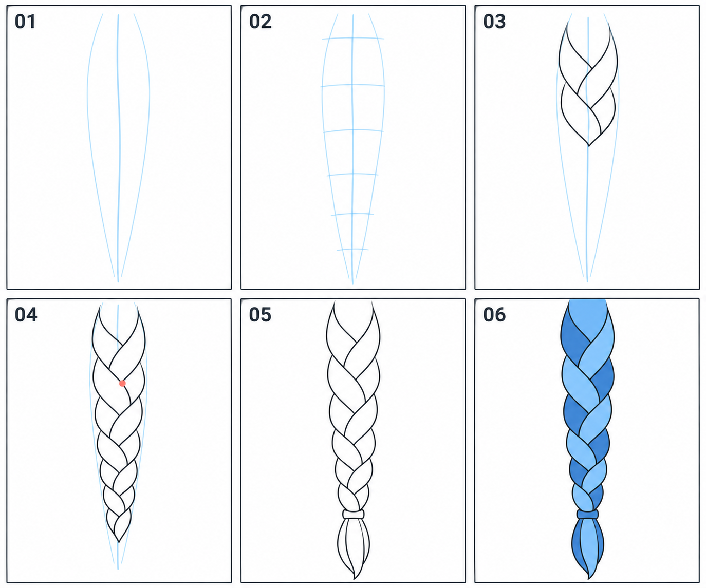

# 13 · 辫子怎样概括

> 今天只画一小段下垂辫子的外观，练走向、粗细和交叠节奏。
>
> 前置：[12 · 头发的前后关系](12-侧发和后发怎样包住头.md)。先单独画辫子，不急着同时处理整张头像。

## 1. 先理解今天画的是“外观概括”

三股辫是真实发束交替编织形成的。本篇不把完整编发过程压缩成一个图案公式，而是先从正面可见的外观入手：一条有走向的整体，里面出现交替向中间穿入、被另一块遮住的发块。

你可以找一张辫子参考，先看整体宽窄和交接位置。暂时忽略成百上千根细发丝。

**关键是连续与遮挡：它不是一串互不相连的圆珠，也不是在长条里画横格子。**

## 2. 看图：先画长条范围，再组织交叠

| 编号 | 当前做什么 |
| --- | --- |
| 01 | 画辫子整体走向与两侧宽度范围 |
| 02 | 粗略标出沿长度方向的节奏位置 |
| 03 | 从上方开始画少量交替覆盖的发块 |
| 04 | 延续节奏，逐渐往下收窄 |
| 05 | 整理线稿，加绑结和末端散开的发束 |
| 06 | 用接近的蓝色帮助辨认相邻发块 |

顶部被画框截取，表示这只是辫子的一段，不是头上连接点的完整画法。红点提示一处交接位置。图为生成示意，颜色用来区分形状，不表示辫子只有两股，也不作为编织拓扑的精确教程。

## 3. 第一步：用一条线确定辫子往哪里走

先画一条轻的长线，表示辫子整体的中心走向。第一遍可以接近竖直，带一点自然弯曲，不必马上画甩动的辫子。

在中心线两边各画一条外边界。上方稍宽，下方逐渐变窄，围出一条长而收拢的区域。

这个范围决定辫子占据的空间。不要还没确定长度和粗细，就开始精细地画每个交叠单元。

## 4. 第二步：沿长度找一个大致节奏

在长条上轻标几处位置，帮助安排相邻交接段。它们不必机械等距，下方变细时可以相应缩短间隔。

这里的横向标记只是草图尺子，最后不需要描出来。它们也不是每一股头发的真实边界。

先只安排几段，确保你能看清每段在做什么。以后画更长的辫子，再增加段数。

## 5. 第三步：画一个向中间收进去的发块

从外侧向中心方向画一条弯曲边界，再配另一条边界，围出一块有宽度的头发。它的一端向下方或中间收拢，被下一块遮住。

下一块从另一侧接过来，形成交替的节奏。观察参考里哪条边界连续、哪条边界在交接处消失，照着这种遮挡关系画。

你可以先只画两三块。若已经分不清前后，就停在这里，不要靠继续往下重复来掩盖问题。

## 6. 第四步：交接处让一条边界停下

两块相接时，前方那块的轮廓保持连贯，被盖住那块的线在交接处结束。它常形成类似一条线接到另一条线上的关系，而不是两条线全部穿过去。

如果你每个交接都画成一个 X，可能会读成绳网；如果每块都封闭成独立圆环，又会像链条。回到相邻两块的遮挡，先改清楚一处，再往下继续。

沿着中心走向逐段延伸，同时检查外边界是不是仍然落在最开始规划的范围里。

## 7. 第五步：加绑结和散开的末端

辫子下端可以用一个小的带状形表示绑结。下面再画一束较短的散发，用整体轮廓概括即可。

散发的来源应当接在绑结下面，而不是与辫子中断成两个物体。可以先用一条轻方向线把它们串起来，再围出发束。

整理时隐藏中心线和节奏标记。保留外轮廓、交叠边界，以及少量帮助看清方向的线。

## 8. 怎样把这一段接回头像？

先看参考里头发从耳侧或后侧怎样汇拢，再把辫子上端接到这片发量下面。连接点可能被侧发、耳部或肩部遮住，需要沿用上一课的前后关系。

第一遍可以只给头像加一侧辫子，另一侧稍后再画。为了画辫子而不断扩大画布也不必急，先决定头像要保留多长的一段。

不要把辫子根部直接接在脸部轮廓线上，仿佛从皮肤长出来。检查它与发型大块有没有连续关系。

## 9. 常见问题与小练习

| 现象 | 检查与修改 |
| --- | --- |
| 像一串珠子 | 取消独立闭合的小块，改清楚两块之间的覆盖 |
| 像梯子 | 隐藏横向辅助标记，用交替弧线描述发块 |
| 中途突然变粗 | 对照最初外边界，只修失控的那一段 |
| 每个交点都很黑 | 先确定谁在前，把被遮挡的线停掉 |
| 末端像另外挂上去 | 用共同走向检查绑结上下的连接 |

**A，十分钟：** 只画一段含三到四个可见交叠的辫子，先把一处遮挡讲清楚。

**B，八分钟：** 重新画一段，从走向、外边界开始，不直接复制全部线条。

**C，五分钟：** 保持交叠方式，稍微改变整体弯曲走向，比较发块是否仍然沿着辫子连续延伸。

能指出整体走向、宽度变化和一处谁盖住谁，就达到本篇目标。精细发丝和漂亮高光留到之后再加。

[上一篇：侧发和后发](12-侧发和后发怎样包住头.md) · [返回总目录](00-系列总计划与目录.md) · [下一篇：帽子](14-帽子怎样放在头上.md)
