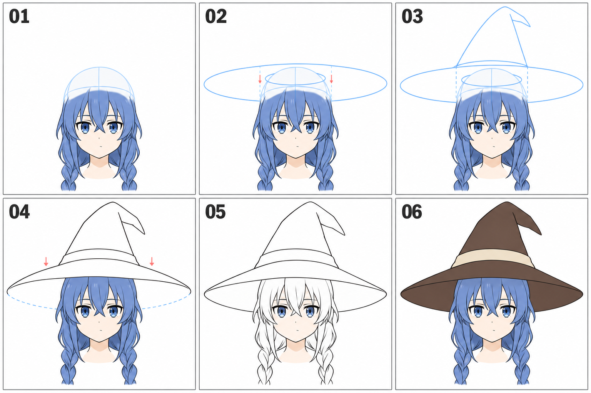

# 14 · 帽子怎样放在头上

> 今天只练一顶简化魔法帽怎样围住头部：先安排帽口与帽檐，再连接帽身。
>
> 前置：[11 · 刘海](11-刘海先画成几大块.md)、[12 · 侧后发](12-侧发和后发怎样包住头.md)。辫子尚未画好也可以先练帽子。

## 1. 把帽子分成三个大部分

先把洛琪希这类魔法帽概括为：容纳头部的帽口、向外展开的帽檐、向上延伸的帽身。

帽口不是直接画在脸上的小椭圆；它表示头进入帽子的开口。帽檐也不是一条随意穿过头的横线，它围着帽口向外延伸。

**先考虑帽子里面有没有空间放下头，再画好看的尖顶。**

## 2. 看图：辅助椭圆与最后可见轮廓

| 编号 | 观察重点 |
| --- | --- |
| 01 | 保留头部体积，知道帽子要包住哪里 |
| 02 | 用大、小辅助椭圆规划帽檐与帽口 |
| 03 | 在帽口上方建立向上收拢的帽身 |
| 04 | 决定前后遮挡，辨认可见边界 |
| 05 | 整理帽子线稿，去掉不需要的辅助线 |
| 06 | 简单着色后确认整体形状可读 |

蓝线和虚线用于帮助推想完整形状，不是最后都要描出来的轮廓。04 的虚线尤其用于提示辅助范围，不能机械地认为虚线所经过的整段永远不可见；是否可见仍取决于帽身、头部与帽檐实际的遮挡。

配图是生成的简化示意，各格存在轻微形状差异。自己练习时在同一底稿上逐步添加。脸部已有颜色只方便辨认，不要求现在同步上色。

## 3. 第一步：先留出整顶帽子的空间

在画布上方和两侧留出余量。先用很轻的线框一下帽尖和帽檐最远能到哪里，避免等帽子画好才发现尖顶被裁掉。

显示完整头部底稿，即使头顶之后会被帽子遮住，也先保留它。头发还有一定体量，规划帽口时一起考虑。

本篇先练近正面、帽子没有大幅倾斜的情况。复杂侧视和帽檐翻折可以以后再展开。

## 4. 第二步：用辅助椭圆规划帽口和帽檐

在头部上方附近，用一个较小的椭圆帮助表示帽口范围。它应该能围住戴帽位置的头部与头发，而不是小到插进头里。

再围着它画一个较大的椭圆，作为帽檐展开范围。先让两个形状的大致方向一致，别一个明显向左斜、一个明显向右斜。

这里用椭圆近似圆形开口的投影。看得越倾斜，圆形投影可能越扁；今天先照着近正面的参考安排，不必背某个固定扁率。

**检查：** 大椭圆两侧是否给帽檐留出足够空间？小椭圆是否有可能容纳头？它们不是两条必须完整露出的装饰线。

## 5. 第三步：从帽口向上连接帽身

从帽口两侧向上画收拢的轮廓，先概括成一个锥体般的大形。帽身的下部要与帽口连接，不能像另一顶帽子悬在上面。

先把整体高度和宽度安排好，再决定尖顶是否微弯、帽身是否柔软。第一遍可以不加褶皱，只保留简单轮廓。

图里的尖顶略有弯折，是造型变化，不是让你忘掉里面最开始规划的体量。

## 6. 第四步：判断谁在前，隐藏被遮住的线

观察参考，前方帽檐通常会挡住一部分上方头发。帽身也会挡住后方帽檐的一些边界。

在每个交接处都问一次：沿着视线看，哪一个部分更靠近我们？靠后的部分被挡住时，边界就不能继续穿过前面的形状。

如果把辅助椭圆完整描成黑线，它很可能穿过头发或帽身，像透明塑料圆环。解决方法是保留完整辅助层用于理解，清稿层只画可见部分。

帽檐下方哪些边缘还露在头两侧，要结合你画的倾角判断。不要简单地把椭圆一半全部擦掉。

## 7. 第五步：最后加帽带

沿帽身下部画一条带状区域。它的走向要顺着帽身绕过去，不能完全无视已经画出的体积，像贴了一条与帽子方向冲突的直线。

先画上下两条边界，间距保持大致连贯。装饰、缝线和复杂褶皱都可以暂时省略。

缩小看整张头像：帽子和头是否连接？帽檐有没有不小心遮掉全部眼睛？帽尖是否仍在画布里？

## 8. 常见问题

| 现象 | 先检查 | 可以怎样改 |
| --- | --- | --- |
| 帽子像漂在头上 | 帽口是否离头过远，遮挡是否缺失 | 重新安排戴帽位置和接触区域 |
| 帽身插进头里 | 是否只顾尖顶，忘记帽口容积 | 显示完整头部，调整帽口与底部宽度 |
| 椭圆线穿过刘海 | 是否把辅助线全部清成实线 | 按前后关系隐藏被挡部分 |
| 帽檐看起来拧了 | 两侧方向、宽度与帽口关系是否矛盾 | 回到大椭圆，先修整体方向 |
| 最后帽尖被裁掉 | 草图阶段是否没有预留空间 | 先扩展画布或整体缩放，再完成细节 |

## 9. 三次小练习

**A，十分钟：** 在已有头部上只画帽口、帽檐和简单帽身，不加帽带。

**B，八分钟：** 自己判断一处遮挡，清掉不该露出的辅助线，再加一条简单帽带。

**C，五分钟：** 复制一版，只改变帽檐宽度，保持帽口和头不动，比较造型变化。

能说明帽口在哪里、头怎样被包住、哪条线因为遮挡而消失，就可以保存。今天不要求复杂帽子透视全部掌握。

[上一篇：辫子](13-辫子怎样概括.md) · [返回总目录](00-系列总计划与目录.md) · [下一篇：颈肩连接](15-脖子怎样接到肩膀.md)
