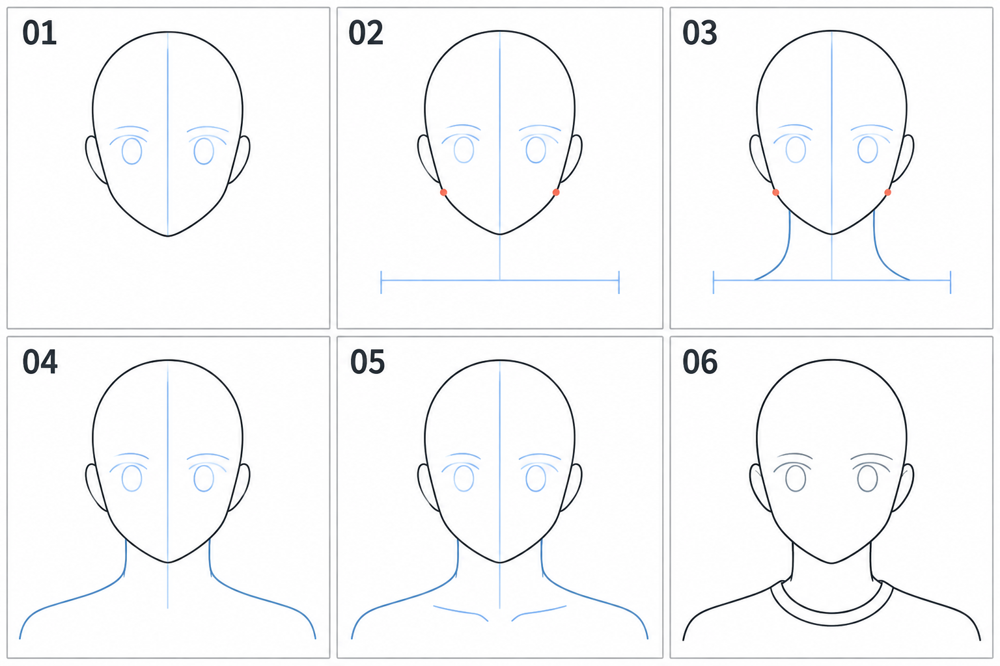

# 15 · 脖子怎样接到肩膀

> 今天只补一个简单的正面颈肩，让头像有清楚的支撑和连接。
>
> 前置：[01 · 头部轮廓](01-头部起形：从圆到脸颊和下巴.md)。头发和帽子可以临时隐藏，便于看清连接。

## 1. 脖子不是从下巴尖分出的两条线

正面看，头在脖子前上方，脖子的两侧从下颌后方附近显露，再向下与肩部连接。

如果把两条线都从下巴尖开始拉，容易像用一根细杆撑着头。今天先用简化轮廓理解前后与宽度，不展开肌肉和骨骼名称。

**保留头部，补出颈部两侧，再把它们自然地过渡到肩部。**

## 2. 看图：先规划位置，再连接曲线

| 编号 | 当前任务 |
| --- | --- |
| 01 | 保留头部和中线，暂时没有颈肩 |
| 02 | 标出下颌两侧参考位置和肩部大致高度 |
| 03 | 从下颌后方附近画出颈部两侧的可见轮廓 |
| 04 | 向外接到肩部，形成连贯的过渡 |
| 05 | 可选地用少量线提示锁骨区域 |
| 06 | 简化整理，并用普通领口帮助表现衣服关系 |

红点用于观察下颌两侧，不是要求颈线严格从点上出发。下方蓝色横线只规划大致高度与范围，不是最终肩膀的形状。图为生成的概括示意，比例不是唯一标准。

## 3. 第一步：先决定头像画到哪里

可以只画到肩膀上部，不必把整件衣服都展开。先在头部下方轻画一条高度参考线，表示你准备让肩部大致出现的位置。

脖子长短先对照一个清楚的正面参考。不要为了给服饰留空间，把它不断向下拉长。

这次画面近正面、平静站立，先让头部中心与躯干中心大致一致，避免引入复杂扭转。

## 4. 第二步：画颈部两侧，留出宽度

在下颌两边较靠内的位置，画出颈部侧边，从下颌后面向下延伸。注意下巴轮廓仍然在前面，不要把原下巴擦成颈线的一部分。

两条颈线之间要有合理宽度。先与头宽比较，不急着记固定比例。不同角色、姿势和画风会有不同安排。

线可以略弯，不必是两条笔直平行的柱子。第一遍曲度小一些，避免为了柔软而画出过多凹凸。

**检查：** 头看起来是否被一个有宽度的颈部支撑？两侧是否都挤到了下巴尖下方？

## 5. 第三步：向外延伸成肩部

到颈根附近，轮廓逐渐向外、略向下延伸，接出肩膀的走向。先看整体的缓和转折，不要突然接成一条水平横杠。

画左侧后，立即画右侧，再比较高度和延伸方向。正面基准练习先保持相近；后面动作课会有高低肩和身体倾斜。

不必今天画完上臂，只要肩部轮廓在画面中有明确延续即可。截取胸像时，画面可以在合适位置结束。

## 6. 第四步：少量提示内部关系

想进一步说明颈肩转折，可以在颈根左右加很轻的线，概括锁骨区域。它们应当服务于大形，不需要画成两条很深的沟。

你也可以先不画内部线。若外轮廓已经能表达连接，省略细节是成立的。

头部下面的阴影以后再学。今天不要用一大块黑色遮住不确定的连接，先把轮廓看清楚。

## 7. 第五步：让领口围住颈部

可以先画一个简单圆领或简化立领，帮助完成头像。领口要围着颈部和上胸所在的体积转过去，不是孤零零的一条装饰线。

衣领靠前时会遮住一部分颈部，按前后关系隐藏相应线条。不要同时保留领口前面的完整颈线，仿佛衣服透明。

若准备画洛琪希的具体衣领，可以参考正式画面，把复杂部分先合并为几个大形。今天的目标仍是颈肩连接。

## 8. 常见问题

| 现象 | 先检查 | 怎样试改 |
| --- | --- | --- |
| 像细杆撑着头 | 颈部是否过窄、两线是否从下巴尖出发 | 把两侧连接分开，参考下颌后方位置 |
| 像一根长管子 | 是否拉长颈部而未检查肩高 | 提高肩部或缩短可见颈长 |
| 肩膀像 T 字横杆 | 是否突然变成完全水平直线 | 让颈根到肩部有较自然的过渡 |
| 头偏在肩膀一边 | 是否无意混入倾斜或躯干移位 | 检查基准中线，先稳定正面安排 |
| 衣领穿过脖子 | 遮挡处是否保留了多余颈线 | 保留草稿，隐藏最终不可见部分 |

## 9. 三次小练习

**A，十分钟：** 隐藏头发，只给现有头部接上简单颈肩。

**B，五到八分钟：** 另画一个小草图，先放肩高，再连接颈部，不照搬每一笔。

**C，五分钟：** 复制一版，只改变可见颈长，保持头部大小不变，比较整体比例。

可以结束时，你能解释颈线为何不从下巴尖拉出，肩部如何延续，以及领口挡住了哪一部分。

[上一篇：帽子](14-帽子怎样放在头上.md) · [返回总目录](00-系列总计划与目录.md) · [下一篇：整理线稿](16-草图怎样整理成线稿.md)
