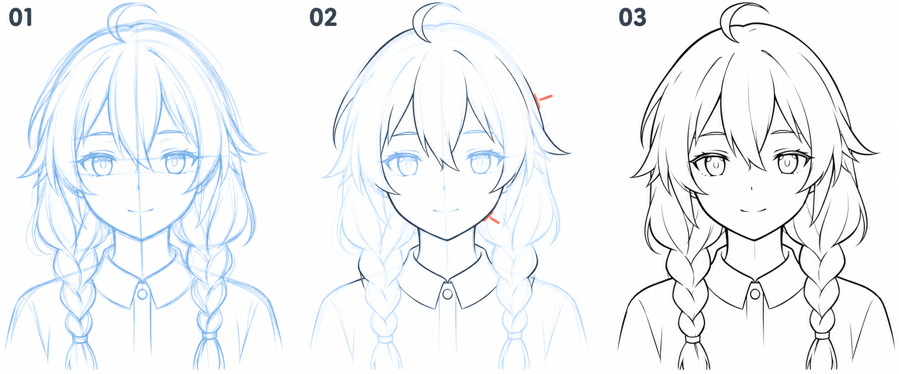

# 16 · 草图怎样整理成线稿

> 今天只把已有草图中的主要边界整理清楚，不在清稿时同时大改造型。
>
> 前置：有一张脸、发型和简单颈肩都已安排好的草图。帽子可以有，也可以暂时隐藏。

## 1. 清稿是做选择，不是把每条草稿线描黑

草图里常有几条相近的尝试线、定位线和被遮住的辅助形。清稿时需要决定：哪条边界最符合想要的形状？哪条只是在帮助思考？

如果把所有线都加深，画面只会从浅乱变成深乱。**先确定形状，再挑需要保留的线。**

发现严重位置问题时，先回草图层调整。清稿更适合处理已经基本决定的大形。

## 2. 看图：保留同一设计，逐步选择边界

| 编号 | 当前状态 |
| --- | --- |
| 01 | 蓝色草图保留尝试线和辅助线 |
| 02 | 降低草图存在感，在上面选择部分边界清线 |
| 03 | 隐藏草图，检查独立线稿是否读得清楚 |

红色短标记提示正在观察的轮廓。图为生成示意，细节在格间略有变化；实际清稿时沿用自己的同一底稿，不需要把发型改成示例。图中辫子与服装只作整体示范。

## 3. 第一步：保留草稿副本，降低不透明度

先保存源文件。把草图放进单独图层或图层组，再在上方建立“线稿”层。

把草图透明度调到能看清但不抢眼的程度。没有必须使用的百分比，关键是你能区分新线和旧线。

检查当前选中的是线稿层，避免忙了半天却把清线全部画到草图里。可以先试画一小笔，再隐藏草图验证。

## 4. 第二步：先选一个小区域清理

建议从一束头发或半边脸部外轮廓开始。沿着草图看一遍，决定要保留哪条路径，再落笔。

如果同一位置有三条尝试线，不必取它们机械平均。选择最符合你要的形状的一条，必要时在草图层先重新概括。

一小块清好后，缩小看是否与周围连贯，再继续下一块。这样比从头到尾追着细线跑更容易发现大形偏差。

## 5. 第三步：用舒服的方向画较长的线

可以旋转或平移画布，让你习惯的落笔方向对着当前轮廓。也可以适度使用防抖，但不同软件和设备手感不同，先从较轻的辅助程度尝试。

一条长轮廓可以分成几笔。把接笔安排在自然转折或遮挡附近，通常比在最平滑的中段反复接线更容易整理。

不要只用很短的碎线来回磨。同样也不必要求所有线一笔完成。目标是连贯地表达形状，不是表演控笔。

## 6. 第四步：用线重区分主要与次要

你可以让整体外轮廓或重要遮挡线稍重一些，内部发丝、浅褶皱等次要线较轻。这是一个易于尝试的层次方法，不是所有画风的强制规则。

先小幅变化。把每个交点都涂黑，不一定更有立体感；眼角、嘴角也不需要自动画成大黑块。

检查方法是缩小：主要形状是否仍清楚？内部线条有没有比五官更抢眼？若有，先减少次要线，而不是继续加粗所有轮廓。

## 7. 第五步：清理遮挡和接头

检查刘海与额头、侧发与脸、辫子交叠、帽檐与头发、衣领与颈部这些位置。

前方边界保持清楚，后方被挡住的线在合适位置停下。线头可以稍微修整，避免超过交接位置留下小刺。

但不要把所有线强行封闭。某些眼睑或脸部提示线本来就可以断开。后续上色需要封闭区域时，可以用单独辅助层或选区解决，不必为了油漆桶把画风改变成处处封口。

## 8. 第六步：隐藏草图，单独看线稿

草图常会在视觉上替新线补全缺漏。隐藏它以后，你才知道线稿自身是否完整。

先看整张头像，再放大找少量明显漏线、毛刺或不需要的辅助线。只修最影响阅读的问题，不必把每个像素磨平。

清稿后若整张脸反而不像草图，检查有没有在追线时改变眼睛大小、下巴长度或刘海轮廓。可以叠回草图比较大位置，而不只是继续加细节。

## 9. 常见问题与练习

| 现象 | 可以先做什么 |
| --- | --- |
| 线越描越粗 | 撤回重复加线，重新选择一条明确路径 |
| 清完像换了人 | 对照草图的大位置和轮廓，不先怪笔刷 |
| 看着草图很完整，隐藏后缺东西 | 单独检查线稿层，补真正需要的边界 |
| 所有线都很抢眼 | 减少内部细线，保留主要层次 |
| 一个局部磨很久 | 缩小确认它是否影响整体，给本次修改设个小范围 |

**A，十分钟：** 只清理一束刘海和附近的脸部轮廓，理解选择过程。

**B，十分钟：** 自己清理另一块区域，过程中至少隐藏一次草图检查。

**C，五分钟：** 复制一版，只减轻内部次要线，比较整体可读性。

可以结束时，线稿脱离草图后仍看得清主要形状；你能指出哪些线被保留，哪些线因为辅助或遮挡被去掉。

[上一篇：颈肩连接](15-脖子怎样接到肩膀.md) · [返回总目录](00-系列总计划与目录.md) · [下一篇：铺底色](17-底色怎样铺清楚.md)
