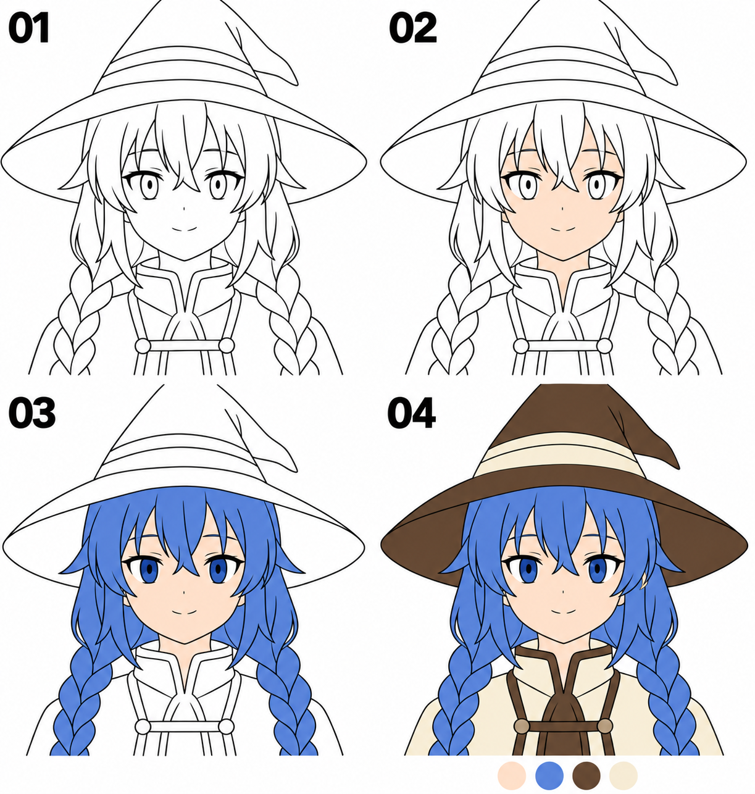

# 17 · 底色怎样铺清楚

> 今天只给主要区域铺上颜色，先不画复杂阴影、高光和材质。
>
> 前置：[16 · 整理线稿](16-草图怎样整理成线稿.md)。使用自己的可编辑画稿，而不是把教程示意图当成分层源文件。

## 1. 底色在解决什么问题？

底色先回答“这是哪一块、它大致是什么颜色”。皮肤、头发、帽子、衣服有了清楚的颜色区域，角色就开始能被整体阅读。

阴影和高光负责进一步说明光照与体积，可以以后再加。今天先把边界、覆盖和颜色分组处理好。

**同一种材料先用一个主要颜色。** 例如头发先用一块蓝色，不需要立刻为每个辫子交叠画深浅变化。

## 2. 看图：按区域逐步增加颜色



| 编号 | 新增加的内容 |
| --- | --- |
| 01 | 线稿，尚未铺主要颜色 |
| 02 | 皮肤区域的底色 |
| 03 | 头发和眼睛的基本颜色 |
| 04 | 帽子、帽带和衣服的大色块 |

图下的小色块提示可以先使用有限的配色。示意为了放大脸部而裁取了部分帽尖；自己的完整头像是否裁帽尖，要根据最终构图决定，不能在保存时无意裁掉。

配图经过简化着色编辑，用来说明区域顺序。生成图仍可能有轻微色差，自己练习时先用统一底色即可，不必仿照细微渐变。

## 3. 第一步：确认线稿下面能够看见颜色

先保存源文件。在线稿下新建“皮肤底色”层，试涂一小块颜色，确认线条仍然在上面、颜色能在下面显示。

如果看不见底色，检查线稿层是否有不透明白底：自己在透明图层上画出的线，与一张带白色背景的图片不同。不要为了这个问题把所有内容合并。先回到保留透明背景的线稿层，或检查是哪一个背景层挡住了颜色。

一种够用的层次，从上到下是：

```text
线稿
头发、帽子等底色层（可按部件分开）
皮肤底色
后发底色（按实际遮挡调整）
临时背景
草图（通常隐藏）
```

这不是固定图层模板。前后顺序要符合你画的遮挡，颜色也可以在选区里分别完成。先用你能理解、方便修改的少量图层。

## 4. 第二步：先定少量主要颜色

在画布角落或单独色板层试放几个色块：肤色、蓝色头发、棕色帽子、浅色衣服等。

可以从参考中观察颜色，也可以先试选近似颜色。底色不是永远不能改的决定，保留分层之后还可以调整。

先缩小看这些颜色能否区分主要区域。不要一开始就收集十几种发色、阴影色和反光色，让选择变得困难。

## 5. 第三步：完整填住一个区域

先从脸部或一块较大的头发开始。你可以沿边界用画笔涂满，也可以用选区圈住区域后填色。

沿轮廓涂色时，注意细窄角落和发尖。边缘可以稍微伸到线条下面，避免颜色与线之间留一圈缝，但不要越过可见外边界。

完成后隐藏一下线稿，检查色块是否完整。线稿可能遮住小空洞，单独看底色更容易发现它们。

先认真完成一个区域，再复制这种检查方法到其他部件。

## 6. 油漆桶为什么有时会填满整个画面？

填充工具需要根据某些边界判断区域。若它只参考当前空白图层，或者线稿有缺口，就可能把颜色填到更大的范围。不同软件的“参考图层”“容差”“扩展”等选项名称会不同。

遇到这种情况先撤销，然后检查两件事：工具实际参考了哪些图层？区域边界是否闭合或被工具正确识别？

如果暂时不熟悉这些设置，直接用选区或画笔补色也能完成这篇练习。不需要为了使用油漆桶，把所有本来应该断开的眼线和发丝都强行封死。

边缘有细白缝时，也可以用小画笔补到线下。稍后熟悉填充扩展等功能，再提高效率。

## 7. 第四步：区分“白色”和“透明”

在白背景上，没涂的区域和涂了白色的衣服可能看起来一样。但导出透明背景或换深色背景后，差异就会出现。

所以白色衣服、眼白等需要保留颜色的部位，也要有自己的不透明底色，不能仅依赖下面的白色背景。

可以在最下方临时放一层中灰色背景。检查眼白、衣服有没有变成灰色，或出现不该有的透明洞。确认后再恢复想要的背景。

这只是检查颜色覆盖的方法，不意味着最终作品必须使用灰背景。

## 8. 第五步：整体看一次，停在底色阶段

把草图隐藏，缩小到正常观看尺寸。先看角色主要区域是否清楚，再看颜色有没有漏出、白色区域是否完整。

如果两个相邻部件颜色接近，先利用清楚的线条和颜色分区判断；需要时小幅调整其中一块底色，不必立即画复杂光影。

底色完成后保存一个版本。你已经可以用它做表情卡或头像，不必等待上色知识全部学完。

## 9. 常见问题与练习

| 现象 | 先做什么 |
| --- | --- |
| 下层颜色完全看不见 | 检查上方是否有不透明白底层 |
| 一点填充涂满整个画布 | 撤销，检查参考层与缺口，再决定手工补色 |
| 轮廓旁留一圈白缝 | 隐藏线稿检查，用画笔或填充扩展补到线下 |
| 换背景后眼白消失 | 给应该是白色的部件真正铺不透明白色 |
| 颜色越加越难控制 | 回到少量主要底色，先不做光影 |

**A，十分钟：** 给皮肤和头发铺底色，只检查覆盖和越界。

**B，十分钟：** 自己给帽子、衣服与眼白上色，再换一次临时灰背景检查。

**C，五分钟：** 复制一版，只改变发色的明暗或饱和程度，比较它与皮肤、帽子的关系。选择一个继续用，不必追求唯一答案。

可以结束时，主要色块清楚、白色与透明区分明确，源文件仍保留可编辑图层。下一篇将整理和保存第一张完整头像。

[上一篇：整理线稿](16-草图怎样整理成线稿.md) · [返回总目录](00-系列总计划与目录.md) · [下一篇：保存第一张头像](18-保存第一张完整头像.md)
