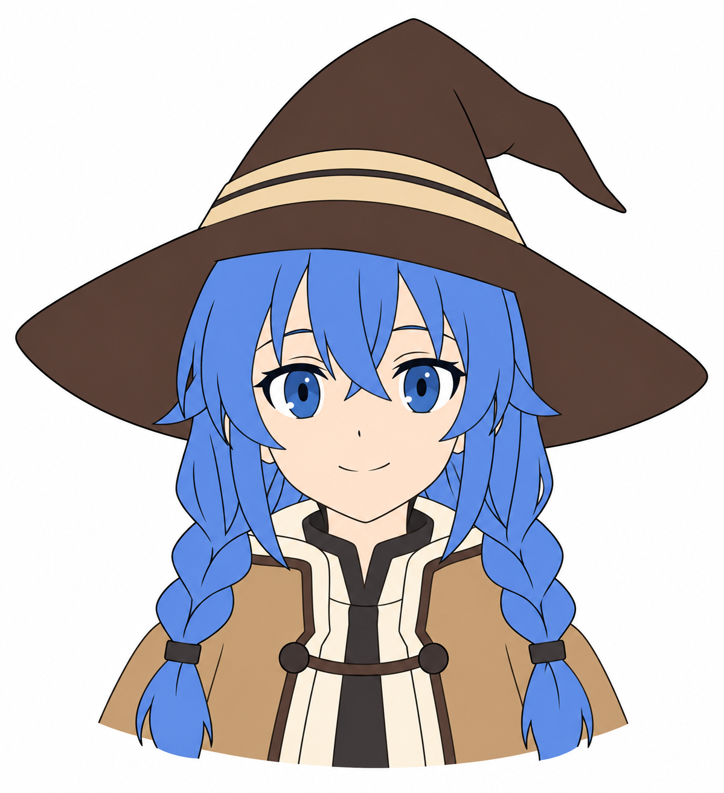

# 18 · 保存第一张完整头像

> 今天把已有画稿整理成一个能展示、能再次打开修改的作品。
>
> 前置：[17 · 铺底色](17-底色怎样铺清楚.md)。这次允许简单线稿和底色成为完成版，不额外加入阴影、背景和复杂装饰。

## 1. 先决定这一版“完成”包含什么

建议这一版包含：头部和五官、可辨认的发型、可选的帽子、简单颈肩或衣领，以及清楚的主要颜色。

如果辫子或帽子还很难，可以保留简化版本。完成的意义是把目前会的内容组织成一件作品，并留下下一次可以继续修改的文件。

**先确定这次要交什么，再检查是否达到。** 不要在最后不停新增衣服花纹、魔法特效或背景，把终点越推越远。

## 2. 看一个完成范围的示例



这张图由 imagegen 生成并作了简化着色编辑，用于说明“头像、主要造型、基本颜色已经组成一件作品”的范围。它不是你需要立刻达到的控笔精度，也不是你自己的练习成果。

你可以省略图中的少量装饰与细节。线条还不稳定、比例仍可改进，也可以保存为第一版。正式角色细节仍以你选定的作品参考为准。

示例本身是白底展示图；你是否导出透明背景，要在自己的源文件里决定，不能因为一张图看起来白就认为它已经透明。

## 3. 第一步：检查画面有没有完整放进画布

缩小看整个画布，确认帽尖、帽檐、头发与辫子末端有没有被无意裁掉。人物四周是否有你希望保留的空间？

头像也可以刻意截到肩部，帽子也可以作构图裁切。关键是你作出的选择，而不是画完才发现画布不够大。

需要调整时，可以先扩展画布或整体调整人物位置。若整体缩放，尽量操作完整的人物图层组或副本，避免只缩了脸、没缩帽子。

今天先保持原来的工作分辨率，不必反复缩小再放大源文件。

## 4. 第二步：只检查三类问题

### 大关系

五官位置、发型轮廓、帽子与头部连接是否符合这次的目标？先用第 10 篇的方法，选最影响整体的一项判断。

### 颜色覆盖

有无明显漏色、越界或意外透明？临时换个背景，特别检查眼白、浅色衣服和发尖。

### 遗留草稿

最终展示里是否还有不需要的中线、定位点、试色块或参考图？把这些放到单独图层并隐藏，保留在源文件里即可。

挑一到两处最值得修的问题处理，然后再看整体。其余内容可以记入下一版，不需要一次解决全部。

## 5. 第三步：先保存可编辑源文件

如果用 Krita，先保存为 `.kra`。使用其他绘画软件时，保留它自己的分层源文件格式。

图层至少要能让你理解主要内容在哪里。可以按“线稿、底色、草图、背景”分组，也可以保留眼睛、嘴等单独层，方便下一阶段改表情。

首次保存后关闭再打开一次，确认画面、图层和隐藏状态没有意外。保存按钮按过，不等于你已经确认文件能继续使用。

**PNG 用来展示和接入程序；可编辑源文件用来继续画。两种文件都保留。**

## 6. 第四步：导出一张展示 PNG

在源文件里准备最终要显示的图层组合。选择白色、纯色背景，或者隐藏背景得到透明区域，再导出 PNG。

第一次可以直接使用当前画布像素尺寸。以后要做特定大小的头像，再另外导出缩小版本，不必覆盖原始大稿。

导出之后，用图片查看器重新打开 PNG。检查是否和你想展示的画面一致，有没有漏掉图层、带出草图或出现不该有的背景。

如果你导出的是透明图，查看器可能用白色或深色显示透明区域。可以把它重新导入绘画软件，在下面放另一种背景检查；不要只凭单一查看器的底色判断。

## 7. 第五步：取一个以后找得到的文件名

例如把这次成果放在一个作品文件夹中：

```text
我的第一张头像/
├── roxy-avatar-v01.kra       可编辑源文件
├── roxy-avatar-v01.png       展示图片
└── 练习记录.md              参考与本次观察
```

这是组织示例，不是已经替你创建了这些作品文件。你可以使用中文文件名，只要自己能看懂版本即可。

继续修改时另存 `v02`，让第一版留在原处。这样以后比较的是两个真实阶段，而不是凭记忆判断有没有进步。

## 8. 写一条完成记录

不用写长篇总结，记录几句就够了：

```text
日期：
本次作品范围：
参考来源：
我最喜欢的一个细节：
我实际修过的一处问题：
下一版最想改的一个地方：
源文件名与展示图片名：
```

分享临摹或参考练习时，可以一起说明来源与练习目的。它也能帮助未来的你找到当时在观察什么。

## 9. 三个收尾任务

**A，十分钟：** 整理显示图层和构图，挑一到两处明显问题修正。

**B，五到十分钟：** 保存源文件、重新打开确认，再导出并打开 PNG。

**C，五分钟：** 把这次头像与最早的头部或脸部练习并排看，写一处具体变化。比如“现在我会先判断帽子遮住哪一块头发”，而不是只说“好像进步了”。

完成时检查：

- [ ] 有一张我愿意称为第一版的完整画面。
- [ ] 源文件可以重新打开，保留了可编辑图层。
- [ ] PNG 导出的内容和背景经过检查。
- [ ] 我知道参考来自哪里，也知道下一版想改什么。

## 10. 下一阶段会用到这张头像

接下来会从微笑开始，在同一张底稿上调整眉、眼、嘴，再画闭眼和半闭眼，让角色第一次眨眼。

所以现在保留眼睛、眉毛、嘴与脸部底色的可编辑性很有帮助。但不用为将来提前做复杂绑定或完全拆图，能复制图层并改表情就够了。

下一篇：[微笑怎样从嘴角传到眼睛](19-微笑怎样从嘴角传到眼睛.md)。

[上一篇：铺底色](17-底色怎样铺清楚.md) · [返回总目录](00-系列总计划与目录.md)
