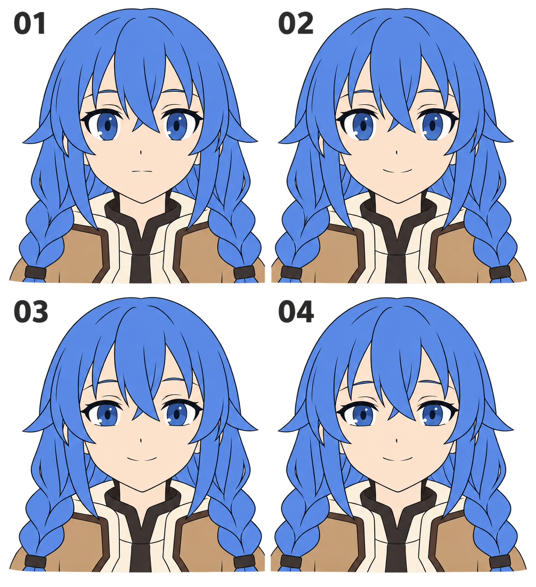

# 19 · 微笑怎样从嘴角传到眼睛

> 今天只做一件事：在已经画好的头像上，改出一个轻柔的闭嘴微笑。用时可以先留 20—40 分钟，不需要重画头发。

前置：有第 18 篇保存的头像；知道眼睑、眉毛、嘴分别在哪里。不确定嘴的形状时，回看[闭合的小嘴](08-闭合的小嘴怎么画.md)。

## 1. 微笑为什么不只是换一个嘴？

嘴角轻轻抬起，通常已经能提示笑意；眼睑与眉毛配合后，神态可能更柔和。你可以选择只改嘴，也可以多改一个部件。这里没有“必须全改才算笑”的规定。

“从嘴角传到眼睛”指观看时各部件共同表达情绪，并不是画面里真的有一条力线。先把变化分开做，才知道是哪一笔带来了效果。不要同时换眼型、脸型、配色，然后猜为什么变可爱了。

## 2. 看图：先找变化最大的地方

- **01：平静底稿。** 先记住嘴宽、眉眼距离与眼睛开口。
- **02：观察嘴角。** 嘴线的两端略高，中部较低，形成轻微弧度。
- **03：观察眼睛。** 开口收得更柔和，下眼睑略抬起，眼睛仍然睁着。
- **04：看整张脸。** 眉眼与嘴共同呈现轻柔笑意，选你喜欢的强度即可。

这是 imagegen 生成的关系示意，各格也存在眉毛、发丝等细小差异。它帮助你辨认变化，不是可直接裁切的动画帧。实际作业请复制自己的同一张头像。

## 3. 动手第一步：留下平静版

另存源文件为“头像-表情练习”，将原来的眉、眼、嘴放进一个能整体隐藏的图层组，命名“平静”。复制这个组，再命名“微笑”。暂时只显示其中一个。

若原画已经合并，可以复制整张画，在上层修改；但必须先用脸部底色清掉旧嘴和旧眼睑，避免新旧线条重叠。长期练习仍建议把五官线稿与脸部底色分开。

**检查：** 快速切换两个版本，鼻尖、下巴、发际线应停在原位。此时完全相同是正常的；这是对照的起点。

## 4. 第二步：只改嘴角，不放大整张嘴

在原嘴两端做两个很小的定位点，保持它们的左右位置。把两端略向上移，用一条柔和的浅弧连接，中部比两端稍低。线不需要弯成明显的半圆。

先看缩小后的头像。如果嘴像一个符号贴在脸上，试着降低弧度或减轻线条。不要为了表现开心就越画越宽；宽度和弧度是两件不同的事，这次优先保留嘴宽。

**检查：** 隐藏“微笑”组再显示，应该主要看到嘴角变化，嘴的中心位置不明显上下跳。

## 5. 第三步：让眼睛更柔和

复制刚刚只改嘴的版本。保留两侧眼角的大致位置，将下眼睑中段轻轻抬起，让眼睛的开口略小。如果原来没有画完整下眼睑，可以只用一小段淡线提示，或调整眼白下缘，不必加一圈黑框。

虹膜仍然是原来大小的虹膜，只是部分被眼睑遮住。不要把虹膜缩成小圆来适应开口，也不要把整只眼睛纵向压缩。眼睛变小一点就够了；若只剩细缝，会更接近眯眼笑，那是另一种强度。

**检查：** 两只眼的调整幅度是否接近？其中一边不小心缩得过多，会像在挤眼。先去掉高光和睫毛的干扰，只看上下边界。

## 6. 第四步：眉毛只做必要的小改动

如果眉头明显压低、眉尾明显抬高，眼神可能仍然很锐利。可以稍减这种倾斜，让眉形更舒展。原眉已经平缓，就保留它。

不要自动把眉毛整个抬高。眉眼距离变大也可能读成惊讶，特别是同时睁大眼睛时。每改一次都缩小观察：你想要的是轻轻高兴，还是非常兴奋？本篇先留住前者。

## 7. 一次只比较一个条件

保存 A“只改嘴”和 B“嘴加眼睑”。交替显示两张，暂时让眉毛完全相同。问自己：B 的眼睛有没有显得更柔和？如果没有，先看下眼睑变化是否小到看不出来，而不是继续添加腮红。

也可能你更喜欢 A。这是有价值的选择：你已经知道用较少的改动也能表达想要的心情。

## 8. 常见问题怎样改？

| 看到的问题 | 优先检查 | 先改一个地方 |
| --- | --- | --- |
| 笑起来像换了人 | 嘴是否变宽、下巴是否跟着改了 | 恢复原嘴宽和脸形 |
| 眼神像不高兴 | 眉头是否压得很低 | 减弱眉毛的倾斜 |
| 像困倦而不是笑 | 是否只有上眼睑明显下垂 | 回退一点，尝试轻抬下眼睑 |
| 一边像在眨眼 | 左右开口是否差太多 | 比较两眼中段的高度 |
| 线条显脏 | 新旧嘴线是否同时显示 | 清掉旧线或隐藏旧图层 |

## 9. 三次小练习

1. **跟着做一次：** 在复制的头像上只改嘴角，保存前后两个状态。
2. **自己做一次：** 关掉示意图，试着给眼睑加入轻微笑意，再缩小看整体。
3. **只改一个条件：** 固定眉眼，做两种嘴角弧度，圈出你更喜欢的一张并写一句原因。

## 10. 到这里就可以结束

- [ ] 我保留了平静版，可以随时切回。
- [ ] 我能指出微笑版具体改了哪些线。
- [ ] 头、发型和鼻子没有随表情移动。
- [ ] 我选出了一个愿意继续使用的微笑版本。

下一课使用同一张底稿表现轻度惊讶，观察“抬眉”和“睁眼”的区别。

[上一篇](18-保存第一张完整头像.md) · [返回总目录](00-系列总计划与目录.md) · [下一篇](20-惊讶怎样表现.md)
