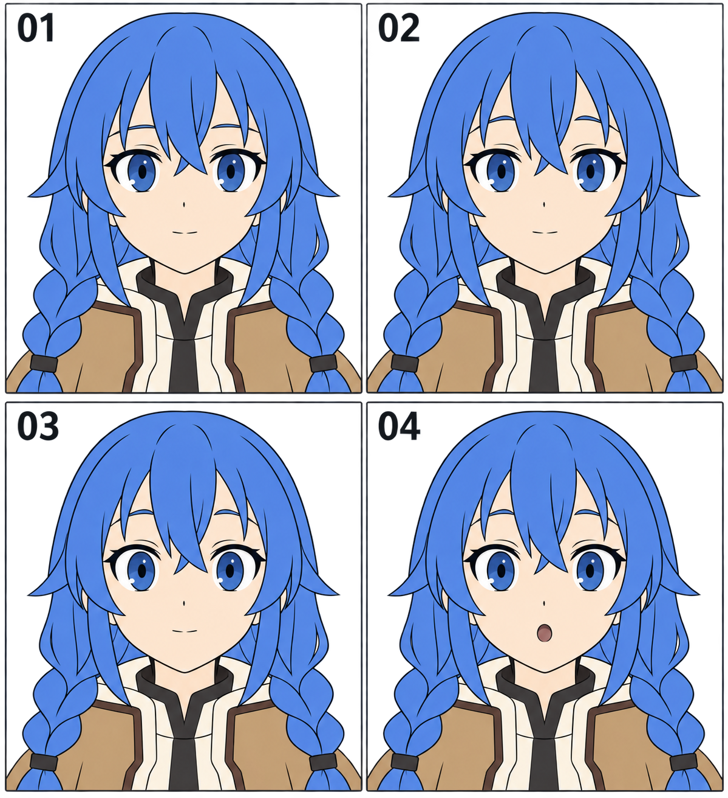

# 20 · 惊讶怎样表现

> 今天只做一件事：从平静头像改出一个“诶？”的轻度惊讶。先控制眉、眼、嘴三个地方的变化，不画夸张惊恐。

前置：第 19 篇的表情图层做法；需要时回看[张开的小嘴](09-张开的小嘴怎么画.md)。本课从平静版出发，避免把上一课的微笑全部叠进来。

## 1. 先想清楚是哪一种惊讶

收到意外的小礼物，与遇到危险，都可能睁眼、抬眉，但强度和部件组合不同。本篇选择前一种：短暂注意到意外的东西，嘴张开一点，脸形基本不变。

惊讶不是必须满足某套表情公式。我们拆成抬眉、开眼、小开口，是为了让你看清每次修改的作用；角色也可以闭着嘴表达惊讶。

## 2. 看图：三个部件逐步配合

**01** 是平静状态；**02** 重点看眉毛与眼睛之间的距离；**03** 看上眼睑抬起后虹膜露出的部分；**04** 加入小圆口，整张脸的情绪更清楚。

这张生成图的各格并非严格相同的底稿，不能用像素测量证明某个固定比例。练习时复制自己的同一头像，只改变指定部位，比较会更可靠。

## 3. 第一步：只抬眉，先看神态

复制平静组并命名“惊讶”。沿原眉的位置，把眉毛略向上移。两边可以保持原来的弧度，不必突然弯成高高的拱门。

为什么先动眉？眉眼之间的空隙变化很容易观察，也不涉及虹膜的重画。你可以先知道“只抬眉”会给这张脸带来什么感觉。

**检查：** 眼睛有没有被误选并一起移动？如果眉眼整组向上挪，改变的就是五官位置，而不是眉眼关系。撤销，再只选择眉毛图层。

## 4. 第二步：让上眼睑抬高一点

保留眼角的大致位置，抬起上眼睑中段，让眼睛的开口稍高。下眼睑这次先保持原样。原先被挡住的上部虹膜可能露出更多，应补出被遮住的部分。

虹膜的底层大小先保持不变。注意区别：眼睛睁大意味着开口改变，不意味着虹膜跟着等比放大。也不需要在虹膜四周突然留出一整圈很宽的眼白；那常会把情绪推得更强烈。

如果原画的虹膜已经露得很多，只做很小的改变即可。不同画风的眼睛开口不同，没有必须再增加多少高度的标准。

**检查：** 与平静版切换，头部保持稳定，主要是上眼睑打开。双眼的开合程度应能读成同一个表情。

## 5. 第三步：在原嘴的位置做小开口

隐藏闭嘴线。在原嘴中心附近画一个小椭圆或柔软的圆角开口，用较深、但不一定纯黑的颜色填入口腔。先不画牙齿、舌头和嘴唇高光。

小嘴不需要非常圆。你可以略偏竖向，也可以上缘更平一点。本次先保持很小的开口，避免一改嘴就变成大喊。

**检查：** 嘴中心有没有下降到下巴附近？开口增加了高度，中心仍应靠近原来的嘴部区域。先查位置，再查形状。

## 6. 把强度当作可以调节的量

保存 A“轻微抬眉、闭嘴”和 B“同样眉眼、小圆口”。这次只改变嘴。观察哪一张更像“刚注意到”，哪一张更像“已经发出声音”。不需要给每张图贴唯一情绪标签。

想画更明显的版本时，下一轮再增加眉毛高度或眼睛开口。每次只选一项，留住上一版作比较。三项同时加到最大，容易超过你原本想表达的情绪。

## 7. 常见问题怎样改？

| 看到的问题 | 可能原因 | 先尝试的修改 |
| --- | --- | --- |
| 看起来像害怕 | 虹膜缩得过小，眼白过多 | 恢复虹膜大小，减弱开眼幅度 |
| 像开心地大笑 | 嘴角明显上扬，开口太宽 | 换成更小、更接近圆角的开口 |
| 只有嘴动，神态很弱 | 眉眼仍非常放松 | 先略抬眉再比较 |
| 五官整体上移 | 移动眉时选中了整组 | 单独修改眉毛图层 |
| 嘴里黑成一大块 | 开口太大或内部对比过强 | 先缩小开口，再调暗部颜色 |

## 8. 三次小练习

1. **跟做：** 复制平静版，只抬眉，保存一张对照。
2. **独立做：** 在第二份复制稿上完成轻度惊讶，不看图尝试说明每一步的作用。
3. **只改一个条件：** 保持眉眼不变，做闭嘴和小圆口两版，选择更接近“诶？”的一张。

可以把平静、微笑、惊讶并排放在同一画布上。缩小到平时会使用的头像大小，看看情绪是否仍有区别。不要只在放大到几百倍时判断。

## 9. 到这里就可以结束

- [ ] 我保留了原来的脸形、发型和五官中心位置。
- [ ] 我能区分“眼睛开口变大”和“虹膜变大”。
- [ ] 惊讶版能与平静版区分，不必靠文字标签才能认出变化。
- [ ] 我知道怎样减弱这个表情，而不只是不断画得更夸张。

下一课把变化集中到视线：头不转，眼睛也能表达想看又有些迟疑的感觉。

[上一篇](19-微笑怎样从嘴角传到眼睛.md) · [返回总目录](00-系列总计划与目录.md) · [下一篇](21-害羞怎样通过视线表达.md)
