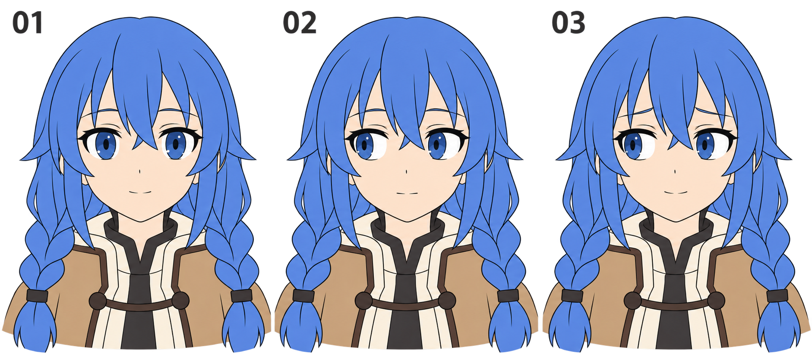

# 21 · 害羞怎样通过视线表达

> 今天只做一件事：保持头朝正面，让双眼轻轻移开视线，再用很少的眉嘴变化尝试含蓄的表情。

前置：知道[虹膜和瞳孔的关系](04-虹膜和瞳孔放在哪里.md)，能把[两只眼睛配成一对](05-两只眼睛怎样配成一对.md)。本篇不学习转头，也不要求画手挡脸。

## 1. 移开视线为什么有用？

直视观看者，与看向一侧，给人的交流感觉会不同。侧向视线可以读成思考、分心、迟疑，也可能在眉嘴与情境的配合下读成害羞。它并不天然等于害羞，更不能据此判断真实人物的心理。

画角色表情时，我们可以试着组合“视线稍避开、眉毛柔和、嘴角轻微上扬”。先不加腮红，看看眼神本身有没有变化。腮红以后可以用来加强效果，不承担所有表达任务。

## 2. 看图：头仍向前，眼神移向一边

- **01：视线主要朝前。** 先看每只眼里虹膜的位置。
- **02：双眼看向画面左边。** 两个虹膜都向图像左侧偏移，鼻子与下巴仍朝前。
- **03：保留偏移的视线。** 加入柔和眉形与小幅度的嘴角变化，尝试含蓄的笑意。

图内 01 的嘴也带着轻微笑意，所以这里不把 01 与 02 解释成严格的“只改变视线”实验。真正的单变量比较请用自己的底稿，只移动虹膜与瞳孔。图示中的发丝也有细微变化，不用于制作动画。

## 3. 第一步：明确说“画面左边”

看着画布，确认你现在要让角色看向哪一侧。这里统一用观看者看到的方向：**画面左边就是屏幕左边**，不使用容易混淆的“角色左眼往左”。

在画布外侧画一个临时小点，表示她在看的方向。点只是你的辅助标记，不导出到成品。今天让目标略偏左、距离较远，先不做看鼻尖附近物体的近距离汇聚视线。

**检查：** 你能不看角色设定，直接指出目标在屏幕哪边。这样移动两个虹膜时才不会一边采用角色方向、一边采用画面方向。

## 4. 第二步：虹膜、瞳孔、高光作为一个组

在“平静”复制稿里选中一只眼的虹膜与瞳孔，让它们一起向画面左边轻移。高光若属于你当前简化的眼睛设计，也先随组移动，避免浮在旧位置。另一只眼同样向画面左边移动。

不要只移动瞳孔而把虹膜留在原地，那样瞳孔会偏到虹膜边缘。本篇沿用简化的正面圆形虹膜，偏移幅度较小；极端侧视时虹膜形状的透视变化留到以后。

移动多少不靠统一像素数。先做很小的偏移，缩小观察，再逐步增加。虹膜靠近眼角时，会被眼睑遮挡，超出眼睛开口的部分应隐藏，不能穿到眼外皮肤上。

**检查：** 对照两眼的左右眼白分布，它们都应支持朝同一侧看。两只眼各自向鼻子靠近，会更像看近处；各自往外跑，会显得视线散开。

## 5. 第三步：头部方向保持稳定

来回切换原版和侧看版，盯着鼻尖、下巴尖、脸部中线，而不是只盯虹膜。它们应留在原处。今天改变的是眼睛在看哪里，不是整个头在朝哪里。

如果你突然觉得必须把鼻子也移过去，先停一下，保留现在这个“正面头、侧向眼神”的版本。转头是后面第 25—27 篇要拆解的问题，本课先把视线本身画清楚。

## 6. 第四步：用眉嘴尝试不同读法

保留偏移后的双眼，复制成两个版本：A 使用中性的眉嘴；B 把眉头轻轻抬一点，让眉形柔和，再给嘴角很小的笑意。

这不是害羞的唯一画法。眉头抬得太高、嘴角又向下，可能更像担忧；眉毛压得很低，可能变成警惕的侧目。先尝试较小的幅度，观察整个组合。

如果你喜欢安静、克制的洛琪希表情，可以让变化非常轻。不必为了让别人第一秒认出“害羞”就把所有符号都堆上去。

## 7. 常见问题怎样改？

| 看到的问题 | 优先检查 | 修改办法 |
| --- | --- | --- |
| 像对眼 | 两个虹膜是否都向鼻子移动了 | 回到屏幕方向，让两边都向同一侧偏移 |
| 视线散开 | 两个虹膜是否各往外侧跑 | 先放回正视版，再一起偏向目标 |
| 眼珠飞出眼角 | 是否没有处理遮挡 | 用眼睛开口限制虹膜可见区域 |
| 表情像担忧 | 眉头过高、嘴角过低 | 减小眉形变化，试轻微闭嘴笑 |
| 角色像转头了 | 鼻子、下巴或眼形一起变了 | 恢复底稿，只改视线组 |

## 8. 三次小练习

1. **跟做：** 让双眼向画面左边稍偏，眉嘴不动。
2. **独立做：** 回到正视底稿，尝试向画面右边看，确认没有变成对眼。
3. **只改一个条件：** 固定侧向视线和嘴，只比较两种眉毛弧度，说说各自让你想到什么心情。

## 9. 到这里就可以结束

- [ ] 我能明确指出双眼看向屏幕哪一侧。
- [ ] 瞳孔仍属于虹膜，虹膜没有越出眼睛开口。
- [ ] 鼻子、下巴和发型没有跟着视线移动。
- [ ] 我知道侧看也可能表达其他心情，能从眉嘴组合解释自己的选择。

下一课暂时收起情绪变化，只学习眼睑完全合上时怎样画，为眨眼准备一个闭眼状态。

[上一篇](20-惊讶怎样表现.md) · [返回总目录](00-系列总计划与目录.md) · [下一篇](22-闭眼线怎样画.md)
