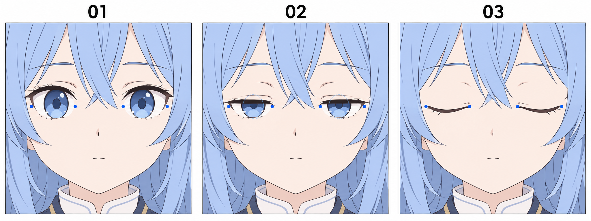

# 22 · 闭眼线怎样画

> 今天只做一件事：在原头像上画一双自然合上的眼睛，并让脸的其他部分留在原位。

前置：能指出上下眼睑和内外眼角。不清楚这些位置时，回看[一只眼睛的外形](03-一只眼睛的外形怎么画.md)。本课做普通眨眼中的闭合状态，先不做用力挤眼或大笑。

## 1. 眼睛闭上后，留下的线是什么？

闭眼线可以理解为上下眼睑闭合处的简化表达。它不是在原虹膜中间另外贴一条线，也不是把上眼睑复制到眼睛正中间就结束。

当眼睑合上，虹膜、瞳孔和眼白不再从开口里露出来。它们仍可以保存在源文件里，但在闭眼版本中应该隐藏。眉毛属于另一部件，不必随着眼睛一起下降。

## 2. 看图：观察眼角、开口与闭合线

**01** 显示睁眼，蓝点提示眼角附近位置。**02** 显示上眼睑下降、虹膜被遮挡的中间状态；淡蓝虚线提示完整虹膜形状，不属于最后线稿。**03** 开口关闭，只留下闭眼线与少量睫毛。

图中的蓝点与虚线用于找关系，不是严格重合的测量模板。实际作业以自己的原眼角为基准。图中 03 是浅浅下垂的弧线，适合本课的放松闭合示例；其他画风也可以更平，笑着闭眼还会有别的弧度。

## 3. 第一步：复制睁眼版，标出眼角

使用平静、正视的头像，不沿用上一课偏向一侧的视线。复制成“闭眼”组，保留脸、眉毛、嘴与头发不变。在临时辅助层上标出四个眼角位置。

为什么需要眼角？闭眼线的起止区域若左右漂移，切换时就像眼睛位置变了。对这次简化练习，眼角可以作为大致稳定的锚点。真实表情里皮肤也会运动，但现在先不加入这些变化。

**检查：** 辅助点只放在眼角附近，不要把睫毛尖当眼角。长睫毛可以伸出边界，不能拿它的最远端量眼宽。

## 4. 第二步：隐藏眼睛内部，清掉旧边界

在闭眼组里隐藏虹膜、瞳孔、高光和眼白。如果白色眼白直接画在脸底色上，要用匹配的皮肤底色恢复该区域。再移除旧的上眼睑与多余下眼睑线，给新线留出位置。

这是闭眼状态中很容易漏掉的一步。只在睁眼图上加一条弧线，眼白和虹膜仍露着，就不会读成完全闭合。

**检查：** 暂时把新闭眼线也隐藏，脸上应只有干净的皮肤区域，没有漂浮的高光或零散蓝点。

## 5. 第三步：连接两个眼角区域

从内眼角附近向外眼角附近画一条浅弧。对本课的放松闭合，可以让中段略低于两端，接近原下眼睑所在区域；具体高度以你的原眼形与参考为准，不规定为眼睛高度的一半。

先用细线，画完后再看是否需要给外侧加一点线重。弧度太深，闭眼线会像下垂的绳子；线太粗，则像在眼皮上涂了黑色条块。两种问题都先减量解决。

与睁眼切换，观察线有没有突然掉到脸颊。位置不合适时，整条线轻微调整比增加很多睫毛更有效。

## 6. 第四步：只保留少量睫毛

在外侧用一两根短线提示睫毛即可。睫毛跟随闭合线的方向，不把睁眼状态那一大簇完整搬过来。你也可以先完全不画睫毛，只用闭眼线验证状态。

两边不必机械镜像，但闭合程度应一致。一边弧度非常深、另一边接近平线，可能像不同强度的挤眼。本次先做温和、接近的双眼状态。

**检查：** 缩小到头像大小，即使没有额外表情符号，也应该能看清“眼睛合上了”。

## 7. 一次只比较弧度

固定闭眼线的两端和大致位置，画 A 较平的浅弧、B 中段略低的浅弧。不要同时改变眉毛和嘴。看看哪一版与自己的原头像更协调。

向上拱起的闭眼弧经常用于笑眯眼，但也受整张脸和画风影响。先完成本课的普通闭眼，再另存一版尝试笑眼，避免把两种练习混在一起。

## 8. 常见问题怎样改？

| 看到的问题 | 先检查哪里 | 修改动作 |
| --- | --- | --- |
| 还是像半睁着 | 虹膜、眼白是否还在 | 隐藏内部色块并补回皮肤 |
| 像脸颊多了一条线 | 闭眼线是否过低 | 对照原眼角与下眼睑位置调整 |
| 像浓重的眼影 | 线宽与旧线残留 | 减细新线，清理多余边界 |
| 切换时整张脸跳动 | 是否重新画了整张头像 | 恢复同一底稿，只替换眼睛 |

## 9. 三次小练习与结束检查

1. **跟做：** 在一对简化眼形上标眼角，隐藏内部，连出闭眼线。
2. **独立做：** 把做法放回自己的完整头像，暂时不画睫毛。
3. **只改一个条件：** 固定线的端点，比较两种浅弧的效果。

- [ ] 闭眼状态没有露出虹膜、瞳孔或眼白。
- [ ] 双眼的起止区域与睁眼版大致一致。
- [ ] 眉毛、鼻子、嘴和头发保持稳定。
- [ ] 我保留了睁眼与闭眼两个可以切换的版本。

下一课补两者之间的半闭状态，重点是虹膜被遮住，而不是变扁。

[上一篇](21-害羞怎样通过视线表达.md) · [返回总目录](00-系列总计划与目录.md) · [下一篇](23-半闭眼为什么不是把眼睛压扁.md)
