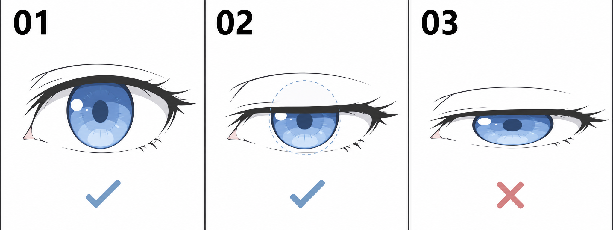

# 23 · 半闭眼为什么不是把眼睛压扁

> 今天只做一件事：在睁眼与闭眼之间，补出一个上眼睑下降的半闭眼状态。

前置：第 22 篇的闭眼版，以及原来的正视睁眼版。本篇只处理眨眼中间状态，不把“半闭眼”固定解释成困倦、嫌弃或某一种性格。

## 1. 开口变窄，与东西被压扁，是两件事

想象一张圆形蓝纸放在窗口后面，窗帘从上往下拉。你看到的蓝色区域越来越少，但纸还是原来的圆。半闭眼中的遮挡，可以先借这个关系理解。

眼睑不是平面窗帘，实际会沿眼球表面运动；不过在本课的正面简化画法里，先理解“遮住”就足够。把整个眼睛图层纵向压缩，会把虹膜、高光、睫毛一起压扁，丢掉这个关系。

## 2. 看图：第二格与第三格差在哪里？

- **01：睁眼。** 虹膜已有一部分被上眼睑覆盖。
- **02：半闭。** 上眼睑下降，蓝色虚线帮助想象原来的完整虹膜；被遮住的部分不画在成品上。
- **03：本课要避免的压扁方式。** 虹膜和瞳孔一起横向变扁，像整张眼睛被压缩。

第三格的叉号针对的是“用整体压缩代替本课遮挡”的做法，不意味着所有椭圆虹膜都错误。侧视、特定画风或夸张动画可以出现别的形状，这里先固定正面视角研究一个变化。

## 3. 第一步：从睁眼版复制

把正视的睁眼组复制为“半闭”，不要从闭眼版凭记忆重新画虹膜。这样原虹膜的大小、瞳孔位置、高光和左右视线都能保留。

若虹膜原本只画了可见的一部分，可以在临时辅助层补出完整圆形或原画风的椭圆外形。它用于检查连续关系，最终要隐藏。不要为了画辅助圆而改掉已满意的眼睛设计。

**检查：** 复制完成时，睁眼版和半闭版切换没有变化。先确认这个起点，再开始改线。

## 4. 第二步：只让上眼睑中段下降

保留内外眼角的大致区域，让上眼睑中段下移。新线仍然是一条带弧度的眼睑边界，不必画成绝对水平的切割线。外侧睫毛跟随眼睑向下调整。

“半闭”在这里指介于开和关之间，不要求精确剩下一半高度。选择一个能与睁眼、闭眼明显区分的开口即可。下眼睑先保持近似稳定，这是一种适合起步的简化，不是对所有眨眼的解剖规定。

**检查：** 只看上边界，你能辨认它比原版更低。若上下两边同时向中央挤、虹膜也变扁，可能误用了整层缩放。

## 5. 第三步：隐藏新眼睑以上的虹膜

清掉旧上眼睑，再把新边界上方露出的虹膜、瞳孔和眼白隐藏。可以使用蒙版，也可以在复制稿上擦除；选择你当前熟悉的工具。用脸部皮肤色补回眼皮覆盖的区域，保持层次一致。

眼睑上方不该还有原高光漂浮着。高光如果落入被遮挡的范围，也应该一起消失。不要特意把它挪到下方，只为了让每个状态都有一颗亮点。

**检查：** 暂时显示完整虹膜辅助形，它应能与下方可见部分接起来；如果接不上，回查是否移动或缩放了虹膜。

## 6. 第四步：对照闭眼版，而不只看单张

按“睁眼—半闭—闭眼”手动切换。注意三件事：眼角有没有大幅跳动；上眼睑是否总体向下；完全闭合时内部色块是否全部消失。

半闭版单独看可能显得困倦，这是正常的阅读结果。作为眨眼过渡，它会很短暂地出现，最终效果还要看播放顺序与停留时间。不要因为一张静止图显困就把嘴角加成微笑，本课先保持其他部件稳定。

## 7. 一次只比较遮挡量

保存 A“较少遮挡”和 B“较多遮挡”，两版共用同一个虹膜。交替查看，看哪一版更适合作为开与关之间的中间一步。先不改瞳孔大小，不加新的光影。

如果你熟悉编程，可以把这一点理解为“改变可见区域”与“改变图形尺寸”的区别。这个类比只是帮助理解，实际板绘仍通过眼睑边界、皮肤覆盖与线条来表达。

## 8. 常见问题怎样改？

| 问题 | 可能原因 | 一次先改什么 |
| --- | --- | --- |
| 蓝色虹膜变成扁饼 | 缩放了整只眼睛 | 取回原虹膜，只改变上方遮挡 |
| 眼皮上有亮点 | 高光没跟着遮挡隐藏 | 清掉新边界以上的高光 |
| 线稿有两条上边界 | 旧上眼睑未移除 | 隐藏旧线，仅保留新边界 |
| 左右像不同表情 | 双眼遮挡程度相差太多 | 对比两侧剩余开口高度 |
| 半闭时头发也晃动 | 状态来自不同完整画稿 | 使用同一头像的复制版本 |

## 9. 三次小练习与结束检查

1. **跟做：** 在单眼上画辅助虹膜，下降上眼睑并遮住上部。
2. **独立做：** 回到头像，为双眼补出半闭版，隐藏辅助层。
3. **只改一个条件：** 比较两种遮挡程度，挑一个作为中间状态。

- [ ] 半闭版保留了原虹膜的底层大小。
- [ ] 旧眼睑、高光和眼白没有残留在眼皮上方。
- [ ] 我能手动按顺序切换三种状态，其他部件保持稳定。
- [ ] 三种状态已经保存，准备做第一次播放。

[上一篇](22-闭眼线怎样画.md) · [返回总目录](00-系列总计划与目录.md) · [下一篇](24-把三种眼睛状态连起来.md)
