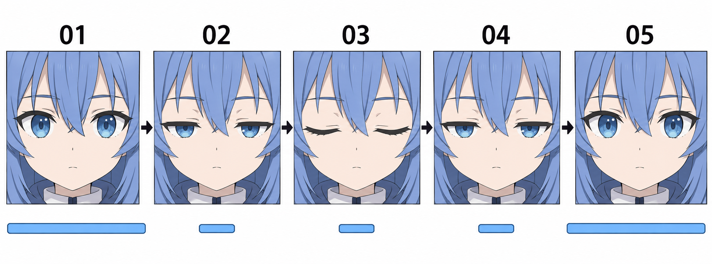

# 24 · 把三种眼睛状态连起来

> 今天只做一件事：把自己画的睁眼、半闭、闭眼三个状态，按顺序播放成一次简单眨眼。

前置：第 22、23 篇的闭眼和半闭版，以及同一底稿的睁眼版。第一版可以很粗糙，先检查变化是否连贯，不要求立即变成完整桌宠。

## 1. 三张图，为什么要排成五个位置？

眨眼包含合上和重新睁开。最小练习可以用下面的顺序：

**睁眼 → 半闭 → 闭眼 → 半闭 → 睁眼。**

这是五个播放位置，但只有三张不同的图片。第一次练习时，张开阶段直接复用半闭图就可以。以后还可以分别画闭合与张开的过渡，调整速度，让动作更细腻。

## 2. 看图：顺序和停留长短

图中 **01、05** 都是睁眼，**02、04** 都是半闭，**03** 是闭眼。下方长条提示睁眼停留较长，中间几个状态短暂经过。条长只是示意，不按比例测量时间。

生成图中的发丝、眼睛位置存在细微差异，因此不要直接裁下这五格作为正式帧。动画最容易暴露这种差异：单张看起来接近，快速切换时头发却会抖。请使用自己的同一底稿。

## 3. 先手动检查三个文件

从源文件分别导出 `open.png`、`half.png`、`closed.png`。三张使用完全相同的画布尺寸与导出范围，人物位置不变。不要每张单独裁切到人物边缘。

这里导出的是完整头像状态。即使眼睛之外的地方完全相同，也先保留它们，减少第一次练习的组装步骤。透明背景可以用，三张都保留同样的透明画布边距。

**检查：** 在同一个窗口里切换三张。盯着帽尖、鼻子或下巴，如果它们在动，先回源文件修位置，再调动画速度。尺寸相同也不代表内容已对齐；两项都要看。

## 4. 用本地预览直接试

打开[眨眼练习工具](blink.html)。HTML 阅读版在本课下方也提供同一工具入口。

工具起初显示一对简化眼睛，用来演示遮挡关系。它是程序绘制的教学示意，不是你的画稿，也不是洛琪希的成品动画。你可以先按“下一步”观察五个位置，再点击“播放”。

准备好自己的图后，分别选择睁眼、半闭、闭眼三个 PNG，点击“使用我的三张图”。文件只在当前浏览器页面中读取，不会上传，也不会改动原图。工具会检查三张尺寸是否一致；位置是否对齐仍需要你观看判断。

关闭或刷新页面后，自选图片需要重新选择。工具只做预览，不导出 GIF 或视频；可编辑源文件和三张 PNG 仍是本课需要保留的成果。

## 5. 先采用一套简单节奏

工具的默认一轮是：睁眼 1000 毫秒，半闭 80 毫秒，闭眼 80 毫秒，半闭 80 毫秒，睁眼 1760 毫秒。加起来是 3000 毫秒，也就是 3 秒。

这是便于比较的练习参数，不是所有角色或真实眨眼必须遵守的时间。重点是：大部分时间保持睁眼，中间几个状态快速经过。第五步与下一轮第一步都是同一张睁眼图，它们相邻时只会继续保持睁眼。

点击暂停，再逐步切换可以检查图形；播放时才判断节奏。把所有状态都设成一秒，通常会像角色在慢慢闭眼休息。你可以切到慢速观察，再恢复正常速度比较。

## 6. 想用 Krita 时怎样对应？

Krita 可以通过动画工作区与时间轴进行逐帧动画，重复帧便于保留原画继续修改，绘图纸外观可辅助检查相邻帧。入口与术语可查[Krita 官方动画手册](https://docs.krita.org/zh_CN/user_manual/animation.html)。

本课给一个可选的 12 帧每秒练习安排：

| 时间轴帧号 | 放什么状态 | 保持到哪一帧 |
| --- | --- | --- |
| 0 | 睁眼 | 11 |
| 12 | 半闭 | 12 |
| 13 | 闭眼 | 13 |
| 14 | 半闭 | 14 |
| 15 | 睁眼 | 35 |

将播放范围设为第 0—35 帧，这一轮共 36 帧，在 12 帧每秒下约为 3 秒。表中的单帧过渡约 83 毫秒，与网页默认的 80 毫秒接近，但不是完全一样。不熟悉时间轴时，先完成网页预览就足够。

## 7. 一次只比较播放速度

同一组三张图，分别用正常速度与慢速播放。不要同时换图。慢速有助于找旧线残留、遮挡错误和位置跳动；正常速度帮助判断是否像短暂眨眼。

如果正常播放很生硬，先暂停定位是哪一步不连贯。半闭与闭眼的差距特别大，可以调整半闭版的遮挡量。若头发在抖，修改时间并不能解决，应该修帧的一致性。

## 8. 常见问题怎样改？

| 看到的问题 | 优先检查 | 下一步 |
| --- | --- | --- |
| 整个人忽大忽小 | 导出尺寸、裁切范围是否一致 | 同一画布重新导出全部状态 |
| 头发在跳 | 是否用了分别生成或分别重画的图 | 回到同一底稿复制修改 |
| 像慢慢睡着 | 中间状态停留过长 | 缩短半闭与闭眼，保留较长睁眼 |
| 像闪了一下 | 闭合过快，或中间状态差距过大 | 慢放检查形状，再小幅调整时间 |
| 浏览器提示尺寸不同 | 三张文件尺寸不一致 | 修正源文件画布与导出范围 |

## 9. 三次小练习与结束检查

1. **跟做：** 使用默认示意，暂停并走完五步，说出为什么只有三张图。
2. **独立做：** 载入自己的三张 PNG，播放一轮，再逐步检查鼻尖是否稳定。
3. **只改一个条件：** 使用同一组图比较正常与慢速，写下一个形状问题或节奏感受。

- [ ] 三个 PNG 使用同一画布，头部位置稳定。
- [ ] 闭合时眼睛内部完全隐藏，重新睁开能回到原状。
- [ ] 我看到了自己的头像第一次眨眼，或已定位到一个具体要修的问题。
- [ ] 我保留了源文件和导出文件，下一次可以继续改。

本阶段 19—24 到这里完成。继续阅读[第 25 篇：球体中线怎样表示转向](25-球体中线怎样表示转向.md)，或先进入已完成的[第 39 篇：整理表情素材](39-怎样导出不会跳动的表情素材.md)。第 39—42 篇附独立的 [Python 桌面练习程序](练习工具/角色小作品/README.md)，可以不用网页完成素材检查与交互练习。

[上一篇](23-半闭眼为什么不是把眼睛压扁.md) · [返回总目录](00-系列总计划与目录.md)

[下一篇：球体中线怎样表示转向](25-球体中线怎样表示转向.md)
