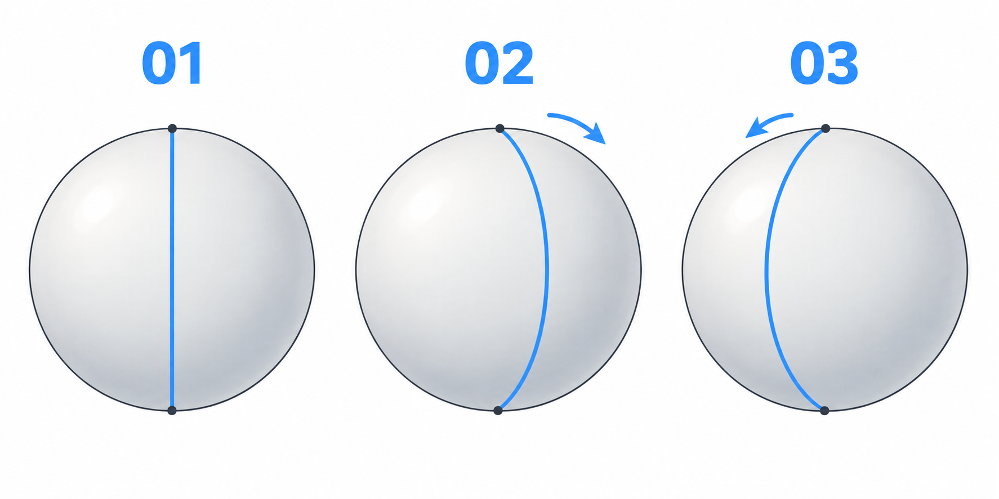

# 25 · 球体中线怎样表示转向
> 今天只画三个球和三条中线，让人能分辨正面、朝画面右边转、朝画面左边转。先不画眼睛，也不要求把球画得很圆。

前置：会在板绘软件中新建图层、画简单圆形。这里的“左、右”都指你看到的画面方向。预计先尝试 20—30 分钟。

## 1. 一个没有标记的球，看不出它转了

想象一个没有花纹的球：绕竖直方向转动后，它的外轮廓仍然是圆。为了看出哪一面朝向我们，可以给它画一条从顶端经过正面到底端的线。

这条线贴在球面上，不是一根悬在球前的直线。正对我们时，它的投影接近直线；球向一侧转动后，看到的线会偏向那一侧并弯曲。它帮我们建立“脸的正中央朝哪里”的感觉。

真实头部不是完整的球，脸颊、下巴和鼻子还要另加。现在只借球体理解朝向，不拿球体曲线直接当作最后的脸部轮廓。

## 2. 看图：圆没有变，中线变了

**01**：中线穿过画面里的圆心，接近直线。**02**：球面正中央转向画面右边，中线中段向右鼓出。**03**：转向画面左边，中段向左鼓出。黑点提示同一竖直转轴的上下端，蓝线才是本课观察对象。

图中的明暗只是帮助认出球体，不是这次练习内容。你可以只用圆和蓝线跟画。生成图用于看关系，各格不作为严格的角度或尺寸标尺。

## 3. 第一步：画圆，找上下两个点

在草图层画一个大约手掌大小的圆，复制成三个。不必反复撤销追求几何精度；线有一点抖，只要不影响判断上下左右就可以。

在每个圆的最上、最下位置各放一个点。先用很淡的直线连接，作为转轴参考。三个圆保持一样大，后面才能把变化归因于中线。

**检查：** 上下两点与圆心大致在同一条竖线上。若起点本身偏斜，容易把转向误画成歪头。

## 4. 第二步：正面先用直线

在第一个圆上沿淡线画出稍清楚的中线。此时左右两半的可见宽度大致相等。把它命名为“正面”。

为什么暂时不用十字线？一条线已经能完成本课的任务。过早叠加很多辅助线，反而可能不知道自己在看哪一个变化。眼睛所在的横向关系下一课再补。

## 5. 第三步：让中段向右鼓出

在第二个圆上保留上下端点，把中线中段移到圆心右边，再用一条连续、平顺的弧线连接。先做轻微弯曲，整条线应留在圆内。

不要把竖直直线整体平移到右侧；那样更像在平面圆上画了一根偏心线。弧线经过的表面正在绕向球体一侧，曲率就是这次要观察的东西。

**检查：** 线条是否只有一个顺畅的鼓出方向？如果先向右、又向左拐，会像波浪贴在球上。先删去多余转折，再减少弧度。

## 6. 第四步：向左做一次，再比较

第三个圆采用相反方向：中段偏左，上下仍接回原来的两个点。并排看三个圆，试着不用文字也能指出朝向。

再复制右转球，只增加一点中段偏移量。对于本课绕竖轴转动的简化情况，中线越靠近侧轮廓，通常表示越接近侧向；但偏移量不是通用的角度刻度。头部加上脸形后还要重新观察。

## 7. 常见问题与一个小对比

| 问题 | 先看哪里 | 先改什么 |
| --- | --- | --- |
| 只像一条移开的直线 | 中线有没有弧度 | 固定两端，让中段平顺鼓出 |
| 看起来是歪了，不是转了 | 上下端点是否一起倾斜 | 恢复竖直转轴 |
| 球也跟着变瘦 | 是否缩放了整个圆 | 复制同一圆，只改中线 |
| 越画越乱 | 辅助线是否堆得过多 | 每个圆暂时只留一条中线 |

单变量比较：固定圆的大小与位置，只画“稍向右”和“更向右”两条中线。先说出朝向差别，不给它们硬套 15 度、30 度。

## 8. 三次小练习

1. 跟图画正面、右转、左转各一个，不加阴影。
2. 关掉图，再画一个朝你指定方向转的球，说出判断依据。
3. 同一圆内只改变中线偏移量，留下两个不同程度的版本。

## 9. 可以结束的标准

- [ ] 圆形外轮廓基本保持相同。
- [ ] 我知道中线表示球面正中央，而不是最后线稿。
- [ ] 我能从弧线偏向判断画面左右的转向。
- [ ] 我没有靠五官或文字来替这条线解释方向。

下一课在这份朝向信息上放两只眼睛，观察为什么远侧的可见眼形会收窄。

[上一篇](24-把三种眼睛状态连起来.md) · [返回总目录](00-系列总计划与目录.md) · [下一篇](26-侧转时双眼为什么不再一样宽.md)
