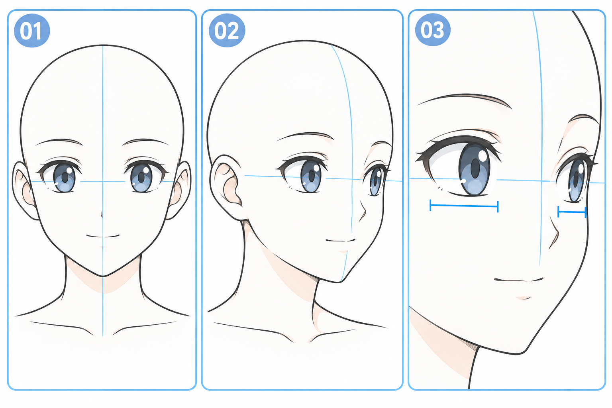

# 26 · 侧转时双眼为什么不再一样宽
> 今天只做轻微侧转的眼部占位：先让两只眼属于同一个朝向，不画复杂睫毛与高光。

前置：第 25 篇的球体中线，以及第 05 篇的双眼配对。本课以头向画面右边转为例，不叠加抬头、低头和歪头。

## 1. “近侧、远侧”指哪边？

头转向画面右侧时，本课示例中画面左侧的半张脸更朝向我们，称为近侧；画面右侧的半张脸绕向后面，称为远侧。近远是相对观看位置而言，不是角色左右眼的固定名称。

眼睛长在有体积的脸上。远侧眼部随脸面转开，投影会收窄，有时还会被鼻梁附近的结构部分遮挡。因此，侧转后的可见眼形不能简单复制两个正面眼睛，再把它们整体挪到一边。

也不要把结论背成“远眼永远缩小多少”。角度、脸形和画风都会影响结果，轻微转向的差异可以很小。

## 2. 看图：先比宽度，再看位置

**01** 是正面参照。**02** 转向画面右侧，中线靠右，近侧眼在画面左边。**03** 放大展示两只眼，蓝色短横括号提示可见宽度差异，不是要求照抄的比例。

图中远眼压缩得比较明显，是为了让差别容易看见。你第一次可以选更轻的角度。生成图的线条和五官有附带变化，自己的练习应从同一底稿比较。

## 3. 第一步：决定脸的朝向

画头部圆形与下巴，补上朝右弯曲的中线。脸颊不再强求左右对称：远侧可见范围会变窄，下巴也要跟随整个脸面方向，不能一直钉在原正面的位置。

如果这一步困难，只用球体和简单下巴占位即可。今天重点是眼睛，不需要先把头部轮廓精修到满意。

**检查：** 暂时没有眼睛时，是否已能大概认出朝右？若朝向仍不明确，先修中线，不用精细眼睛掩盖问题。

## 4. 第二步：把眼部看成绕脸的一条带

用一条轻的辅助线提示两眼所在高度，让它沿脸部表面延伸。在本课接近水平观看、没有歪头的示例里，两眼整体处在相近的高度区域；不必为了“远”就突然把远眼抬高很多。

先在近侧画一个简单眼形框，再给远侧留一个较窄的框。框的中心与中线的关系也会变化，不能只缩眼睛而完全照搬正面眼距。

**检查：** 眼睛是否挤到了脸外？远侧眼与轮廓之间仍要有合理的眼角区域，但不要求与近侧留下同样宽的空隙。

## 5. 第三步：远侧主要收宽，别整只压扁

在近侧框里放上下眼睑；远侧则沿更窄的可见区域画。先保持接近的开合程度，让它们表达同一个神态。

整只眼纵向压扁可能看起来像一边半闭，不是在转头。也不能把远眼当作一张小贴纸等比缩小后塞进脸上：眼角、眼睑弧线和虹膜遮挡仍要适应那个脸面。

虹膜可以先画成很简单的可见色块。先确认两眼看向一致，再处理虹膜的侧向形状，暂不画高光。

## 6. 第四步：用远近关系检查整张脸

缩小画布，看两只眼是否仍像一对。有时单独看远眼并不符合你习惯的正面画法，放在侧转脸里却是协调的；不要离开整张脸追求每只眼都像独立漂亮的正面眼。

做一个 A/B 对比：A 把两眼画成同宽，B 只调整远侧可见宽度与必要的眼角位置。比较哪一个更能延续中线给出的朝向。保持眉嘴暂时不变，减少干扰。

## 7. 常见问题

| 现象 | 检查点 | 一步修正 |
| --- | --- | --- |
| 脸转了，眼睛仍正对着 | 两眼是否机械同宽同形 | 沿远侧脸面收窄眼形 |
| 像一边没睡醒 | 远眼高度被压得太低 | 恢复开合，优先调整横向宽度 |
| 两眼各看各的 | 虹膜是否各自随意摆放 | 先统一目标方向，再修遮挡 |
| 远眼挤出轮廓 | 眼框与远侧脸边界冲突 | 先重排占位，再画细线 |

## 8. 三次小练习与完成判断

1. 跟图画中线和两个眼框，先不画虹膜。
2. 不看图，做一次朝相反方向转的眼部占位，重新指出近侧与远侧。
3. 固定头部朝向，只比较远侧眼形略宽和略窄两版。

- [ ] 我能指出本图的近侧和远侧。
- [ ] 两眼沿同一眼部区域排列，神态大致一致。
- [ ] 远眼的变化主要来自朝向，没有误画成半闭眼。
- [ ] 缩小后，双眼与头部中线表达同一个方向。

下一课把鼻子和嘴放回这个方向中，避免“眼睛侧转、嘴还贴在正中”的拼接感。

[上一篇](25-球体中线怎样表示转向.md) · [返回总目录](00-系列总计划与目录.md) · [下一篇](27-侧转时鼻子和嘴怎样跟着走.md)
