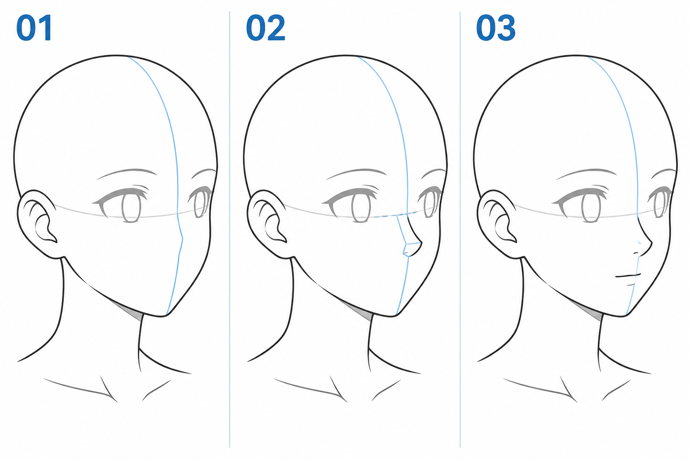

# 27 · 侧转时鼻子和嘴怎样跟着走
> 今天只把简化鼻子和小嘴放进上一课的侧转脸。先做到方向一致，不深入复杂鼻翼、嘴唇体积和极端侧面。

前置：第 26 篇已有眼部占位。继续沿用朝画面右边的轻微侧转，使用同一个头部底稿。

## 1. 中线是参考，鼻尖还会向前突出

正面小头像里，鼻子可能只是一点或一小段线，因此很容易把它当作贴在皮肤上的符号。侧转以后，鼻子的突出方向更容易被看见。

脸部中线帮助安排额头、鼻根、嘴部中心与下巴的关系，但鼻尖在脸面前方，不要求所有可见标记像珠子一样串在一条直线上。嘴也贴着口部表面，会随该表面的转向改变可见形状。

## 2. 看图：先有朝向，再加突出部分

**01** 留出侧转脸面与眼睛占位。**02** 用一个小转折提示鼻子向画面右前方突出，蓝色小结构是辅助解释。**03** 简化鼻线，在下方加入小嘴，五官共同朝同一方向。

这张图故意省去了头发，避免用发型遮住定位问题。中线在真实脸部的走向会受到额头、鼻子和下巴形体影响，不需要把第 25 篇的球面弧线原样穿过整张脸。

## 3. 第一步：找鼻根与鼻底的大致区域

在原头像上轻标鼻根区域，它位于两眼之间靠上的面部连接处；再参考原角色的眼鼻距离，标鼻底区域。先检查上下位置，不急着画一个完整鼻子。

不同二次元画风对鼻子大小和高度的处理不同。使用自己之前的头像作参照，比套一个陌生的“三庭”数值更容易保住角色特征。

**检查：** 新鼻子是否忽然拉长了中庭，让角色年龄感觉明显变化？先恢复原来的大致眼鼻关系，再调整朝向。

## 4. 第二步：用小折面提示突出

从鼻根区域向鼻底方向带一小段线，在鼻尖处向画面右侧略突出，再收回鼻底。线条可以很短，甚至只保留鼻尖附近的两个转折。

你可以先在辅助层把鼻子想成很小的楔形，再在清稿里删去不必要的边。不要把整个鼻梁到鼻翼都描黑；本课目标是读出突出方向，而不是一次画完写实鼻结构。

**检查：** 线的凸出方向是否与头部转向一致？如果鼻尖向左、脸中线向右，除非有特殊设计，否则容易产生冲突。

## 5. 第三步：确定嘴部中心，不把嘴贴到鼻尖正下方

沿鼻底以下的脸面找嘴部区域。嘴中心跟随口部表面，而鼻尖因为向前突出，投影位置可能更偏一侧。所以不能单纯从鼻尖向屏幕正下方拉一条直线，就认定那一定是嘴中心。

先放一个很小的中心点，再向两侧延伸短嘴线。远侧那一半可以显得更短，整条线还要贴合脸面，不强求左右等长。先保留平静闭嘴，避免同时增加表情难度。

**检查：** 嘴是否仍位于鼻底与下巴之间合理的区域？有没有一边伸到远侧轮廓外？缩小后若像贴歪了，优先移动整个嘴部占位，不用增加唇线。

## 6. 第四步：一起看眼、鼻、嘴和下巴

暂时隐藏细节，用四个简单区域检查：双眼所在带、鼻子突出、嘴部中心、下巴落点。它们要像属于同一张转过来的脸。

若只把眼睛挪右、鼻子挪右、嘴挪右，外轮廓仍完全正面，结果可能只是五官歪到一边。回看脸颊的近远关系与下巴位置，把它们作为一个整体调整。

做单变量比较时，可以先固定眼、鼻和脸形，只把嘴放在两个略不同的位置，比较哪一个更贴合脸面。不要同时换嘴角弧度。

## 7. 常见问题

| 问题 | 可能原因 | 先改一处 |
| --- | --- | --- |
| 鼻子像贴纸 | 没有任何突出或朝向提示 | 补一个很小的鼻尖转折 |
| 嘴像还在正面 | 两半等长且中心仍沿原正面位置 | 沿新口部表面重新定位 |
| 鼻嘴拉得很远 | 朝向变化时连上下比例也改了 | 恢复底稿里的大致间距 |
| 脸像被扭坏 | 五官和脸颊、下巴朝向不一致 | 回到简化占位整体检查 |

## 8. 三次小练习

1. 在现成侧转头部上，只用两个转折提示鼻子方向。
2. 关掉示意图，加入小嘴，再指出它为什么放在那里。
3. 固定其他部件，只试两个嘴部中心位置，保留更协调的一版。

## 9. 可以结束的标准

- [ ] 鼻子的突出方向与头部转向一致。
- [ ] 嘴的中心跟着口部表面，而不是机械跟着屏幕中心。
- [ ] 原角色的大致眼鼻嘴距离仍可辨认。
- [ ] 我能在没有头发遮挡时说明五官的朝向关系。

下一课暂时回到正面，区分“转向一侧”和“整张脸在画面里倾斜”。

[上一篇](26-侧转时双眼为什么不再一样宽.md) · [返回总目录](00-系列总计划与目录.md) · [下一篇](28-歪头时整张脸怎样一起倾斜.md)
