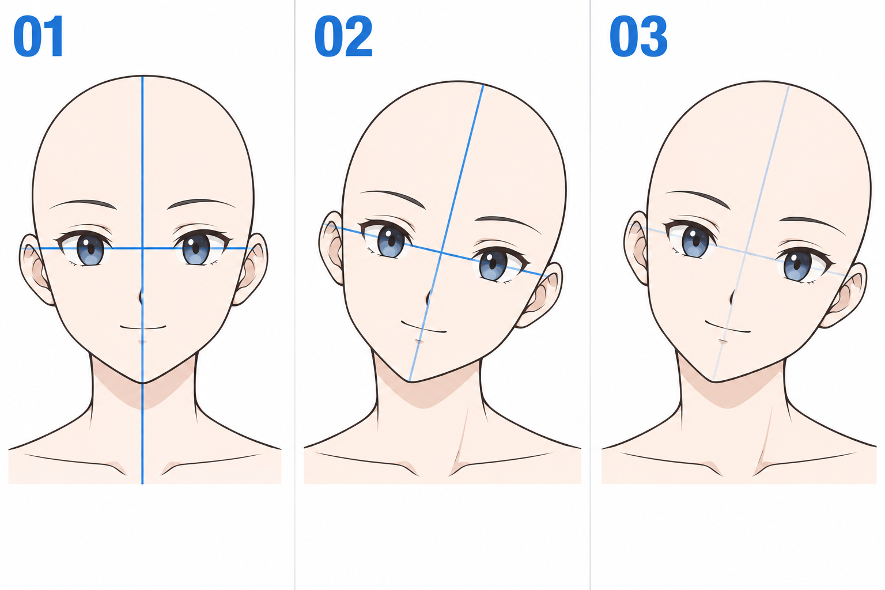

# 28 · 歪头时整张脸怎样一起倾斜
> 今天只画一个轻微歪头：让脸形、眉眼、鼻嘴一起倾斜。先不同时侧转，也不加身体动作。

前置：第 10 篇的正面脸、第 15 篇的颈肩连接。第 25—27 篇讲侧转，本篇换一种变化。

## 1. 歪头与转头，最容易混在哪里？

转头时，一侧脸面绕向远处，双眼的可见宽度会发生变化。歪头可以先理解为正面脸在画面平面里倾斜，整张脸的内部关系一起旋转。

真实动作可能同时包含转头、俯仰和倾斜。初学时把它们分开，会更容易找出哪一步出了问题。本篇只练一个小角度的平面倾斜。

## 2. 看图：两条轴线一起转

**01** 是竖直中线与近似水平的眼线。**02** 头顶朝画面右侧、下巴朝左侧，十字线一起倾斜；画面右侧眼睛因此更低。**03** 辅助线变淡，保留已经统一倾斜的五官。

这是一组动作关系示意，不是逐像素旋转对照。图里的脖子与脸形也做了绘画调整。实际练习先用自己同一张脸，保留一个不动的版本作比较。

## 3. 第一步：先画十字，再放脸

新建辅助层，画一条略向右上方倾斜的脸部中线；在眼睛高度附近加一条与它近似垂直的线。本课正面简化示例中，这两条轴线应成组转动。

在中线两边放头部外形，先找下巴与头顶，不画睫毛。若圆形难以控制，也可以复制现有正面头部草图，用软件旋转工具做一份参照，再另画一次。

**检查：** 你能看见整张脸的倾斜方向，而不是只有下巴偏向一边。辅助线交点也不必固定在画布中心，关键是内部关系。

## 4. 第二步：让眼睛跟着眼线排列

把两只眼睛放在倾斜的眼部区域内。它们相对屏幕一高一低，但相对头部仍然处在同一组关系中。

不要为了“让双眼对齐”又把它们拉回屏幕水平线。对齐应该对着头部自己的轴线看。这个区别很重要：画布的水平不一定是角色脸部的水平。

眉毛也跟随这组关系。可以先用两条短线占位，确认眉眼距离与正面版本接近，再补实际眉形。

## 5. 第三步：鼻嘴也使用同一坐标方向

在倾斜中线附近定位鼻子与嘴。平静的小嘴也要顺着脸部方向倾斜，不能眼睛已经斜了，嘴还固执地贴着屏幕水平。

你有编程基础，可以把头部想成一个父对象：五官相对头部的局部位置暂时不变，父对象整体转动。这个类比只用于理解关系；在绘画中仍需调整轮廓与颈部连接。

**检查：** 用一条淡辅助线经过嘴部，比较它与眼线是否大致同向。表情会改变嘴角，但本课先用平静嘴，避免混淆。

## 6. 第四步：脖子重新接回肩膀

头歪了，肩膀可以仍然接近水平。头颈连接处与脖子两侧的外形会随之调整，一侧看起来更短或被下颌遮住，另一侧更展开。

不要把整段脖子当成硬木棒，跟头一起机械旋转后插进肩膀。先放肩线，再从头颈连接处向肩颈区域接两条简化轮廓，观察有没有断裂或尖锐折角。

第一轮角度小一点即可。若感觉只能靠很长的脖子才能接上，尝试减小倾斜、调整头相对肩膀的位置。

## 7. 一个对比与常见问题

复制同一张正面头像，A 只倾斜外轮廓，B 把外轮廓和五官一起倾斜。比较哪张更像完整的头。A 是故意的错误实验，不用把它修到好看。

| 现象 | 检查 | 修改 |
| --- | --- | --- |
| 眼睛像画歪了 | 眼线是否与脸中线关系冲突 | 让两条轴线一起转 |
| 嘴像贴上去的 | 嘴还保持屏幕水平 | 顺头部方向调整嘴线 |
| 像一侧眼变小 | 是否又加了侧转的压缩 | 本轮恢复正面眼宽关系 |
| 头与脖子脱节 | 是否整层机械旋转后未重接颈部 | 固定肩线，重新连接脖子 |

## 8. 三次练习与完成判断

1. 只画三组不同小角度的十字轴线，不画脸。
2. 选一组，放入自己的正面脸和简化五官。
3. 固定倾斜角度，只修改颈部连接，比较修改前后。

- [ ] 眼、眉、鼻、嘴和脸形遵循同一倾斜方向。
- [ ] 我没有把歪头误处理成一只眼缩小。
- [ ] 脖子能接回肩膀，头没有悬空。
- [ ] 我能解释这张画与侧转头部有什么不同。

下一课暂停改变姿势，先在简单球体上理解光与影。

[上一篇](27-侧转时鼻子和嘴怎样跟着走.md) · [返回总目录](00-系列总计划与目录.md) · [下一篇](29-光从哪里来，阴影会落在哪里.md)
