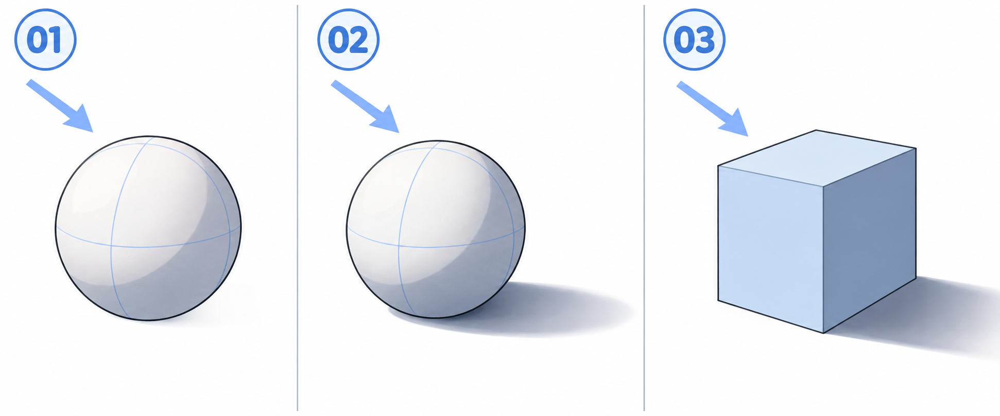

# 29 · 光从哪里来，阴影会落在哪里
> 今天只决定一个光源，并把一个球上的受光、背光和地面投影分清楚。先不画角色皮肤，也不研究复杂材质。

前置：能分层铺色。准备一种底色与一种较暗颜色，预计先做 20—30 分钟。

## 1. 先分清两种“影”

球上背向光的区域比较暗，这是形体自身的明暗变化。球挡住光，使地面某一块变暗，这是球投到地面上的影子。两者成因和所在表面不同。

画角色时，头发自己背光，与头发挡住光后落在脸上的影子，也需要区分。现在用球和地面把这件事讲清，之后才不会见到哪里空就随意涂一块灰。

## 2. 看图：箭头指光照过来的方向

三格都使用来自画面左上方的光。**01** 重点看球左上较亮、右下较暗。**02** 额外观察地面向右延伸的投影。**03** 换成方块，相对光源朝向不同的面有不同明暗。

图里有少量渐变、接触暗部和柔边，它们用于说明体积。第一次作业只需把大明暗分组画清楚，不要求复制所有过渡。蓝色球面线是结构参考，不是暗部边界。

## 3. 第一步：先画光源箭头

在画布左上角画一个箭头，指向球体。把它放在“光向”辅助层，整个练习暂时不变。球下面画一条简单地面提示线。

不要画着画着，为了让右侧某块好看又临时加一盏灯。多光源当然可以画，但今天只保留一种主要方向，判断更容易。

**检查：** 看箭头而不是凭记忆，你能说出“光从左上来，朝右下照”。箭头指向光照行进方向，不要把它与指向灯的位置混淆。

## 4. 第二步：在球上分出一块背光区

先铺球的底色。新建阴影层，在较背向光的右下区域安排一块偏暗的颜色，边界顺着球的曲面弯曲。不要沿着圆轮廓等宽描一圈，那更像描边。

球面明暗并不一定是刚好一半亮、一半暗，也不必用一条直线对半切。你可以先做简化的两块色，重点是判断朝向；柔和过渡留给下一轮。

**检查：** 隐藏线稿后，明暗是否仍让球像有体积？若只看到一枚有色圆片，先调整暗部形状，不用急着加高光。

## 5. 第三步：把投影画到地面上

在球下方、较远离光源的一侧画一个贴着地面的扁形影子，本例总体向画面右边延伸。接触附近应与球底衔接，不能留出明显白缝，否则容易看起来悬空。

投影具体长短、方向和软硬还受灯的位置、光源大小、物体离地高度影响。今天只保留粗略方向关系，不能从“左上光”三个字算出唯一正确的投影轮廓。

**检查：** 球上的暗部和地面影子是否都能由同一箭头解释？影子是否真的落在地面上，而不是沿球轮廓飘着？

## 6. 第四步：换成方块，仍用同一盏灯

给一个简单方块的几个可见面铺不同明度。大体朝光的一面较亮，较背光的一面较暗。方块有明确转折面，能帮助你理解为什么不必给所有区域刷同一种渐变。

保持光向不变，再安排地面投影。不要因为方块与球形状不同，就把光源方向也反过来。

单变量对比：复制同一球体，只把灯改到右上，重新画暗部与投影。比较两张方向如何相反；球的底色和大小暂时相同。

## 7. 常见问题

| 问题 | 优先检查 | 修改动作 |
| --- | --- | --- |
| 影子像随便贴了一块 | 有没有先确定光源 | 补光向箭头，再重画大暗部 |
| 球像描了黑边 | 暗部是否沿轮廓等宽一圈 | 改成描述曲面的色块 |
| 球浮起来 | 地面投影与球底有没有断开 | 检查接触位置 |
| 每个物体光都不同 | 是否局部随意选择亮暗 | 同时显示光向层检查 |

## 8. 三次小练习与结束检查

1. 只用底色与一种阴影色，画左上光下的球体。
2. 不看图，添加地面投影，并说明它为何在这一侧。
3. 只改变光源方向，比较对应的暗部变化。

- [ ] 我能区分物体自身背光和落到别处的投影。
- [ ] 暗部与投影能由同一个主要光源解释。
- [ ] 我没有把蓝色结构线直接当成阴影分界线。
- [ ] 不靠大量高光，也能看出一点体积。

下一课回到已完成的头像，只加一层简单阴影。

[上一篇](28-歪头时整张脸怎样一起倾斜.md) · [返回总目录](00-系列总计划与目录.md) · [下一篇](30-给头像加一层简单阴影.md)
