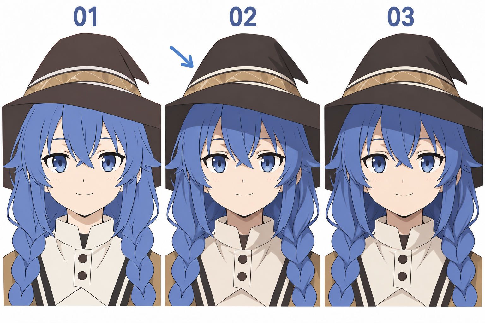

# 30 · 给头像加一层简单阴影
> 今天只给第 18 篇的底色头像增加一层简单阴影。让帽子、头发、脸和脖子遵循同一个光源，保留一份纯底色版。

前置：第 17 篇的颜色分区与第 29 篇的光源判断。可以直接使用正面头像，不要求同时练侧转。

## 1. “一层阴影”不等于全画同一种黑色

这里的一层，指先建立一档主要阴影关系，不叠加很多反光、第二层暗部和发丝高光。蓝头发、皮肤、棕帽子仍有各自的底色与阴影色。

你可以用一个独立图层，也可以给各底色层配各自的阴影层，选择熟悉的方法。绘画目标是颜色分组清楚，不是强制图层数量必须等于一。

## 2. 看图：主要看新增的大暗部

**01** 作为底色参照，保留眼内必要的小色块。**02** 用箭头提示左上来光，观察帽檐下方、发块背光处和下巴下方。**03** 看合并后的整体效果，不把每一条发丝都当作必须完成的任务。

生成的各格并非严格同一底稿，衣领和发丝可能略有区别。你的作业只在现有头像上增减阴影，用显示/隐藏图层作可靠的对照。

## 3. 第一步：保留底色，写下光向

把文件另存为“头像-简单阴影”，保留原有图层。在辅助层画一个左上向右下的光向箭头。先想清楚：帽檐、刘海和下巴分别会遮住哪里？

第一次可以先只处理脖子和一块头发，不必所有区域同时开工。每一块暗部都要能说出原因，再决定加在哪里。

**检查：** 隐藏阴影相关图层时，你仍然能完整看到原底色版。若需要反复擦底色才能改影子，先把修改方式调整得更容易撤回。

## 4. 第二步：先画下巴下面的阴影

下巴挡住从上方来的光，脖子上部可以出现一块投影。让它从下颌下方接出来，顺着脖子所在表面安排，不要把整条脖子随意涂成纯黑。

皮肤阴影先选比底色稍暗的颜色，缩小看能分出头与脖子即可。色相与饱和度没有一组对所有角色都合适的固定数值，可以先做两块色卡比较。

**检查：** 暗部是否位于被遮住的脖子区域？若画到了脸中央，又没有相应遮挡物，就需要重新解释它的来源。

## 5. 第三步：头发按大块判断朝光与背光

挑一块侧发或一节辫子，把它当成有体积的发块。较朝向光的一面保留底色，较背光的一面加暗色，先不要逐根描暗线。

刘海还可能把影子投到额头上。这个影子属于皮肤表面，应被脸部区域限制，不能不分界地横跨眼白与头发。前一课讲的“自身背光”和“投影到别处”，在这里正好分别使用。

**检查：** 远看是否还能读出几大块头发？如果阴影碎成一堆条纹，先合并小色块，减少数量。

## 6. 第四步：检查帽檐与脸部关系

帽檐会挡住一部分光，额头和上方头发可能有较集中的投影。它的形状与帽檐的位置、光向有关，不是永远一条固定宽度的黑带。

先让投影轻一些，保持五官可读。如果整张脸被压得很暗，可以检查帽檐是否画得过低、投影范围是否过大，以及阴影颜色是否过深。不要一味提高眼睛亮度来补救所有问题。

## 7. 第五步：关掉细节，比较整体

在同一个缩放比例下切换底色版与阴影版。看头颈是否更明确、发块是否更有体积、各区域是否仍属于同一个光源。

单变量练习：复制阴影版，只调阴影深浅，比较轻、重两个版本。暂时不改变光向，也不同时新增高光。选出更符合你想要的轻柔头像气氛的一版。

## 8. 常见问题与修正

| 问题 | 先检查 | 修改 |
| --- | --- | --- |
| 头像变脏 | 暗色是否太灰黑、碎块过多 | 减少碎块，重新选一档阴影色 |
| 每节辫子亮暗相反 | 是否忘了统一光源 | 显示箭头逐块回查 |
| 皮肤阴影越界 | 是否没有限制在对应底色区域 | 用选区或蒙版约束边界 |
| 眼睛被压得不清楚 | 帽檐投影过重或位置不合适 | 先减轻投影，而不是堆高光 |

## 9. 三次练习与完成判断

1. 先只画下巴投到脖子的影子，并说明遮挡关系。
2. 独立给一块头发添加自身背光，保持同一光向。
3. 比较两种阴影深浅，选一版保存为 PNG，同时保留源文件。

- [ ] 底色版仍然可以恢复。
- [ ] 主要暗部都能解释来自背光还是遮挡。
- [ ] 阴影方向一致，颜色分区没有明显越界。
- [ ] 我完成了一版可保存的头像，没有被细节拖住。

第 25—30 篇到这里完成。下一阶段先把身体拆成三块，再逐步接手臂和腿，最后做几个可爱的小姿势。

[上一篇](29-光从哪里来，阴影会落在哪里.md) · [返回总目录](00-系列总计划与目录.md) · [下一篇](31-身体先用头、胸腔和骨盆概括.md)
