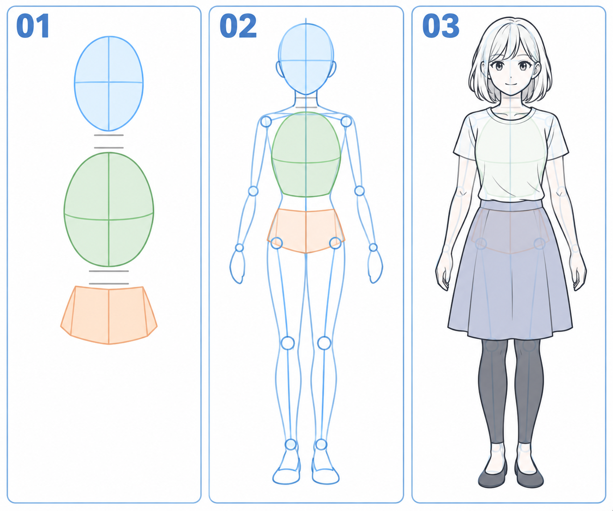

# 31 · 身体先用头、胸腔和骨盆概括
> 今天只画头、胸腔和骨盆三个大块，理解它们怎样连接。暂时不画肌肉、不细化胸部，也不要求完成全身角色。

前置：第 01 篇的头部起形、第 15 篇的颈肩连接。已有头像可以继续使用，也可以先用一个椭圆代替头。

## 1. 为什么先找三块，而不是从衣服边缘描起？

衣服外轮廓会随款式和动作改变，但头、胸腔与骨盆的大致位置仍然决定身体怎么站、怎么弯。先找这些部分，后面才知道手臂从哪里接、腿往哪里落。

这里的“胸腔块”表示躯干上部的大体积，不是衣服上的胸口图案；“骨盆块”表示躯干下端连接双腿的区域，不是裙子本身。它们是简化模型，不是精确骨骼图。

## 2. 看图：三块、连接、套上衣服

**01** 用蓝色椭圆、绿色蛋形和橙色短块区分三部分。**02** 补上脖子、腰部和四肢方向线。**03** 在同类结构上加简化衣服，帮助看出这些体块藏在成品哪里。

不同格不是精确等比例描摹，图中身体比例只是示例。你的角色可以更偏可爱或更修长，但本次先选一套比例保持住，不要一边画一边换年龄感。

## 3. 第一步：先定整个人的占位范围

在画布上方标头顶，下方标脚底预留位置。即使今天只画三块，也先知道身体大概能占多高，避免画完躯干后没地方放腿。

先用一个头形，再在下方放胸腔蛋形。两者之间留出脖子的空间，不把头直接压进胸腔，也不拉开成很长的一截。

**检查：** 缩小画布时能看见整个安排。若只在局部放大状态画，很容易让后加的部分越画越大。

## 4. 第二步：胸腔先是一块有朝向的蛋形

用上部略宽、下部收一点的蛋形表达胸腔，先标一条中线。胸腔块本身不包含所有肩宽，肩膀与手臂还会在两侧接出。

不要把胸腔画成两条细腰线。体块需要占据一块面积，你才有东西可以倾斜或旋转。本课保持正面、基本竖直，只学习“它在哪里”。

**检查：** 去掉头以后，绿色块仍然像一个完整体积，而不是空心的衣服边缘。

## 5. 第三步：放骨盆，保留可活动的腰部

在胸腔下方留一小段连接区域，再画较短的骨盆块。它可以先是圆角梯形或盒子，表示躯干下端的宽度与方向。

不要让胸腔和骨盆大块完全挤在一起，也不要让它们像两座不相连的岛。中间的腰腹可以弯曲、连接，后面动作变化会用到这段空间。

**检查：** 两块中线在本课正面直立姿势里大致延续，但不要求画成一根永远不能弯的硬棍。

## 6. 第四步：只补连接点，不急着补细节

在胸腔上部两侧标肩部连接区域，在骨盆下方两侧标腿的起点。用线段提示四肢方向即可，手脚可以暂时画成小块。

衣服等结构清楚后再包上去：宽袖不改变肘大致在哪里，长裙也不会让膝盖消失。先在草图层轻轻保留这些被衣服挡住的位置，清稿时再隐藏。

做一个单变量对比：固定头与胸腔，只把骨盆放得稍高或稍低，看看腰腹连接与腿部空间怎么变化。不要在同一轮也改变头大小。

## 7. 常见问题与修正

| 问题 | 检查 | 修改 |
| --- | --- | --- |
| 身体像细长管子 | 胸腔和骨盆有没有独立体积 | 先补两块大形，再连腰部 |
| 脖子非常长 | 头与胸腔间距是否过大 | 移动整块头，不只加宽脖子 |
| 衣服遮住一切就不会画 | 是否跳过被遮挡结构 | 在草图层补体块与关节点 |
| 不像原来角色 | 是否突然换了头身关系 | 参考原头像，先确定一套比例 |

## 8. 三次练习与完成判断

1. 跟图只画三块，并用自己的话指出各代表哪里。
2. 关掉图，做一张三块连接的正面站姿草稿，四肢只用线段。
3. 固定两块，只移动骨盆，比较连接空间；最后选一个版本。

- [ ] 能清楚指出头、胸腔与骨盆。
- [ ] 脖子与腰部有合理连接，不是断开的积木。
- [ ] 手臂和腿的起点大致明确。
- [ ] 不画衣服花纹，也能看出身体安排。

下一课只检查这套身体怎样被脚支撑，不要求把全身画漂亮。

[上一篇](30-给头像加一层简单阴影.md) · [返回总目录](00-系列总计划与目录.md) · [下一篇](32-身体怎样站稳.md)
