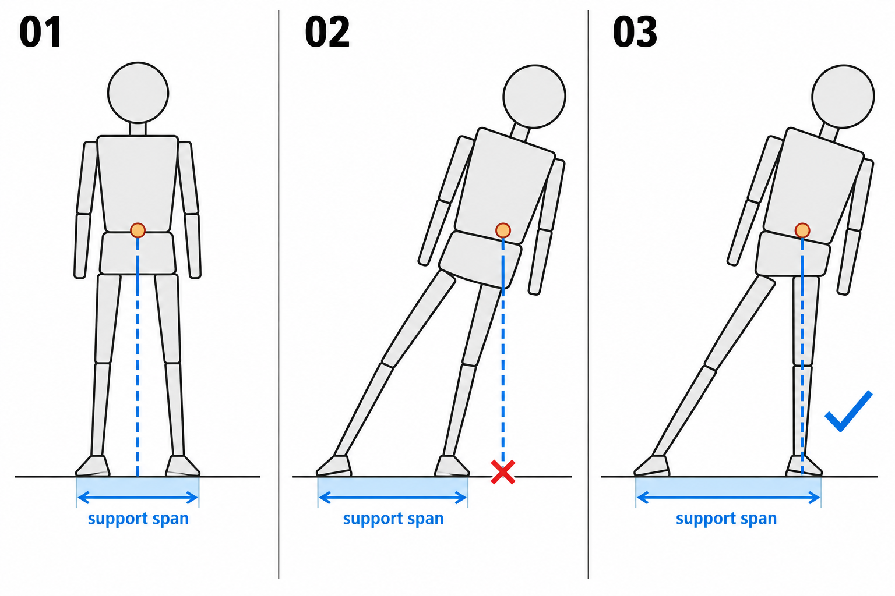

# 32 · 身体怎样站稳
> 今天只判断一个安静站姿有没有被脚支撑住，并修正一处让它更稳定。先不研究走路、跑跳或斜靠物体。

前置：第 31 篇的三块体积。脚暂时用短小楔形表示，不需要先会画漂亮鞋子。

## 1. 稳定感来自身体与支撑的关系

安静站着时，身体重量需要通过腿传到脚与地面的接触区域。双脚着地可以提供一片支撑范围；主要用一只脚承重时，身体会更多安排到那只脚上方。

本课用从身体大体重量区域向下的竖直辅助线帮助观察。它不是脊柱线，也不是动作倾斜线。身体可以斜，表示重力方向的线在本课水平地面上仍然竖直向下。

真实人体的重心受姿势和身体各部分质量影响，不能只根据肚脐或头顶准确求出。本课做绘画上的粗略判断，不把某个小点说成永远正确的重心。

## 2. 看图：身体移动与脚的落点

**01** 表示身体大体落在双脚支撑范围上方。**02** 是故意失衡的静止示意，躯干与骨盆明显偏到脚外，竖直投影落在支撑范围之外。**03** 把支撑脚移到更靠右的位置，重新接住偏移后的身体。

蓝色虚线强调向地面垂直投下的方向，地面色带提示支撑范围；图中的 support span 就是“支撑范围”。它们是简化教学标记，不是力学计算结果；第二格只在“没有外部支撑、没有正在迈步”的本课条件下判断。

## 3. 第一步：先画地面，再放两只脚

画一条水平地面线，在上面放两个鞋底小块。第一版先取容易观察的距离，不交叉腿。两只脚都需要有看得懂的接触位置。

为什么先放脚？如果先把身体画得很歪，最后随便补两只鞋，就不容易发现支撑究竟在哪里。脚的位置是你检查姿势的参照。

**检查：** 鞋底与地面之间有没有不打算存在的空隙？若本来就想踮脚，要把真正接触地面的前脚掌区域标出来。

## 4. 第二步：放骨盆与胸腔，粗看重量在哪边

把骨盆放在两脚上方，接胸腔和头。看整个人的大体积偏向哪里，不要只盯鼻子是否居中。

在躯干与骨盆附近做一个粗略参照点，再向地面落一条竖直虚线。它帮助发现特别明显的偏离；不要为了让线刚好落进脚里，故意把参照点随意挪走。

**检查：** 若头、胸腔、骨盆几乎都偏在两脚外面，是否有一条腿或外部物体实际支撑？本课没有的话，就优先调整。

## 5. 第三步：明确哪条腿主要承重

可以先做双脚较均匀承重的站姿，再试一侧承重。后者通常让骨盆更靠近支撑腿上方，另一条腿相对放松；支撑腿也不必锁得完全笔直。

不要为了表现放松，把两膝同时随意弯曲、脚尖也悬起来，却没有安排身体靠什么支撑。先做清楚的承重关系，再加轻微姿势变化。

## 6. 第四步：只选一种修正方法

若身体偏出支撑范围，优先在两种方法里选一个：把躯干与骨盆移回脚上方，或移动一只脚到能支撑身体的位置。本图第三格采用移动支撑脚。

不要同一轮把全身所有部分都重画。保留原稿，修一处，再缩小看是否更稳定。无法决定时，用你自己舒服的站姿作观察参照，先不尝试极端倾倒动作。

## 7. 常见问题

| 现象 | 检查点 | 修改 |
| --- | --- | --- |
| 身体像要倒 | 大体积是否明显落到两脚之外 | 移骨盆或支撑脚，先改一项 |
| 线是斜的却被叫重力线 | 是否混入了身体动作线 | 重画竖直参考，另画动作方向 |
| 两条腿都软，但身体还很直 | 是否没有明确承重腿 | 先确定主要支撑的一侧 |
| 鞋子像飘着 | 鞋底接触不明确 | 对照地面修落点 |

## 8. 三次练习与完成判断

1. 用三块加两只脚做一个双脚稳定站姿。
2. 把身体稍移向一边，观察原脚位还能否支撑，再独立修一处。
3. 固定身体位置，只移动一只脚，比较支撑范围的改变。

- [ ] 我能指出主要承重腿或双脚支撑范围。
- [ ] 没有把身体倾斜线误当成重力方向。
- [ ] 修正后可以说明稳定感来自哪个关系。
- [ ] 我知道静止站姿的判断不能直接套在跑跳瞬间。

下一课只拆手臂的两段与肘，先让弯曲连接清楚。

[上一篇](31-身体先用头、胸腔和骨盆概括.md) · [返回总目录](00-系列总计划与目录.md) · [下一篇](33-手臂怎样弯起来.md)
