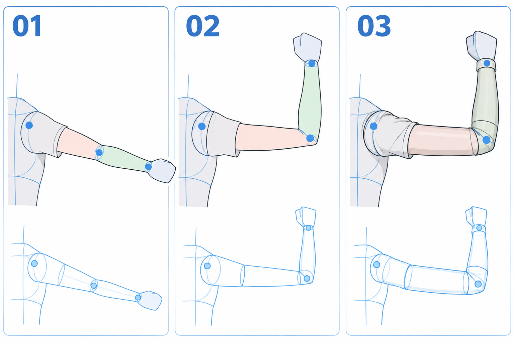

# 33 · 手臂怎样弯起来
> 今天只画一条弯起来的手臂，认清肩、肘、腕三个位置。手先画小块，暂时不细画五指。

前置：第 31 篇的胸腔与肩部连接。选择侧向、容易看清两段长度的示例，不做手朝镜头伸出的强烈透视。

## 1. 先把手臂理解成两段连接

肩到肘是上臂，肘到腕是前臂，手掌接在腕部之后。先画这两段方向，才能知道弯曲发生在哪里。

肘不是画在线条上的装饰圆点。它是两段连接、方向变化的地方。腕也不是第二个肘，手掌应该从前臂末端接出，而不是从中间长出来。

## 2. 看图：位置点先于外轮廓

**01** 用蓝点提示肩、肘、腕，区分两段。**02** 弯曲后前臂朝上。**03** 给连接关系补上体块和袖子。下方的小图用于观察简化方向，手暂时是块状。

生成图的分格尺寸和两段投影并非严格相同，不从图片里量出所谓标准臂长。实际练习复制同一段线，再改变夹角，才能更清楚地比较。

## 3. 第一步：先落肩点与腕点

在胸腔外侧标肩部连接位置，想一下手最终想放哪里，再放腕点。第一次可以让腕在头部旁边，为后面打招呼作准备。

不要先画五指，再硬拉一条很长的手臂去接。腕点只是目标，如果肘和两段长度接不上，可以移动它，不需要为了保住先画好的手而扭曲整条胳膊。

**检查：** 肩点是否真的接在肩区域，而不是直接从脖子中间出发？

## 4. 第二步：在两点之间找到肘

先画肩到肘的线段，再从肘连到腕。两段的夹角决定手臂大致弯曲程度。可以看自己的侧面手臂，观察弯曲时哪一段方向改变。

本课只画较平面的动作，先尽量保留同一角色的上臂和前臂长度关系。实际投影会随朝向变短，但不要用“透视”解释所有明显不连贯的长度。

**检查：** 你能沿肩—肘—腕连续指出这条路径，没有突然多出一个弯折。若连接像折了三次，先简化回两段。

## 5. 第三步：把线段包成逐渐收细的体积

沿两段方向画简单圆柱或略收细的形状。上臂与前臂不必等粗；前臂到手腕附近通常收窄，先抓住这种总体趋势，不急着画每块肌肉。

肘部连接需要留出转折区域。两段相接时，内侧有弯曲压缩、外侧有转折，不能只是两个完全独立的香肠头碰在一起。

**检查：** 暂时隐藏蓝色方向线，黑色外轮廓是否仍能读出同一个弯曲动作？若体积包完反而方向不明，回头检查两段边缘是否走偏。

## 6. 第四步：最后才给手掌与袖口位置

在腕点之后接一个短小手掌块，确认朝向。本课可以像图里一样先用连指手套形代替五指。袖口围着手腕或前臂，不应该凭空切断它们。

画宽袖时，在草图层保留手臂方向，外面再加布料。袖子可以遮挡肘，却不能替你决定一个不存在的肘位置。

单变量对比：固定肩、上臂长度与肘点，只让前臂绕肘改变角度，画两种腕的位置。你会看见动作怎么变化，而不是全靠重画外形猜测。

## 7. 常见问题

| 问题 | 先检查 | 修改 |
| --- | --- | --- |
| 弯曲像折断 | 肘是否有连接体积 | 用小转折连接两段外轮廓 |
| 前臂突然特别长 | 是否为了够到先画的手而拉长 | 移动腕点，再检查长度关系 |
| 手从袖子中间长出 | 腕与袖口不对应 | 先画裸露的结构占位再包衣服 |
| 不知道肘在哪 | 只画了连续曲线 | 回到三个点、两条线段 |

## 8. 三次练习与完成判断

1. 跟图只画肩、肘、腕与两条连接线。
2. 关掉图，在自己的躯干上接一条弯臂，手先用小块。
3. 固定上臂，只改前臂方向，比较两种动作。

- [ ] 三个连接位置清楚，没有多余关节。
- [ ] 两段长度变化能解释，不是随意拉伸。
- [ ] 加袖子后还能找到被遮挡的肘与腕。
- [ ] 缩小后可以看懂胳膊弯向哪里。

下一课从小手掌块开始，补出最简单的张开手。

[上一篇](32-身体怎样站稳.md) · [返回总目录](00-系列总计划与目录.md) · [下一篇](34-手掌先画成一个小块.md)
