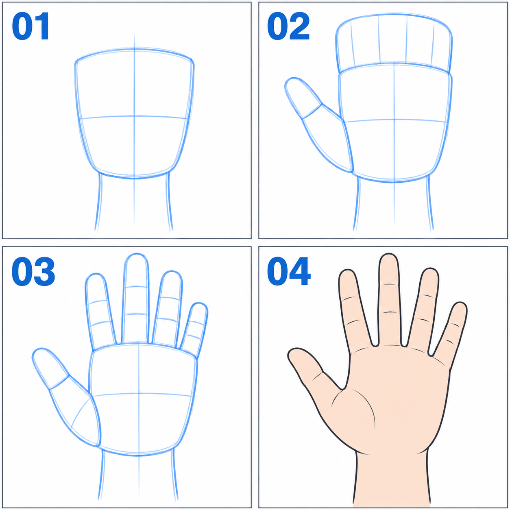

# 34 · 手掌先画成一个小块
> 今天只画一只朝向观看者的简化张开手：先手掌，再四指组，最后辨认拇指。先不画复杂握拳与指节透视。

前置：第 33 篇的腕与手掌连接。可以拿自己的手作观察，手的左右名称容易混淆时，直接说“画面左边的拇指”。

## 1. 为什么从手掌块开始？

手掌决定整只手的宽度、朝向和腕部连接。先画五根孤立细条，常常会出现手指不错，却没有合理手掌能装下它们的问题。

拇指从手掌侧面较低处接出，另外四指从上缘一带接出。它们不是五根同样长度、均匀插在一条直线上的棍子。

## 2. 看图：块、分组、分指、整理

**01** 是略向手腕收窄的手掌块。**02** 在画面左侧加拇指，并用一个大块安排上方四指范围。**03** 把四指组分开。**04** 整理成简化的张手。

图中有少量指节线和渐变，第一次可以省略。先检查数量：上方四根，加侧边拇指一根，总共五根。不要把手掌侧边的轮廓误数成第六根。

## 3. 第一步：画一个连接手腕的圆角块

先画上方略宽、下方较窄的掌形，在下端接一小段手腕。掌形不必严格方正，边缘可以有轻微弯曲。

把这个块放到前臂末端，看它的大小与角色头像是否协调。二次元可以简化手的大小，但不要因为细节难画就无限缩小，最后只剩一个点。

**检查：** 手腕从掌根接出，没有插到手掌侧面或指缝里。掌块已经能表达“手朝向我”。

## 4. 第二步：先放拇指根，再放四指大形

在掌块一侧较低的位置加一个拇指根部的小楔形，再向外上方接拇指。拇指可以先概括为短的两段方向，不画指甲。

掌块上方加一片扇形或略拱起的大形，表示另外四指所占范围。注意中指通常较高，小指较短，四指指尖不会天然排成笔直水平线。

**检查：** 拇指是否与上方四指有明显不同的起点和朝向？若五根全从顶边冒出来，先把拇指移回侧面。

## 5. 第三步：在大形里分四指

用轻线先标四条指向，再分出指缝。张手可以略微展开，但不必把每根都撑到极限。指缝是从掌上缘附近分出的空隙，不是一直割到手腕的深槽。

手指可以先画成两边略弯、末端圆润的小条形。现在最值得检查的是数量、长短关系和根部连接，指节横纹留到最后。

**检查：** 从靠拇指的一侧数到小指，是否正好四根？有没有因为重复轮廓多出一根很细的“手指”？

## 6. 第四步：用少量转折替代一排平行管子

沿自己手的轮廓观察，手指两侧并非绝对笔直平行。可以在指节附近轻微转折，在指尖处收圆，但不要加得凹凸太多。

张开手的掌面与手背也不同。本课按掌面示意，不突然给所有指尖加手背视角的完整指甲。换视角时再重新观察。

单变量对比：保留掌形与各指长度，只改变四指展开程度，做“稍合拢”和“稍张开”两个版本。先不改变拇指所在一侧。

## 7. 常见问题

| 现象 | 原因检查 | 修正 |
| --- | --- | --- |
| 像五根香肠 | 指根与掌块未组织 | 先还原四指组与侧面拇指 |
| 拇指像多出的食指 | 起点太高或方向相同 | 从掌侧较低处接出 |
| 掌心被割开 | 指缝过深 | 把分指起点上移，保留掌体积 |
| 手像一把梳子 | 指长相同且过分平行 | 先调指尖外轮廓，再修单指 |

## 8. 三次练习与完成判断

1. 跟图只画掌块、拇指和四指组，不分指。
2. 看自己的手，独立分出四指，省略掌纹与指甲。
3. 固定长度，只改展开程度，选一个适合打招呼的版本。

- [ ] 有明确掌块与腕部连接。
- [ ] 四指加一拇指，数量正确。
- [ ] 拇指的根部和方向与其他四指不同。
- [ ] 缩小后能读成张开的手，不靠画很多掌纹解释。

下一课回到身体下方，只学习腿怎样接到脚与地面。

[上一篇](33-手臂怎样弯起来.md) · [返回总目录](00-系列总计划与目录.md) · [下一篇](35-腿和脚怎样接到地面.md)
