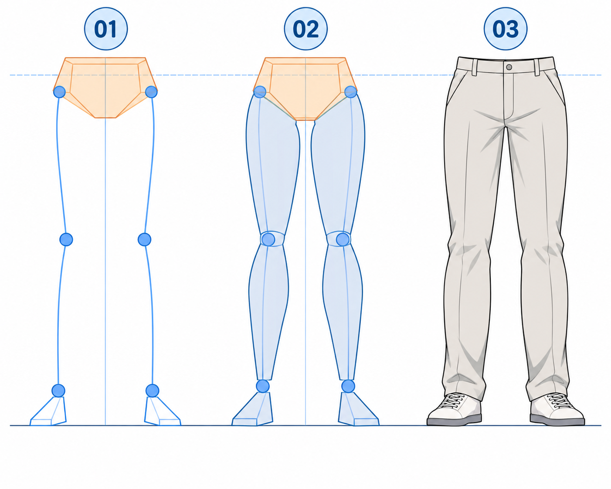

# 35 · 腿和脚怎样接到地面
> 今天只把骨盆、膝盖、脚踝与脚连起来，画一个简单站姿的下半身。不画跑跳，不细分腿部肌肉。

前置：第 31 篇的骨盆块与第 32 篇的支撑范围。脚可以先用鞋形小楔块，不需要先学脚趾。

## 1. 先认路径：髋到膝，膝到踝，踝再接脚

腿可以先分成大腿与小腿两段。大腿从骨盆两侧的髋关节区域出发，到膝；小腿再到踝，脚从那里接到地面。

脚不是直接在小腿末端画一个尖尖的收尾。它有朝前伸出的部分和后跟，需要占据地面上一段面积，才能支持站姿。

## 2. 看图：点线、体积、衣服

**01** 标骨盆、膝和踝，并用线段连接。**02** 加上大腿、小腿与脚块。**03** 包上简单裤子和鞋。底部横线提示地面，蓝色关节辅助点在清稿时隐藏。

图中两脚略向外，脚块的几何形只是占位，不是脚部骨骼。各格细节和比例有生成差异，实际练习先在自己的同一站姿上逐层添加。

## 3. 第一步：留出骨盆到地面的距离

画骨盆块与地面线，先决定整条腿可以占多高。在地面上放两只脚的接触区域，延续上一课已有的稳定站姿。

不要画完很长的大腿后才发现脚没地方放，只好把小腿压成一小截。整段空间先确定，再安排膝盖位置。

**检查：** 下半身没有被画布边缘意外裁断，脚部有完整空间。若画不下，先缩小整体，而不是局部挤压。

## 4. 第二步：分别连接两条腿的关节点

在骨盆左右标大腿起点，再在中途放膝点，接到脚上方的踝点。本课正面静止示例中，两边长度关系应接近，腿的方向可以有轻微差异。

膝不一定精确位于整个下半身的一半；脚有高度，骨盆连接也有结构，不套一个像素公式。可以用自己的身体或明确角度的参考检查总体关系。

**检查：** 两条腿是否从骨盆不同的连接区域出发，而不是都从裆部同一个尖点长出来？膝盖是否真位于大腿与小腿转接处？

## 5. 第三步：沿方向加体积

大腿先画上方较有体积、往膝附近收一些的形状，小腿也有自己的起伏，再向脚踝收细。不要把每一段都画成完全等粗的直管。

本课只用柔和、简化的外轮廓。左右腿内侧与外侧不必机械镜像；看大方向正确后，再用一两处起伏提示体积。

**检查：** 隐藏方向线以后，还能分出大腿、小腿与踝吗？若一条外轮廓到底没有任何连接关系，先找回膝的位置。

## 6. 第四步：脚块决定落地和朝向

在踝点下方接一个短楔形，前方稍长、后方有后跟，底面贴到地面。左右脚朝向可以略有区别，但脚块应与小腿连接，不像被粘在旁边。

最后加鞋底厚度和简化鞋面。要画靴子时，先保留脚踝与鞋底位置，再向上延伸靴筒；靴筒装饰不能代替脚的结构。

单变量对比：固定骨盆、腿长和地面，只轻改一只脚的朝向，观察鞋面和脚块轮廓需要怎样跟随。强烈转向时膝与腿的方向也需考虑，第一次只做小变化。

## 7. 常见问题

| 问题 | 先检查 | 修改 |
| --- | --- | --- |
| 长短腿 | 两侧髋、膝、踝位置是否不一致 | 回到点线比较，再加轮廓 |
| 腿从同一点分叉 | 髋起点是否挤在裆尖 | 分别放到骨盆两侧连接区域 |
| 脚像尖尾巴 | 是否没有前脚掌和后跟占位 | 先补完整脚块 |
| 鞋子没重量 | 鞋底与地面没对应 | 找真正接触面，再补小投影 |

## 8. 三次练习与完成判断

1. 跟图画关节点和脚块，不画裤褶。
2. 关掉图，给自己的骨盆草稿接两条腿与鞋。
3. 固定其他位置，只小幅改变一只脚的朝向，再检查连接。

- [ ] 能连续指出髋、膝、踝与脚的路径。
- [ ] 左右长度差异有姿势依据，不是画到哪算哪。
- [ ] 脚有接触地面的面积，不是腿部尖端。
- [ ] 不靠服装细节也能看出站立关系。

下一课把已经学过的肩、弯臂、张手组合成一个打招呼姿势。

[上一篇](34-手掌先画成一个小块.md) · [返回总目录](00-系列总计划与目录.md) · [下一篇](36-做一个打招呼的姿势.md)
