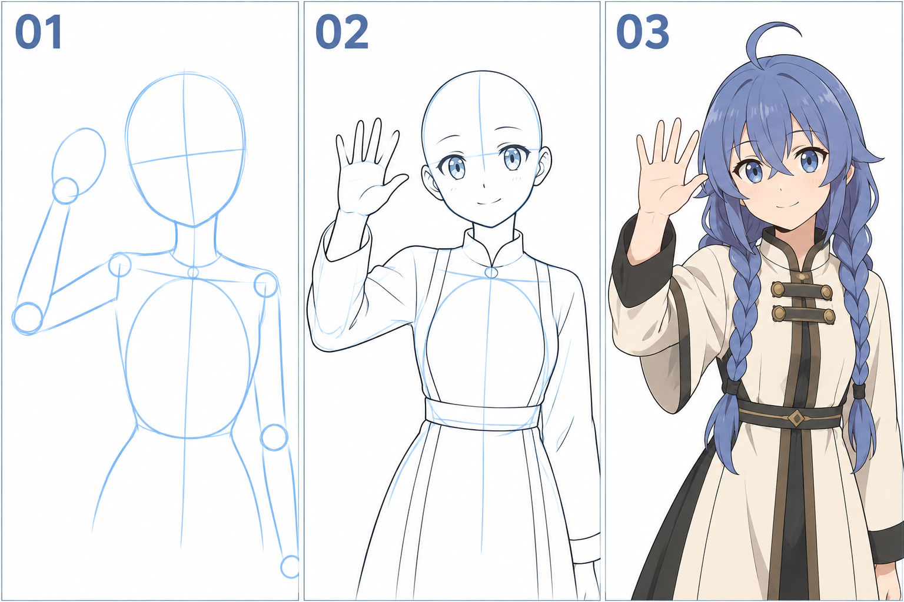

# 36 · 做一个打招呼的姿势
> 今天完成一个能看懂的上半身打招呼姿势：一只手抬到脸旁，掌面打开，配轻微微笑。可以先只画线稿。

前置：第 33 篇的弯臂、第 34 篇的张手、第 19 篇的微笑。完整腿部不是这次作业的前提。

## 1. 先让姿势的轮廓读得出来

打招呼的识别重点是抬起的前臂和张开的手。头发、袖子和手如果全挤成一团，即使每一根手指画得细，也可能看不清这个动作。

本课选手在脸旁、手掌与脸之间留一点空隙的构图。先不把手伸到镜头前，也不要求夸张挥动的运动效果。

## 2. 看图：先动作，再角色细节

**01** 先看肩、肘、腕与手掌占位。**02** 补手与衣服外轮廓。**03** 添加蓝发、辫子和轻微笑意，形成角色化的上半身。

图中成品有一些服饰和光影，它们是可选细化。姿势不依赖复制这些装饰；生成图里头部角度也略有变化，你练习时可以固定正面头，先只解决抬手。

## 3. 第一步：先给手留空间

在画布上放头与胸腔，确认画面一侧有足够位置容纳手掌与手指。不要先把头画满整页，最后只能把手挤在边缘。

用一个椭圆或掌块标出手的大致位置，略靠脸旁但不遮住眼睛。先看这个块和头的距离是否舒服，再开始接手臂。

**检查：** 手和脸之间有没有可读的小空隙？若两者轮廓刚好贴合，会不容易看清哪个边属于手、哪个边属于脸。

## 4. 第二步：用肩—肘—腕连出抬臂

从肩部向外下方或外侧找到肘，再把前臂接到抬起的腕点。具体肘高取决于你选择的招手方式，不必固定等于肩高。

先比较上臂与前臂的长度。若手放得太远，要么调整腕点，要么改变整个肩臂安排，不随意把前臂拉长一倍。

**检查：** 沿三点可以顺畅走到手掌。手的朝向要与手腕的转接合理，暂时避免极端反折。

## 5. 第三步：张手只抓掌形与五指

用第 34 篇的方法先画掌块和拇指侧，再把另外四指分开。五指稍有长短差别，展开程度适中即可。

看自己的手或清楚的同角度参考，核对拇指在哪一侧。不要从另一幅相反手的图复制手掌，却直接接在现有手臂上。

**检查：** 手的轮廓能读成张开、总共五指、指根连回掌部。掌纹和指甲暂时省略，不影响打招呼这个动作。

## 6. 第四步：让袖子包住手臂

沿已有手臂外面加宽袖，袖口围着腕附近。宽袖下缘可能垂下，可以留一点布料空间；但不要把肘的结构完全换成随意布袋。

最后加头发与微笑。如果帽檐会遮住手，第一版可以不画帽子，或调整手的位置。衣服花纹可以留空，先保住表情和动作的清楚程度。

**检查：** 缩小后，第一眼是否能看见“她抬手打招呼”？若看不见，优先改善手与脸、手与袖子的轮廓间隔。

## 7. 一个对比与常见问题

单变量比较：保持身体和手形不变，分别把腕点放得稍高与稍低，重新连接相应前臂，看看招呼的活跃程度如何变化。

| 问题 | 检查点 | 修改 |
| --- | --- | --- |
| 手像长在头发里 | 轮廓相贴或互相遮挡 | 移手或发块，留出清晰空隙 |
| 胳膊突然变长 | 腕位置与两段长度冲突 | 调腕点，再查肘 |
| 手掌接反了 | 拇指侧与腕朝向不合理 | 用同侧同角度参考重新核对 |
| 有手但不像招呼 | 掌面和张开的轮廓不清楚 | 简化细节，先画清手的外形 |

## 8. 三次练习与完成判断

1. 只画头块、肩肘腕与手掌块，做一个招手占位。
2. 不照步骤图，把自己的角色发型与微笑加进去。
3. 只改腕的高度，比较两种招呼感觉，选一张保存。

- [ ] 手臂从肩部连续接到掌部。
- [ ] 张手的轮廓和五指数量清楚。
- [ ] 缩小后仍能认出打招呼的动作。
- [ ] 我保存了一个可继续细化的版本，即使衣服还很简单。

下一课改变双臂的任务：让它们围住一本书，重点转向前后遮挡。

[上一篇](35-腿和脚怎样接到地面.md) · [返回总目录](00-系列总计划与目录.md) · [下一篇](37-做一个抱书的姿势.md)
