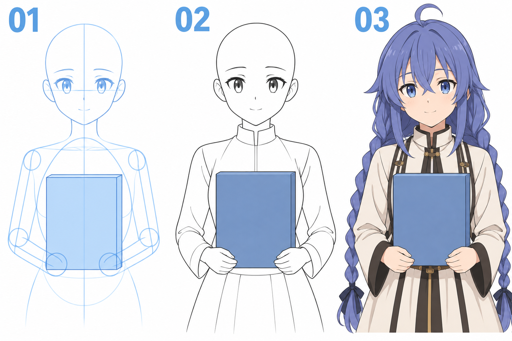

# 37 · 做一个抱书的姿势
> 今天只画一个把书抱在身前的上半身姿势，弄清楚躯干、书、前臂和手谁在前、谁在后。

前置：第 31 篇的躯干块、第 33 篇的弯臂、第 34 篇的手掌。手指可以简化，不要求立即画出精细抓握。

## 1. 书会帮助组织动作，也会暴露遮挡问题

书是一个明确的块，双手可以围绕它安排。只要书的位置和两手的接触点清楚，就容易画出“拿着”或“抱着”的感觉。

如果前臂线穿过书封面、手指从不合理的地方露出，观众会读不清前后关系。本课每加一个部分，都先决定它在哪个表面之前或之后。

## 2. 看图：把遮挡关系分层看

**01** 先定躯干与书的位置，再连手臂方向。**02** 书在胸前，两手在下方附近接触书，部分手掌或手指覆盖封面边缘。**03** 加上角色发型和简化服装。

图里手指有合并与遮挡，不把可见线条条数直接等同于手指数量。你画时可在辅助层先画清掌块与拇指位置，再删掉被书挡住的部分。

## 3. 第一步：书先放在躯干前方

画头与胸腔，把书用一个竖长方形放在胸前。先让书的上缘低于下巴，避免把脸遮住。给一侧补一点厚度，使它像有体积的物品。

书的封面、侧边和上下边应属于同一个小盒子，不要边画边换方向。第一次可以接近正面，只露一点侧面，降低透视难度。

**检查：** 书是否真正挡住身后的衣服线？源草图可以透着画，但清稿里躯干线不该穿过不透明书本。

## 4. 第二步：先定两手接触的位置

在书下方两角附近放两个掌块。可以一手托下缘、一手轻扶封面，也可以像图中一样双手靠近下角。本次先选一种，不一边画一边换握法。

问自己：掌心、手指或拇指哪一部分实际碰到书？如果整只手都与书留着空隙，姿势就像在书旁摆手，而不是抱住它。

**检查：** 书与手至少有清楚的接触关系。不要用一圈阴影代替接触位置，先把轮廓接对。

## 5. 第三步：从肩经肘连到两只手

肩点仍在躯干两侧，肘可以靠身体两边较低的位置，前臂再斜向书下方的手。先画隐藏的完整方向，再决定哪一段被书挡住。

左右可以略有不同，但两边都需要合理的上臂、前臂长度。不要为让手刚好够到书角，把某边肘偷偷移进胸口。

**检查：** 你能沿每一条手臂从肩找到肘，再找到腕。被挡住的地方只是不可见，不是消失了。

## 6. 第四步：用轮廓的中断表达前后

书在躯干前，躯干线遇到书时停止。手指覆盖封面时，书边在手指处被遮断；手指绕到书后方的部分也应在相应边缘消失。

这种“后面的线被前面挡住”的关系，比到处加黑边更有用。清稿时逐个检查交接点，尽量避免几条轮廓恰好贴成一根难辨认的线。

再加宽袖与头发。辫子可能落在书前，也可能垂在书旁，选定一种关系并贯彻，不让同一根辫子莫名穿过书。

## 7. 常见问题与单变量比较

| 问题 | 先检查 | 修改 |
| --- | --- | --- |
| 像书悬浮在身前 | 手和书没有接触 | 重新放掌块与托扶位置 |
| 手臂穿书 | 隐藏轮廓未清理 | 保留草图，清稿删除被挡线 |
| 书像折坏了 | 边线与厚度方向不一致 | 先独立画清书这个小盒子 |
| 手从胸口伸出 | 肩肘腕路径没有检查 | 轻画完整方向后再做遮挡 |

单变量比较：固定书与躯干位置，只改变一只手是托下缘还是扶封面；相应调整腕与前臂，比较接触关系，不同时改变书大小。

## 8. 三次练习与完成判断

1. 只画躯干、书块与两个掌块，标出接触位置。
2. 独立接双臂，画清可见和被遮挡的轮廓。
3. 改一种托扶方式，观察需要跟着变化的手腕与前臂。

- [ ] 书的体积与朝向一致。
- [ ] 双手实际接触书，手臂路径可以解释。
- [ ] 前后轮廓正确中断，没有明显穿插。
- [ ] 不靠服装花纹，也能看出抱书的姿势。

下一课回到安静姿态，只通过头、肩和发型的关系做一个轻微歪头。

[上一篇](36-做一个打招呼的姿势.md) · [返回总目录](00-系列总计划与目录.md) · [下一篇](38-做一个安静歪头的姿势.md)
