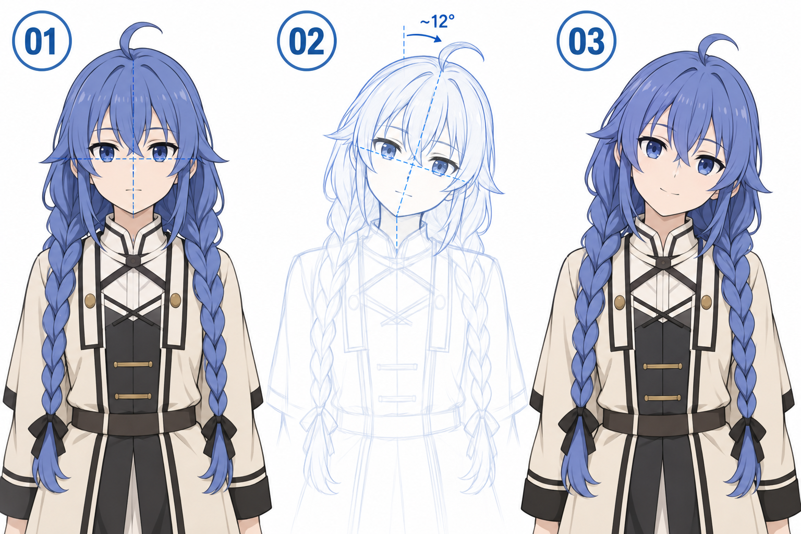

# 38 · 做一个安静歪头的姿势
> 今天完成一个安静歪头的角色上半身。重点是头整体倾斜、脖子接回肩膀，以及头发怎样随之调整。

前置：第 28 篇的脸部整体倾斜、第 12—13 篇的发型与辫子。站姿可以沿用第 32 篇，双臂保持放松。

## 1. 与第 28 篇相比，这次多了什么？

第 28 篇把脸部轴线和五官一起转，本课把这件事放回完整角色：肩膀可以保持接近原位，颈部连接要变化，头发根部跟头走，较长部分还受重力与身体接触影响。

小动作已经可以带来神态。不必把头歪得很大、眼睛变得很夸张，才能显得可爱。先选择轻微、舒适的幅度。

## 2. 看图：头动，身体先稳住

**01** 是直立参照。**02** 通过倾斜的中线和眼线示意头部变化。**03** 补完整发型与柔和神态。图中约 12° 只是示例标注，不是“可爱歪头”的标准角度。

分格中的肩、衣领和发丝并非完全相同，所以它们不能作为动画对齐帧。你的对比最好复制同一份底稿，在需要的局部修改。

## 3. 第一步：保留躯干与肩线

复制已经站稳的上半身草稿，暂时锁定躯干与双肩。先在头部画中线与眼线，再向一个方向轻倾。

这次不要让身体也一起倒过去。头部变化清楚后，如果以后想加肩部的小幅反应，可以另存一个版本再试。

**检查：** 来回切换时，肩部与身体中心大致稳定，主要变化集中在头部。若整张画都转了，那更像相机倾斜，不是角色自己歪头。

## 4. 第二步：整体移动脸部关系

头形、眉、眼、鼻、嘴一起沿新轴线安排。可以先用软件旋转复制稿帮助观察，再重新修线；旋转工具是参照手段，不代替理解。

眼睛相对屏幕一高一低是正常的，但相对头部仍属于同一眼部带。不为了看起来整齐又把嘴拉回水平。

**检查：** 不加头发时，脸是否已经像完整地倾斜？若只有外轮廓动了，回第 28 篇检查局部轴线。

## 5. 第三步：重新接颈部与衣领

观察下颌下方的空间，一侧可能更压缩，另一侧更展开。用少量线条接到肩颈区域，先不画复杂肌肉起伏。

衣领围着脖子与上身，不能把原衣领原封不动贴到一个完全断开的颈部上。先确认连接，再保留必要的前后遮挡线。

**检查：** 头是否像悬在衣领上方？若是，优先检查头颈间距和颈根位置，不用新增一大片阴影掩盖空隙。

## 6. 第四步：头发根部跟头，长发重新整理

刘海贴着头部，整体跟随头的倾斜。侧发和辫子的起点也跟着移动；但较长部分往往仍有下垂趋势，并可能搭在肩或衣服上，不必把整根辫子当成硬塑料条等角度旋转。

先画辫子的走向线，确认它在肩前还是肩后，再补大块编织。不要逐节修好以后才发现整根辫子穿过肩膀。

**检查：** 发根连着头，长发与身体的接触关系能解释。你可以先把细发丝全部省去，检查大轮廓是否成立。

## 7. 第五步：表情只加一点

在姿势已经清楚的基础上，加一个平静或轻微微笑。眼睛可以继续看向前方。若再加入明显侧视、闭眼、大张嘴，可能一下多出太多变化，难判断歪头本身的效果。

单变量比较：固定身体与表情，只比较两个小的倾斜幅度，并分别修好颈部连接。选更符合你想要的安静感觉的一张。

## 8. 常见问题

| 问题 | 检查 | 修改 |
| --- | --- | --- |
| 像整张照片歪了 | 肩线和躯干是否一起旋转 | 恢复身体，只调整头颈 |
| 头发像硬板 | 长发是否全等角度旋转 | 重画走向，考虑下垂与接触 |
| 五官零散 | 是否只改了部分部件方向 | 重新使用统一头部轴线 |
| 辫子穿肩 | 未决定前后关系 | 先定走向与遮挡，再画编织 |

## 9. 三次练习与完成判断

1. 在现有角色上仅画新头部轴线，身体不动。
2. 独立完成倾斜的脸、颈部与发型连接，保持简单表情。
3. 只改变小幅倾斜程度，留下你更喜欢的一版。

- [ ] 头部变化与身体倾斜能够区分。
- [ ] 颈部连续，五官方向统一。
- [ ] 长发既连着头，也与肩部保持合理关系。
- [ ] 我已留下招手、抱书、歪头中的至少一个喜欢的动作版本。

第 31—38 篇到这里完成。下一阶段回到头像表情素材，用编程做一个会眨眼、点击后微笑的小作品。

[上一篇](37-做一个抱书的姿势.md) · [返回总目录](00-系列总计划与目录.md) · [下一篇](39-怎样导出不会跳动的表情素材.md)
