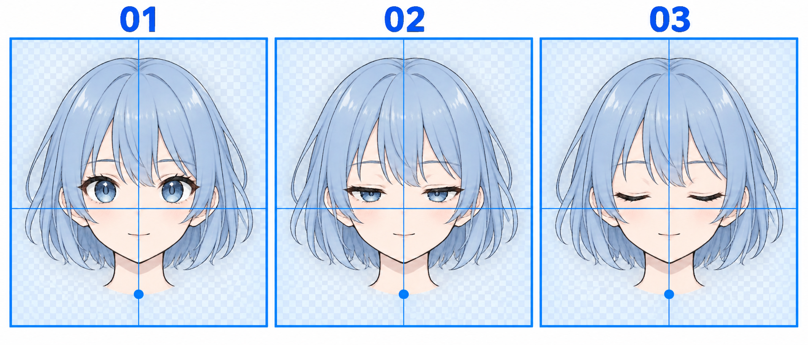

# 39 · 怎样导出不会跳动的表情素材
> 今天只把平静睁眼、半闭、闭眼、微笑四个状态，导出为画布和人物位置一致的 PNG。暂时不改播放时间。

前置：第 19、22、23 篇保存的表情状态。第 24 篇做过粗略预览，这次把素材整理成可长期替换使用的一组文件。

## 1. 为什么单张都不错，连起来却在跳？

动画切换时，眼睛以外的部分若也在变，就会被看成头在晃、发型在变或整个人忽大忽小。常见原因是分别重画整张头像，或者导出时每张都裁切到不同的内容边缘。

因此要分别固定两件事：文件的画布范围，以及人物在画布里的位置。四张都是 480 × 480，不代表头一定对齐；头的位置相同，但文件边距不同，也会在放进程序时跳动。

## 2. 看图：框固定，参照点固定

三格示意睁眼、半闭和闭眼。蓝框表示相同的画布范围，横竖参考线与下方蓝点提示观察固定位置。微笑版也应沿用同样的规则。

本图中的棋盘格是画在教学图里的纹理，用来表示“这里考虑透明背景”，不意味着裁下它就得到透明素材。生成图还存在细小差异，正式帧请从自己的同一画稿导出。

## 3. 第一步：只保留一个源画布

打开自己的头像源文件，保留不变的头发、脸形、鼻子、衣领等部分。把眼睛、眉毛和嘴的不同版本放在可切换的图层或图层组里，给每种状态命名。

若阴影是共同的，也尽量共用；眼睛附近因状态改变需要修改的局部，再单独调整。不为闭眼版重新描整张头，能显著减少位置漂移。

**检查：** 在软件里切换状态时，盯住鼻尖、下巴、帽尖这些不该动的参照点。若它们现在就在动，先修源稿，导出设置不会自动解决。

## 4. 第二步：统一导出范围

第一次可以使用同一个 480 × 480 画布，或者保留原来四张都相同的尺寸。480 只是方便本系列示例窗口显示，不是画头像的必须尺寸。

导出时使用完整画布，关闭逐张自动裁掉透明边缘的做法。四种状态应有相同的上、下、左、右边距，尤其是发丝或表情线只在某帧多出来一点时，不能让它改变裁切范围。

**检查：** 导出的宽高完全相同；在同一个窗口中显示时，人物比例也相同。

## 5. 第三步：透明背景要检查真实透明

隐藏不需要导出的背景层，按软件的 PNG 导出设置保存透明背景。导出后重新导入绘画软件，在下面垫一块明显的颜色，检查角色外部是否能透出底色。

如果看见一整块白色或棋盘纹理，可能背景已经被画进图片。不要靠文件扩展名判断透明，也不要把示意图上的棋盘格当成透明通道。

**检查：** 头发边缘是否有不该出现的白边？先回查原图边缘和背景层，不要在程序里强行把所有白色都删除，那可能误删眼白和衣服。

## 6. 第四步：用固定文件名整理

给示例程序准备这四个名字，放在同一个文件夹中：

| 文件名 | 内容 | 保持一致的东西 |
| --- | --- | --- |
| `open.png` | 平静、正视、睁眼 | 画布、头部、发型、底色 |
| `half.png` | 半闭过渡 | 同上，主要改眼睑遮挡 |
| `closed.png` | 完全闭眼 | 同上，隐藏眼睛内部 |
| `smile.png` | 第 19 篇的轻微微笑 | 同上，只改所需眉眼嘴 |

可放进随附程序的 `my_frames` 文件夹，也可以保存在自己的作品目录。程序可以选择任意包含这四张 PNG 的文件夹。

## 7. 第五步：暂停状态下逐张检查

参照[运行说明](练习工具/角色小作品/README.md)打开 Python 示例，载入图片后依次按“睁眼、半闭、闭眼、微笑”。手动状态按钮会暂停，便于观察位置。

“十字参考线”只是固定在窗口中心的观察线，不保证穿过你图片的鼻尖。挑一个实际参照点，看它在参考线旁边的位置是否变化即可。程序会检查尺寸，不会自动对齐人物。

若原图超过显示区，程序对所有帧使用同一个整数缩小倍率，保留原文件不变。这能保持一致性，但小图细节可能变粗；想清楚展示时，可在绘画软件里为四张统一导出适合的显示尺寸。

## 8. 常见问题与三个小任务

| 问题 | 先检查 | 修正 |
| --- | --- | --- |
| 尺寸相同仍在抖 | 内容位置是否改变 | 在同一源稿内对齐不动部分 |
| 忽大忽小 | 是否分别裁边或缩放 | 用共同画布重新导出 |
| 背景有格子 | 是否把棋盘纹理画进去了 | 检查真正的透明区域 |
| 程序说少文件 | 命名与目录是否正确 | 按表检查四个名字与扩展名 |

1. 跟着整理一份共同源稿，导出四种状态。
2. 独立检查尺寸和透明背景，再逐张切换。
3. 故意在副本中把一帧移一点，比较跳动与修正后的区别，正式文件保持正确版本。

- [ ] 四张文件尺寸和边距一致。
- [ ] 不该动的部分在切换时保持稳定。
- [ ] 我验证了透明区域，而不只是看扩展名。
- [ ] 源文件、导出图片分开保存，之后还能继续改。

下一课素材不动，只比较播放时各状态停留多久。

[上一篇](38-做一个安静歪头的姿势.md) · [返回总目录](00-系列总计划与目录.md) · [下一篇](40-怎样调整眨眼的节奏.md)
