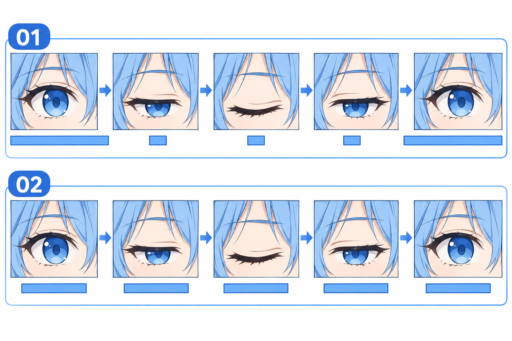

# 40 · 怎样调整眨眼的节奏
> 今天只改眨眼的节奏，使用同一组三张开合眼素材。先分清“图片顺序”与“每张停留多久”。

前置：第 39 篇整理好的素材，或先使用随附 Python 程序的示意模式。无需再生成网页。

## 1. 还是三张图，但顺序有五步

沿用第 24 篇的顺序：睁眼 → 半闭 → 闭眼 → 半闭 → 睁眼。中间的半闭重复使用，最后恢复原来的睁眼。

如果每一步停留一样久，观感可能更像慢慢闭眼休息。普通短暂眨眼的练习可以让大部分时间留在睁眼状态，中间几步快速经过。不过这不是所有角色、所有情境都必须遵守的生理参数。

## 2. 看图：同样的图，不同的时间分配



上排 **01** 的睁眼停留较长，中间三步短；下排 **02** 每步等时。图中条长是概念示意，不用于量出毫秒数。具体练习参数看下面的表。

各小格也不是精确对齐的播放素材。这里比较的是时间分配；实际预览保持你自己的图片不变，避免把帧间位置差异误认成节奏问题。

## 3. 第一步：先逐步看图，再点击播放

按照[运行说明](练习工具/角色小作品/README.md)启动程序，先用手动状态按钮确认半闭是遮挡而不是缩扁，闭眼没有虹膜残留。

然后选择“短眨练习（3 秒）”，点击“播放”。如果头发或衣领在跳，先返回第 39 篇修素材。调整时间不能修好不同帧的对齐错误。

**检查：** 一轮结束后回到原来的睁眼图，没有突然切成另一张脸。

## 4. 第二步：读懂毫秒和时间段

一秒是 1000 毫秒。程序默认采用下面这套便于比较的练习参数：

| 播放位置 | 图像状态 | 本段停留 | 从这一轮开始计算的范围 |
| --- | --- | --- | --- |
| 1 | 睁眼 | 1000 ms | 0 到不足 1000 ms |
| 2 | 半闭 | 80 ms | 1000 到不足 1080 ms |
| 3 | 闭眼 | 80 ms | 1080 到不足 1160 ms |
| 4 | 半闭 | 80 ms | 1160 到不足 1240 ms |
| 5 | 睁眼 | 1760 ms | 1240 到不足 3000 ms |

一轮共 3000 ms。最后一段与下一轮第一段都是睁眼，连起来就是继续保持同一张图，不会凭空多一次开合。这里没有人为要求每一轮开头都一定产生动作。

## 5. 第三步：比较等时版本

把节奏切到“等时对照（3 秒）”。五步各 600 ms，总时长仍为 3 秒，但合上和张开的过程明显拖长。

这一轮控制图片和整轮时长不变，只比较内部停留时间的分配。问自己：哪一版像短暂眨眼？哪一版更像慢慢眯起眼睛？不是所有慢节奏都错，只是它表达了不同动作。

还可以选择“慢放检查（12 秒）”，它把默认每段时间统一放大四倍，专门便于观察；看完再回正常速度判断最终效果。

## 6. 第四步：闭眼多停一点，整轮仍保持 3 秒

打开随附的 [character_demo.py](练习工具/角色小作品/character_demo.py)，找到 `TIMINGS`。例如把默认闭眼那一段从 80 改为 120，并从最后睁眼段扣回多出的 40 ms：

```python
"短眨练习（3 秒）": (1000, 80, 120, 80, 1720),
```

这样整轮仍然是 3000 ms，菜单名字和代码中引用的名字都不用改。修改前保留脚本副本，修改后保存并重新运行程序；已经运行中的窗口不会自动读取代码改动。

这是观察“从睁眼等待中分一点时间给闭眼”产生什么效果的实验，不是推荐你照抄的新标准。虽然表中两个数相应变化，但主动改变的是闭眼停留，另一处用于维持总长；半闭时间和图片都不动。若只加闭眼时间而不扣回，整轮就会变成 3040 ms，也可以播放，只是比较条件不同。

## 7. 程序为什么不用 sleep 等待？

界面需要继续处理点击与刷新，所以示例通过 `root.after(25, self.tick)` 安排下次检查，而不是在界面主循环里长时间睡眠。它依据实际经过时间选图，不把回调次数当成精确帧数。

25 ms 是检查间隔，不意味着闭眼只显示 25 ms。显示哪张由上面的时间表决定。界面调度会有延迟，这个练习工具也不是要求精确到每毫秒的动画导出器。

## 8. 常见问题与练习

| 现象 | 先区分 | 修正 |
| --- | --- | --- |
| 像一直打瞌睡 | 中间状态是否过长 | 与短眨预设比较 |
| 闭眼根本看不见 | 停留过短或运行卡顿 | 先慢放确认图形，再小幅延长 |
| 脸在闪动 | 图形跳动还是节奏问题 | 暂停逐帧回查位置 |
| 修改后整轮变长 | 是否只加时间而未减其他段 | 重新相加，不靠菜单名字判断 |

1. 跟表说出 1100 ms 时应显示哪张图，再用慢放观察。
2. 独立比较短眨与等时版本，图片保持同一组。
3. 在代码副本中调整闭眼停留、相应扣回睁眼等待，记录效果，再恢复或保存选定版本。

- [ ] 我能分别说明图片顺序与停留时间。
- [ ] 我知道三张素材为什么占五个播放位置。
- [ ] 我能把素材跳动与节奏不合适分开处理。
- [ ] 我选好了一套适合当前角色的练习节奏。

下一课增加点击反馈，重点是微笑和眨眼不要争抢当前显示的图片。

[上一篇](39-怎样导出不会跳动的表情素材.md) · [返回总目录](00-系列总计划与目录.md) · [下一篇](41-点击后怎样切到微笑再恢复.md)
