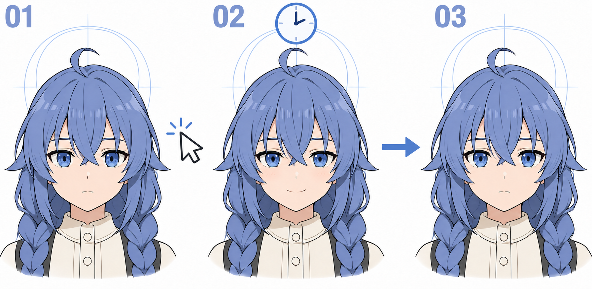

# 41 · 点击后怎样切到微笑再恢复
> 今天只做一种响应：点击角色，微笑一小会儿，再回到睁眼和默认眨眼。先不添加对话框、声音或复杂动画系统。

前置：第 39 篇的四张图、第 40 篇的播放节奏。随附的 Python 程序已经实现本课行为，你可以先运行再读关键逻辑。

## 1. 最常见的问题不是不会换图，而是两个逻辑同时换

假设眨眼定时器正在准备切半闭眼，你刚点击把画面换成微笑。几十毫秒后，旧定时器又把微笑覆盖，结果看起来像点击没生效。

解决思路是给“当前应该显示什么”一个统一的决定位置。微笑反馈期间，默认眨眼先让位；反馈结束后再从明确的睁眼状态恢复。

## 2. 看图：平静、反馈、恢复



**01** 表示默认状态，指针提示发生点击。**02** 微笑，时钟提示短暂停留。**03** 恢复平静，之后允许默认眨眼继续。图中的辅助圆和发丝不是程序控制范围，图片只用于说明状态关系。

本课不要求微笑时继续叠加眨眼。那需要更多素材或更细的部件拆分，第一版先保持规则简单。

## 3. 第一步：把行为写成几句话

本示例采用下面的规则：

- 点击画面或“点击微笑”按钮，立即进入微笑反馈。
- 微笑维持约 900 ms，在此期间再次点击，就从最新点击重新计算 900 ms。
- 微笑结束，先回到睁眼，并从头开始一轮眨眼。
- 按某个手动状态按钮时暂停，便于你检查素材；按“播放”再开始。

连续点击延长微笑，是本练习选择的交互方式，不是唯一正确方案。也可以设计为忽略重复点击，但要先明确规则，再写程序。

## 4. 第二步：只记录一个“微笑到什么时候”

在 [character_demo.py](练习工具/角色小作品/character_demo.py) 中找到 `Player.smile`：

```python
def smile(self, now_ms):
    self.paused = False
    self.smile_until = now_ms + SMILE_MS
```

它更新一个截止时间，没有每点一次就另开一串新的定时器。连续点击只会推迟这个时间，避免累积很多相互覆盖的恢复回调。

**检查：** 微笑快结束时再点一次，它应继续保持，而不是旧计时到了就强行把新反馈打断。

## 5. 第三步：显示前先判断反馈是否还有效

`Player.current` 先看是否处于手动暂停，再看微笑截止时间。如果反馈尚未结束，返回 `smile`，这一刻不采用默认眨眼结果。

反馈到期后，清掉截止时间，把眨眼起点重置为当前时刻。这样会先经历默认时间表的睁眼段，不会突然跳回点击前某个半闭眼瞬间。

你可以把它理解成优先顺序：手动检查模式 → 当前点击反馈 → 普通眨眼。界面只展示这个决定的结果。

**检查：** 特意在半闭或闭眼附近点击，微笑是否仍完整显示？这比只在刚启动、还没眨眼时测试更容易发现冲突。

## 6. 第四步：界面始终只保留一条刷新链

界面里的 `tick` 大约每隔 25 ms 查询一次状态，再安排下一次查询。点击只更新状态数据，不另外启动第二条循环。

关闭窗口时取消尚未执行的刷新回调，然后销毁窗口。这样不会让已经关闭的窗口继续被旧回调访问。示例代码也保留了图片对象引用，避免图像被提前释放后画面消失。

这些是让小作品稳定工作的基本安排，不要求你先学习大型游戏引擎。先理解一处数据如何决定当前画面，再考虑扩展。

## 7. 第五步：用四种情况验证

按顺序试一次：普通睁眼时点击；半闭附近点击；微笑快结束时再次点击；手动暂停后点击。根据本课规则，最后一种也会进入微笑并恢复播放。

若你想让暂停时点击无效，可以以后修改规则，但别同时改图片和时间。先在当前版本里确认程序行为与你写下的说明一致。

单变量比较：只修改 `SMILE_MS`，比较 500 ms 与 1200 ms 的反馈感受。图片、眨眼节奏和重复点击规则都先保持原样。

## 8. 常见问题与三个小任务

| 问题 | 优先检查 | 修改方向 |
| --- | --- | --- |
| 微笑一闪就没了 | 默认眨眼是否仍直接写图 | 统一当前状态的决定位置 |
| 点越多越乱 | 是否不断新增独立恢复定时器 | 改为更新一个截止时间 |
| 恢复时突然半闭 | 是否续用了旧眨眼进度 | 重置到新一轮睁眼开始 |
| 手动检查时自己乱跳 | 是否真正暂停了状态推进 | 让暂停优先于默认播放 |

1. 跟规则运行示例，观察一次完整“点击—微笑—恢复”。
2. 独立测试半闭时点击与快速重复点击，解释优先级。
3. 只改反馈时长，挑一版你喜欢的响应节奏。

- [ ] 点击反馈不会被默认眨眼抢走。
- [ ] 重复点击的行为明确且可预测。
- [ ] 反馈结束后恢复睁眼，再进入普通眨眼。
- [ ] 我能指出代码中负责决定当前表情的位置。

下一课把源画稿、导出帧与程序整理成一份能重新打开的小作品。

[上一篇](40-怎样调整眨眼的节奏.md) · [返回总目录](00-系列总计划与目录.md) · [下一篇](42-完成并保存自己的角色小作品.md)
