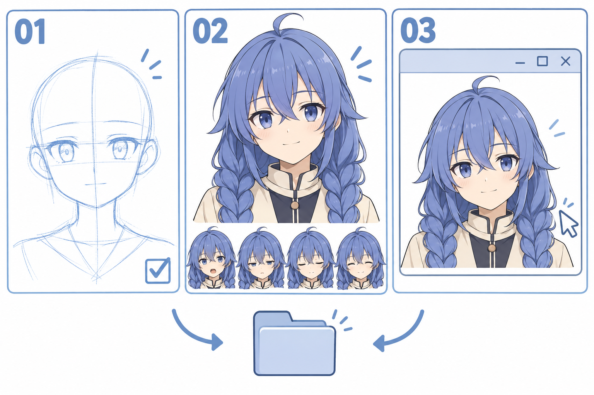

# 42 · 完成并保存自己的角色小作品
> 今天完成并保存第一版角色小作品：自己的头像会眨眼，点击后微笑，关闭后还能重新运行。先把已有内容整理好，不在结课时突然增加一堆新功能。

前置：第 39—41 篇的素材、节奏与响应。没有画完全身也可以完成，互动头像本身就是一个明确的成果。

## 1. 这一版完成到什么程度就够？

设一个清楚的边界：一个角色头像，四张状态图，一套眨眼节奏，一次点击微笑。它可以有简化衣领、略生硬的线条和待改的手工细节。

“完成第一版”不意味着以后不能改，而是你已经有一件能打开、能观看、能回应的小作品。喜欢的角色第一次用你画的素材动起来，本身就值得保留下来。

## 2. 看图：画稿、状态、程序都要留下



**01** 表示草稿与起形过程，**02** 表示角色图与多种表情，**03** 表示程序中的展示。文件夹图标提示最后把有关文件整理保存。

图内缩略表情包含不同嘴形，是成果示意，不严格对应本程序的四张状态素材，也不直接裁成动画帧。程序窗口图同样是概念配图；实际使用随附的 Python 文件与自己的 PNG。

## 3. 第一步：先确认运行环境

随附程序使用 Python 与 Tkinter，不需要额外的 Python 图像库。先在终端运行：

```powershell
python -m tkinter
```

若弹出 Tk 演示窗口，说明这项 GUI 组件可用；若提示缺少模块，需要使用带 Tcl/Tk 的 Python 安装。这个检查方式来自 [Python 官方 Tkinter 文档](https://docs.python.org/3/library/tkinter.html)。关闭演示窗口后继续。

再进入程序文件夹运行：

```powershell
python character_demo.py
```

具体文件位置与操作见[运行说明](练习工具/角色小作品/README.md)。日常不需要运行教程构建脚本，也不依赖 HTML 文件。

## 4. 第二步：先试示意，再载入自己的画

没有自备图片时，程序先显示用线和色块绘制的简化脸，方便理解按钮。这不是你的画稿，也不是教程配图中的洛琪希成品。

点击“载入我的图片文件夹”，选择含 `open.png`、`half.png`、`closed.png`、`smile.png` 的目录。四张尺寸一致并能读取后，才会替换当前素材。载入失败时按提示检查，原来显示的素材会保留。

**检查：** 你现在看到的确实是自己的头像，而不是把示意模式误认为已经接入素材。按四个手动状态按钮看一遍，再播放和点击。

## 5. 第三步：按真实使用方式走一遍

依次检查：启动能显示；四种状态位置稳定；短眨节奏正常；点击后微笑；连续点击符合规则；关闭窗口后可以重新运行。

想让下一次启动自动载入，把四张图片放进程序旁边的 `my_frames` 文件夹。若用按钮临时选择其他目录，本示例不会记住那个选择，下一次需要重选；这是当前版本的明确行为。

不要一开始就打包成可执行安装程序。先保证源代码与图片在同一份作品目录里能运行，更容易看见问题、替换画稿。

## 6. 第四步：把三类文件分开保存

建议把自己的作品整理成下面的结构。树里的源画稿与四张 PNG 是你练习后放入的文件，不是教程已经替你画好的个人作业：

```text
我的角色作品-v01/
├── source/                   绘画源文件与必要参考说明
├── character_demo.py         可运行程序
├── my_frames/
│   ├── open.png
│   ├── half.png
│   ├── closed.png
│   └── smile.png
└── 作品记录.md               版本、运行方法、最想改的一点
```

修改前复制一份版本目录，或使用你熟悉的版本管理方法。换新素材时统一替换四张，保留同一画布与锚点，不只替换一张不同尺寸的“更好看”头像。

## 7. 第五步：写一份很短的作品记录

可以照着填，不需要写成长报告：

```text
版本：v01
我画了哪些部分：
我参考了什么资料：
怎样运行：
这版可以做什么：
最让我开心的一个细节：
下一版只想改的一件事：
```

把教程中 AI 生成的示意图、自己临摹的练习和自己的最终素材分清，有助于回看真实进步。作品记录先为自己服务，不必为了展示而隐藏还不熟练的地方。

## 8. 常见问题与三个收尾任务

| 问题 | 优先检查 | 下一步 |
| --- | --- | --- |
| 换个文件夹就打不开图 | 程序是否能找到素材目录 | 保留 `my_frames` 结构或重新选择 |
| 运行后只见示意脸 | 四个名字是否齐全 | 载入自己的图片并确认来源提示 |
| 想细化却回不去了 | 是否只保存了 PNG | 回到原软件保留可编辑源文件 |
| 一直不敢称为完成 | 是否不断扩张本版目标 | 先以四张图和一次反馈为边界 |

1. 按运行说明从头启动一次，完成显示、播放、点击、关闭。
2. 不照着步骤提示，重新载入自己的图片并检查对齐。
3. 另存 v01，写下下一版只改一个部位，例如眼角线或刘海大形。

- [ ] 程序能显示我自己的四张素材。
- [ ] 眨眼与点击反馈符合我选择的规则。
- [ ] 源画稿、PNG 与代码都已保留，重新打开的方法清楚。
- [ ] 我知道最喜欢哪一个细节，也知道下一次想试什么。

## 9. 42 篇之后怎样继续？

不必立即再报一整套更大的课。先从这件作品里挑一个最想改善的小问题：某个眼形、辫子的走向、手的轮廓或表情的节奏，回到对应章节练一次，再替换进作品。

想看视频时，也带着这个具体问题去找演示。看完关掉视频，自己做一小段，再与参考比较；不需要先把各种视频全部看完才允许创作。

你已经有编程基础，可以让绘画和编程轮流提供反馈：画一个新表情，放进程序看；发现哪里不协调，再回到画布修。接下来最重要的不是把所有领域一次学完，而是持续做出你愿意打开、愿意看见的小作品。

[上一篇](41-点击后怎样切到微笑再恢复.md) · [返回总目录](00-系列总计划与目录.md)
