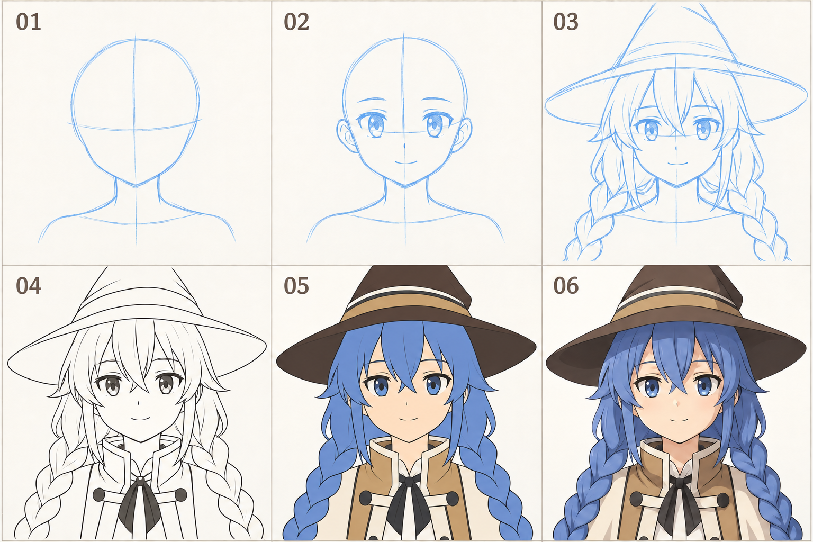
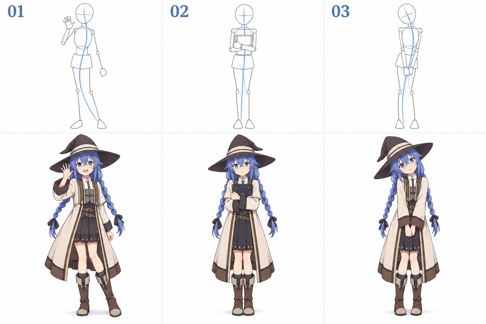
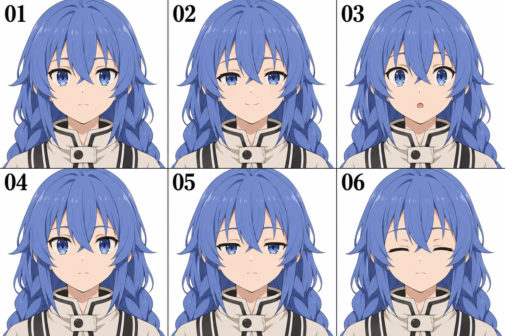

# 从零开始学板绘：画出喜欢的洛琪希

> 写给有编程基础、没有绘画基础，想画出喜欢的二次元角色，也想让她露出可爱表情、做出可爱动作的你。
>
> 第一个目标：完成一张自己画的洛琪希小头像，再做出睁眼、闭眼、微笑三个版本。用你会的编程，让她在屏幕上眨眼、回应点击。

这份指南是一条可以调整的入门路线。练习安排和时间分配是针对你的目标提出的建议，不是统一的教学标准，也不承诺几周就能画到某种水平。资源链接核对于 2026 年 9 月 21 日。

**图文版怎么读：** 第 3 节看“头像从草图到上色”，第 7 节看“动作从大形到角色”，第 11 节看“表情与眨眼”。每张图都有观察方法和可以立刻动笔的小作业。图片保存在同目录的 `assets/` 中，移动笔记时一起带走即可。

配图以洛琪希为主题，由 AI 生成并作教学整理，用于帮助理解绘画步骤；属于简化演绎，角色细节以你选定的正式作品参考为准。各格是教学示意，做动画时请在自己的统一底稿上绘制对齐的帧。

## 1. 先回答你最关心的问题：板绘到底应该怎么学？

**可以看视频，但要选一套有顺序的基础教学作为主线，再用自己的练习和小作品把它学会。**

建议采用这个循环：

**确定一个小问题 → 看一小段讲解 → 跟着画 → 自己再画 → 对照修改 → 用到喜欢的角色上。**

比如，今天的问题是“我画的脸总是太长”。你就学习头部比例，画几个简化头像，比较眼睛到下巴的距离，然后修改自己的洛琪希草图。今天不需要顺便看完头发、衣服、透视和光影教程。

你可以直接在数位板上学习绘画基础。纸上素描可以作为补充，但不必先完成一整套纸笔课程才能开始板绘。

把学习分成两部分会更清楚：

| 要学的部分 | 它解决什么问题 | 一开始怎么安排 |
| --- | --- | --- |
| 工具操作 | 笔怎么画、图层怎么用、怎样保存和上色 | 先用几次练习掌握常用功能，之后按需查 |
| 绘画能力 | 形状为什么不像、五官为什么不协调、表情怎样表达 | 持续练习观察、比例、形体、明暗和表达 |

会使用软件，是你开始画画的条件。画得越来越好，需要积累观察、尝试和修改的经验。

## 2. 先准备一个够用的板绘环境

### 设备怎么选

如果你已经有电脑，可以从一块带压感笔的数位板开始。数位板是在板上画、看电脑屏幕；数位屏则是直接在带显示的设备上画。两者都能学习，前者需要适应手眼分离。

已有能正常使用的绘画设备，就先用已有设备。尚未购买时，优先确认：支持你的系统、压感正常、绘画区域和桌面空间合适、驱动和售后信息清楚。有条件可以试用，看握笔和落笔是否舒服。先不用围绕最高参数做决定。

### 软件先固定一个

本指南默认用 **Krita** 开始：可以从官网下载桌面版，并参考中文入门文档。如果你已经安装并习惯 CLIP STUDIO PAINT，也可以继续用它，后面的绘画练习同样适用。

- [Krita 官方下载](https://krita.org/zh-cn/download/)
- [Krita 中文新手入门](https://docs.krita.org/zh_CN/user_manual/getting_started.html)：用于查新建、保存、基本概念和画布操作。
- [CLIP STUDIO PAINT 官方中文教程](https://tips.clip-studio.com/zh-cn/official)：已使用该软件时再看，不需要同时学两个软件。

### 第一次打开软件，只完成这些设置

1. 按设备厂商说明安装驱动，确认笔能移动光标并落笔。
2. 选择一支支持压感变化的笔刷，轻画、重画各几笔，观察粗细或不透明度是否变化。
3. 建一个约 **1600 × 1600 像素、RGB/sRGB** 的练习画布。尺寸是起步建议；电脑吃力时可以缩小。屏幕作品先关注像素尺寸。
4. 选一支边缘清楚、没有明显纹理的普通笔刷。初期固定它即可。
5. 认识画笔、橡皮、撤销、缩放、平移、旋转画布、新建图层、图层显隐、选区、移动和变形。
6. 保存一次可编辑源文件，再导出一次 PNG。Krita 的源文件可以用 `.kra`；PNG 适合展示，但不能代替保留图层的源文件。

如果画得出线却没有压感，先检查笔刷是否启用了压感，再核对驱动和软件的输入设置。Krita 文档说明，Windows 下的 WinTab / Windows Ink 选择需要与设备驱动配置相匹配。具体排查参考 [Krita 数位板说明](https://docs.krita.org/zh_CN/user_manual/drawing_tablets.html)。

**完成标志：能新建画布，在不同图层上画两笔，隐藏其中一层，保存后重新打开。** 到这里就可以开始绘画练习了。

## 3. 绘画应该按什么顺序学？

下面按“尽早画出角色头像，再逐步扩展到动作”的目标排序。各项会反复穿插，不需要完全掌握上一项才允许接触下一项。

| 顺序 | 学什么 | 用白话解释 | 一个具体练习 |
| --- | --- | --- | --- |
| 1 | 控笔与形状 | 让笔画大致走到想去的地方，看清外轮廓 | 画直线、弧线、椭圆，再用大形状概括帽子 |
| 2 | 观察与比例 | 比较谁更长、更宽，彼此隔多远 | 对照参考，比较头宽、脸长和眼睛位置 |
| 3 | 简单形体与透视 | 理解物体转向后为什么变样 | 画转向不同方向的盒子、球和圆柱 |
| 4 | 头部与五官 | 让五官处在同一个头部上 | 画正面和轻微侧转的简化头像 |
| 5 | 头发与角色特征 | 从大块形状组织发型、帽子和服装 | 先画发型整体，再分出刘海和侧发 |
| 6 | 表情设计 | 用眉、眼、嘴和姿势表达情绪 | 同一张脸画平静、微笑、惊讶 |
| 7 | 平涂与简单明暗 | 分清颜色区域，让形体有朝向 | 底色上加一层方向一致的阴影 |
| 8 | 简化人体与动态 | 表达重心、身体朝向和动作意图 | 用头、胸腔、骨盆和四肢线画打招呼 |
| 9 | 动画与互动 | 把几个状态组织成自然的变化 | 睁眼、半闭、闭眼，组成一次眨眼 |

**你想画二次元，也值得学习真实物体的结构。** 比如球体和圆柱的转向，有助于理解脸部和手臂；观察自己的眉眼变化，有助于设计角色表情。这些知识最终都可以回到你喜欢的角色上。

### 初期可以少花时间的内容

复杂笔刷、华丽特效、完整人体肌肉名称、复杂背景、精细材质、长篇动画，都可以在作品需要时逐步加入。第一个头像只需要处理有限的问题：轮廓、五官位置、发型大形和简单颜色。

### 图解一：一个头像是怎样一步步画出来的？



**阅读顺序：上排从左到右是 01—03，下排从左到右是 04—06。** 每一步只增加一类信息。你自己的第一张作品做到 05，也已经可以保存和展示。

| 图中编号    | 这一格在做什么               | 你动笔时先注意什么                      |
| ------- | --------------------- | ------------------------------ |
| 01 结构   | 概括头部外形，用辅助线标方向和五官所在区域 | 先比较头部的高与宽，再加颈肩；圆形只是辅助形，脸不必是标准圆 |
| 02 五官   | 在同一个头部上安排眼、鼻、嘴        | 把两只眼睛一起看，比较眼距以及嘴到下巴的距离         |
| 03 大块特征 | 加刘海、侧发、辫子和帽子的大形       | 先看整体轮廓，辫子先画成几段连接的大块，细节可以省略     |
| 04 整理线稿 | 根据草图选择需要保留的边界         | 降低草图层透明度，在新层画主要轮廓，不必描回所有草稿线    |
| 05 铺底色  | 给不同区域分配基本颜色           | 在轮廓明确后区分皮肤、头发、帽子和衣服，先保持色块清楚    |
| 06 加明暗  | 用阴影和少量亮部进一步描述形体       | 先选定光源方向，练习时只加一层简单阴影就够了         |

**辅助线是定位工具。** 图中的横线帮助你比较五官位置，它不是必须穿过瞳孔的标准线。不同画法会把眼睛参考线定义在眼部的不同位置，练习时先理解教程的定义，再保持一致。

**可以照着建立的图层，从上到下：** 阴影 → 线稿 → 底色 → 草图 → 背景。这是一种适合开始练习的安排。阴影层先用普通模式、低一些的不透明度就可以，之后再学限制上色范围和混合模式。

图中帽尖为了突出脸部局部被画框截取；你自己的完整头像若需要露出整顶帽子，应在草图阶段先给帽尖留出空间。

**二十分钟小作业：** 用五分钟画 01，五分钟加到 02，再用十分钟画头发和帽子的几个大块。今天可以停在 03。缩小画面，检查“头朝哪里、眼睛在哪里、帽子有多大”是否清楚。

## 4. 视频怎么选？该不该到处看？


### 给自己固定三个资源位置

**一个软件参考 + 一套基础主线 + 一个当前问题的补充教程。**

软件参考解决“这个按钮怎么用”；基础主线提供学习顺序；补充教程解决“我这次画眼睛遇到了什么问题”。主线先选定一段时间，比如两周，再根据自己能否跟上、能否完成作业来调整。

挑主线教程时，看这些具体特征：

- 明确面向零基础，讲解比例、形体和观察方法。
- 展示草图和修改过程，并解释为什么修改。
- 有正常速度的示范，你能暂停后跟着做。
- 每节能转化成一个小练习，最好提供作业或参考。
- 教学目标接近你当前阶段，例如简化头像，而不是复杂商业立绘。

精美的加速绘画视频可以用于欣赏、了解流程。学习一个陌生知识点时，优先选择能听懂理由、看清操作的讲解。

### 我建议你现在这样选资源

| 用途 | 资源 | 现在具体看什么 |
| --- | --- | --- |
| 软件操作，必需 | [Krita 中文新手入门](https://docs.krita.org/zh_CN/user_manual/getting_started.html) | 首次使用、基础概念、视图控制；边查边操作 |
| 绘画基础，可作主线 | [Ctrl+Paint 免费课程目录](https://www.ctrlpaint.com/library) | 从观察比例、概括形体、线条和基础明暗中按下面顺序选课 |
| 中文角色专项，按需 | 在 B 站等视频平台定向搜索 | 按下面的关键词找一套连贯的头像基础系列 |
| 动起来，完成头像后 | [Live2D 官方中文教程](https://docs.live2d.com/zh-CHS/cubism-editor-tutorials/top/) | 先看眨眼入门，再决定是否继续学习制作模型 |

Ctrl+Paint 有英文短视频课程，目录包含观察测量、形体简化、线条、明暗等内容；部分课程使用 Photoshop，也有纸笔示范。这里推荐其中通用的绘画知识。你可以在 Krita 中做相同概念的练习，软件菜单与快捷键则查 Krita 文档。该资源并非专门的日系角色课程。[课程目录与说明](https://www.ctrlpaint.com/library)

如果英文讲解理解起来费力，就用中文基础系列作为主线；没必要为了某个资源额外增加学习负担。中文课程可以依次搜索：

1. `板绘 零基础 观察 比例 形体 系列课`
2. `二次元 头部结构 正面 四分之三侧面 基础`
3. `二次元 表情 眉毛 眼睑 嘴型 讲解`
4. `赛璐璐 平涂 阴影 入门`

“四分之三侧面”就是头转向一边、仍能看到大部分正脸的角度；“赛璐璐上色”在这类教程里通常指用比较清楚的色块边界表现底色和阴影。

这些是搜索词，不代表我已经评估或推荐了搜索结果中的某个付费老师。**先限制自己花约二十分钟选一节能够跟上的课，接着动笔。**

### 选 Ctrl+Paint 时的最小观看顺序

在课程目录中按标题查找即可，每次只选一到两节：

1. `Visual Measuring` / `Visual Measuring: Proportion`：练比较长宽和距离。
2. `Drawing shape: Linear Block-in` / `Negative Space`：练概括大轮廓，观察形状之间的空隙。
3. `Simplifying Form` / `Constructive Form pt. 1`：练把复杂对象拆成简单形体。
4. `Fluid Linework` / `Canvas Rotation`：练线条和旋转画布辅助落笔。
5. `Form, Value, and Light`：开始理解形体、明暗和光照。

每看一组，都回到自己的角色草图中应用一次。课程库剩余部分可以日后按需使用。

### 一节课怎样才算学过？

以“头部比例”为例：

1. **看：** 看五到十五分钟，记录一个要点，例如“先比较头部外轮廓，再安排五官”。
2. **跟：** 暂停视频，跟画一遍，不追赶老师速度。
3. **重做：** 关闭步骤演示，保留参考图，自己再画一个。
4. **变化：** 改一个条件，例如把正脸转过去一点，或者换一个角色参考。
5. **比较：** 标出一处差异，修改并保存前后版本。

只看懂讲解，说明你理解了作者在说什么；能够自己画出并检查一次，才有机会发现自己还缺什么。

## 5. 每天练多久？练习和快乐怎么兼顾？

先按每周四到五次、每次四十到六十分钟尝试。时间不合适就调整，周数也可以延长。建议保留一部分时间专门画喜欢的东西。

一次六十分钟的示例：

| 时长 | 做什么 |
| --- | --- |
| 5 分钟 | 直线、弧线、椭圆热身 |
| 10 分钟 | 看或复习一个知识点 |
| 15 分钟 | 做一个针对性练习 |
| 25 分钟 | 把它用到洛琪希头像、表情或小涂鸦上 |
| 5 分钟 | 对照、保存、写下一次要改的地方 |

视频时间可以被反复观看某个关键片段替代。已经理解了就直接练，不用每天找新教程。

很累时用十五分钟版本：看参考两分钟，画十分钟，记录三分钟。只完成一个小表情也可以。中断几天后从最近的问题继续，不需要补齐“欠下的练习”。

## 6. 第一周每天怎么做：照着这一段开始

这一周以熟悉工具、学会比较形状、留下第一张头像为目标。每天是一节练习，可以隔天做。

### 第 1 天：让笔正常工作，留下第一张画

- 完成第 2 节的安装、压感检查和保存操作。
- 新建“草图”“线稿”两个图层，试着隐藏和显示它们。
- 选一张脸部清楚、角度接近正面、光照简单的洛琪希参考图。
- 花十五到二十分钟画头像，允许不完整，不要求像。
- 保存为 `day01_first_try.kra`，导出一张 PNG。

**今天的检查：能否打开自己的源文件继续画？** 第一张画留下来，之后用它看进步。

### 第 2 天：只观察轮廓和比例

- 看一小节观察或比例教学。
- 用直线和弧线画三个小头像轮廓，暂时省略睫毛和饰品。
- 在参考和练习上分别找头顶、下巴、脸最宽处、眼睛所在高度。
- 比较头部高宽、眼睛到下巴的距离，修改一处最明显的差异。

**今天的检查：能否说出“哪里偏长或偏宽”？**

### 第 3 天：用简单形体理解头部和帽子

- 画几个盒子、球和圆柱，标出正面与侧面。
- 给球体画一条弯曲的中线，表示它朝哪个方向。
- 用球体加简化下颌概括头部，用锥体和椭圆概括帽子。
- 画三个小草图；保留能看懂朝向的一个。

**今天的检查：有没有先确定整体朝向，再加细节？** 初期不要求复杂透视准确。

### 第 4 天：把五官放进同一个头部

- 先画头部外轮廓、中线和眼睛参考线，再放眼睛、鼻子、嘴。
- 画两个正面头像，比较眼距、嘴的位置和下巴长度。
- 缩小查看，或临时水平翻转画布，挑一处位置问题修改。

**今天的检查：先看整张脸是否协调，再细画单只眼睛。** 二次元风格的比例可以变化，不必把某个比例公式当成所有角色的标准。

### 第 5 天：头发先分大块

- 把头发概括为整体轮廓，再分刘海、侧发和后发等大块。
- 在头像上加发型和帽子，每一大块先用少量线表达。
- 做一张小尺寸预览，看角色特征是否清楚。

**今天的检查：缩小以后，是否仍能看出发型和帽子的形状？**

### 第 6 天：完成一个平涂头像

- 选前几天最喜欢的草图，降低草图图层的不透明度。
- 新建线稿层，整理主要轮廓。可以旋转画布，以舒服的方向落笔。
- 在线稿下方建颜色层，分别铺皮肤、头发、帽子和衣服的底色。
- 先保留简单颜色，保存源文件并导出 PNG。

**今天的检查：能否把这张图当作“第一版完成品”保存？** 少画饰品或肩膀都可以。

### 第 7 天：做一次具体复盘

- 并排看第 1 天与第 6 天的图。
- 写下两处变化，例如“眼睛位置更接近参考”“头发外形更清楚”。
- 选一个下周要解决的问题，例如“侧转时五官还是像贴在平面上”。
- 如果有精力，复制头像草图，尝试把嘴角和眼睑改成微笑。

**今天的检查：下次打开画布时，你是否知道先改什么？**

## 7. 接下来七周的路线：每阶段留下一件小作品

这里的“周”表示一个练习阶段。每周只有一两次空闲时，把一阶段扩展为两周或更久即可。完成条件只用来决定下一步，不是考试分数。

| 阶段 | 主练内容 | 针对性练习 | 阶段作品与观察点 |
| --- | --- | --- | --- |
| 第 2 周 | 观察与头部比例 | 根据同一参考画 4—6 个短时头像，每次只检查一种比例 | 修订版头像；能指出并修正一处比例问题 |
| 第 3 周 | 头部转向与简单形体 | 画正面、轻微侧转和侧面的结构草图 | 一页头像角度练习；能大致看懂朝向 |
| 第 4 周 | 发型、帽子、颈肩 | 先大形，后分块，再加少量细节 | 一张简单胸像；轮廓清楚，头颈连接可理解 |
| 第 5 周 | 表情 | 在同一底稿上画平静、微笑、惊讶，协调眉眼嘴 | 一张三表情图；不看文字也能区分情绪 |
| 第 6 周 | 平涂与明暗 | 给球体和头像各设一个光源，用少量明暗色块表现 | 一个带简单阴影的头像；主要阴影方向一致 |
| 第 7 周 | 简化人体与姿势 | 看参考，用头、胸腔、骨盆和四肢线画 5 个小姿势 | 简单打招呼或抱书姿势；能看懂动作意图 |
| 第 8 周 | 小作品与互动 | 整理头像表情图，统一画布和位置，接入程序 | 一个能眨眼和点击微笑的小页面或应用 |

遇到卡点时可以缩小作品范围：胸像改成头像，全身动作改成上半身，精细线稿改成整洁草图。你仍然可以完成一个表达明确的小作品。

### 图解二：可爱的动作，先用简单形状表达



**按列看：同一列的上排是姿势概括，下排是加上角色外观后的示意。** 两排比例经过简化，不需要把它们当成可以直接叠合的模板。先观察动作关系，再在自己的同一个底稿上逐步细化。

上排的椭圆表示头和胸腔，接近盒子的形状表示骨盆，线段表示四肢方向。蓝线用于概括身体的动作走向，帮助你观察弯曲和倾斜；它不是脊柱的精确位置，也不是重心垂线。

| 姿势 | 可爱感来自哪些可观察的变化 | 第一遍只需要画什么 |
| --- | --- | --- |
| 01 挥手 | 手抬到脸旁、手臂弯曲、身体略有倾斜，表情与招呼动作呼应 | 头、肩线、弯曲的手臂、支撑身体的腿 |
| 02 抱书 | 书靠近胸前，双臂围住书，肩部姿态较收敛 | 头、胸腔、书的矩形和两条手臂的走向 |
| 03 歪头 | 头部有轻微倾斜，身体和手的位置比较安静 | 倾斜的头部中线、肩线、身体大形和脚的位置 |

**先让动作能被读懂。** 把帽子、头发和衣服细节遮住，如果简单的人形仍然像在挥手或抱书，说明动作意图已经比较明确。站姿还要检查脚是否接地、躯干是否被腿支撑；衣服花纹可以最后画。

**十五分钟小作业：** 每个姿势画三分钟，只画上排那样的大形；剩下六分钟选一个加上帽子和头发轮廓。第一遍手掌可以概括成一个小块，先处理手臂方向，再逐步学习手指。

如果全身太难，可以只画头到胸口：保留头的倾斜、肩的位置和手臂方向，同样能练到表演。

## 8. 临摹怎样做才有用？

看参考画画是可以持续使用的方法。先给每次临摹一个目标：练轮廓、比例、表情还是明暗？一张图不必同时解决所有问题。

| 方法 | 怎么做 | 适合练什么 |
| --- | --- | --- |
| 对照临摹 | 参考放旁边，自己观察后画 | 比较形状、距离和颜色 |
| 结构分析 | 在参考上另建一层，标中线、轴线和大形体 | 理解画面怎样组织 |
| 简短默画 | 观察后关掉参考，画一个简化版本，再对照 | 检查自己记住并理解了什么 |
| 变化练习 | 保留大部分结构，只改一个表情或角度 | 把学到的内容迁移到新情况 |

结构分析可以覆盖在参考上做，但随后最好在空白画布重画一次。默画是检查工具，不要求你以后都凭空画。分享练习时说明是临摹或分析，并记录参考作者、作品或出处。

一个适合你的循环是：**临摹洛琪希的平静表情 → 标出眉眼嘴的位置 → 在自己的底稿上设计一个轻微微笑 → 对照检查变化是否自然。**

## 9. 没有老师，我怎么知道哪里有问题？

先把“画得不好”换成一个能动手修改的问题。建议按下面顺序看，避免在基础位置有偏差时反复打磨睫毛。

1. **整体轮廓：** 头是不是过窄？帽子是不是过大？
2. **比例位置：** 眼睛是否过高？嘴到下巴的距离是否合适？
3. **形体朝向：** 头已经转向一侧，五官是否也跟着转？
4. **表达：** 眉、眼、嘴是否共同表达同一种情绪？
5. **线条和颜色：** 主要轮廓是否清楚？明暗是否遮住了表情？

每次只改最影响画面的一到两项。可以缩小图像、水平翻转，或暂时转成灰度查看明暗；这些都是帮助观察的工具，不能代替理解结构。

寻求反馈时，把参考、练习和你的疑问放在一起，例如：

> “我在练正面头像比例。我觉得眼睛到下巴的距离不对。请指出最值得先改的两处，并解释比较方法。”

可以找有绘画经验的朋友、学习社区或能看图的助手一起分析。涉及结构和风格判断时，多对照可靠参考；自动分析也可能出错。

每周留一条简短记录就够了：

```text
日期：
今天练的问题：
参考来源：
我发现的一个差异：
我做了什么修改：
下次继续做什么：
今天让我开心的一个细节：
```

## 10. 什么时候报班或买课？

可以先用免费资源完成前几次练习，确认自己主要卡在哪里。付费教学是否值得，优先看它能否提供你缺少的结构化指导和具体反馈。

试听或查看课程说明时，确认：

- 是否明确适合零基础，有没有前置要求。
- 作业量是否与你的时间匹配。
- 是否有针对个人作业的批改，由谁批改、频率怎样。
- 能否看到普通学员的作业与修改过程。
- 课程最终成果是否接近你想做的角色头像、表情或插画。

如果你总是不知道错在哪里，逐项讲解的批改可能比增加视频数量更有帮助。如果你已经知道该练什么，只是尚未动笔，可以先把现有练习完成再决定。

## 11. 如何用编程让学习更开心？

### 图解三：表情变化与眨眼，是两种不同的练习



**上排练情绪，下排练眼睑运动。** 图中省略帽子，让你更容易比较脸部；观察时可以把头发和衣服暂时忽略。

| 图中编号 | 观察重点 | 在自己的画上怎么做 |
| --- | --- | --- |
| 01 平静 | 眼睛自然睁开，嘴部放松 | 先把它画成统一底稿，保存一份 |
| 02 微笑 | 嘴角轻轻抬起，眼睑更放松，眉眼嘴共同表达情绪 | 复制底稿，先改嘴，再少量调整眼睑；不必把嘴画得很大 |
| 03 惊讶 | 眼睛更张开，眉毛略抬高，嘴形成小开口 | 同时比较眼睛和嘴的变化，避免只放大嘴 |
| 04 睁眼 | 眨眼之前的常态 | 固定脸部、头发和衣服图层，只准备修改眼睛 |
| 05 半闭眼 | 上眼睑下移，遮住更多虹膜 | 保持眼角位置大致稳定，重新画眼睑覆盖关系 |
| 06 闭眼 | 眼睑闭合，虹膜不可见 | 用简洁的闭眼线表达，检查闭眼后脸是否仍是同一张脸 |

**眨眼练习可以按 `04 → 05 → 06 → 05 → 04` 播放。** 先尝试每个过渡帧约 40—80 毫秒，睁眼状态停留几秒，再根据效果调整。这只是用于试验的起点，动作快慢要结合你想表达的感觉。长时间保持 05，读起来可能更像困倦；短暂经过 05，则更容易读成眨眼。

半闭眼也不是把整只眼睛垂直压扁：注意眼睑怎样遮住虹膜，而眼角、头部和鼻子的位置基本保持稳定。

**二十分钟小作业：** 选你自己的平静头像，把眼睛单独放一层，复制出半闭和闭眼版本。通过隐藏、显示图层快速切换，检查头有没有跳动。上图各格有细微绘制差异，适合观察变化关系；制作动画时，在自己的同一张底稿上画三种状态会更稳定。

### 把自己画的表情接进程序

完成一个静态头像后，安排一个范围很小的互动项目。绘画先做到可用，程序先做到能运行。

建议准备同一画布尺寸、同一位置的三张透明背景图片：

```text
roxy_idle.png     平静、睁眼
roxy_blink.png    闭眼
roxy_smile.png    微笑
```

用你熟悉的编程方式完成：

1. 默认显示平静头像。
2. 隔几秒短暂切到闭眼，再恢复睁眼，试着调整节奏。
3. 点击头像时显示微笑，稍后恢复。
4. 保持图片锚点一致，检查切换时整个头是否跳动。

之后可以增加半闭眼图片改善过渡，或者把眉、眼、嘴拆成独立图层。需要更自然的连续转头、身体变形和头发摆动时，再学习 Live2D。它的官方教程覆盖眨眼、表情与身体运动，可以从局部功能开始。[Live2D 官方教程](https://docs.live2d.com/zh-CHS/cubism-editor-tutorials/top/)

拆图和绑定本身也是技能。你可以先用官方练习素材学软件，再根据需求准备自己的分层图稿。普通完整 PNG 无法直接保留被遮住的部位和独立部件。

**给编程部分也设一个小范围：先只做“眨眼 + 点击微笑”。** 让它帮助你展示自己的画，之后再决定要不要加聊天、语音或复杂界面。

## 12. 初学时常见的卡点

| 遇到的情况 | 下一步怎么做 |
| --- | --- |
| 收藏很多教程，仍然没开始 | 选一个知识点，看十分钟，立即画一个对应练习 |
| 线条抖，一直撤销 | 适度使用防抖、旋转画布、用舒服的笔触长度；同时检查大轮廓 |
| 只画精致眼睛，拼起来不像一个人 | 先统一头部轮廓和五官位置，再细化眼睛 |
| 头发越画越乱 | 回到整体轮廓，把发丝合并成几个大块 |
| 跟着教程能画，自己画就停住 | 保留参考，关闭步骤演示重画，再尝试一个小变化 |
| 练基础很枯燥 | 每次把一个基础点应用到角色上，例如用椭圆练帽檐 |
| 总觉得第一张图不够好 | 保存第一版，列一个具体问题，在第二版中解决 |
| 连续几天没练，觉得必须重来 | 打开最近的作品，从记录的下一个问题继续 |

你可以喜欢一个角色很多年，也可以在学习中发现自己更喜欢画表情、设计姿势或制作互动。方向可以随着作品改变。

## 13. 今天就可以完成的清单

- [ ] 确认绘画设备能正常工作，压感有效。
- [ ] 固定一个软件和一支普通笔刷。
- [ ] 学会新建图层、保存源文件、导出 PNG。
- [ ] 选一张清楚的洛琪希正面参考，记录出处。
- [ ] 花十五到二十分钟画第一个头像。
- [ ] 保存它，写下一个想改的地方和一个自己喜欢的细节。

今天留下的这张画，会成为以后所有练习的起点。你喜欢她的眼神、表情和动作，接下来就可以一点点学会怎样亲手表达它们。
